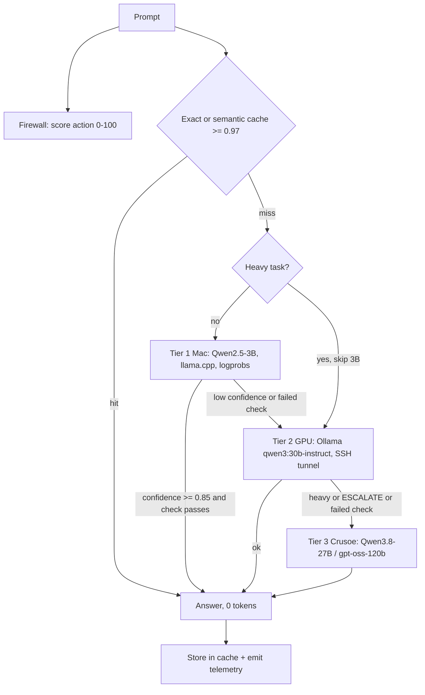
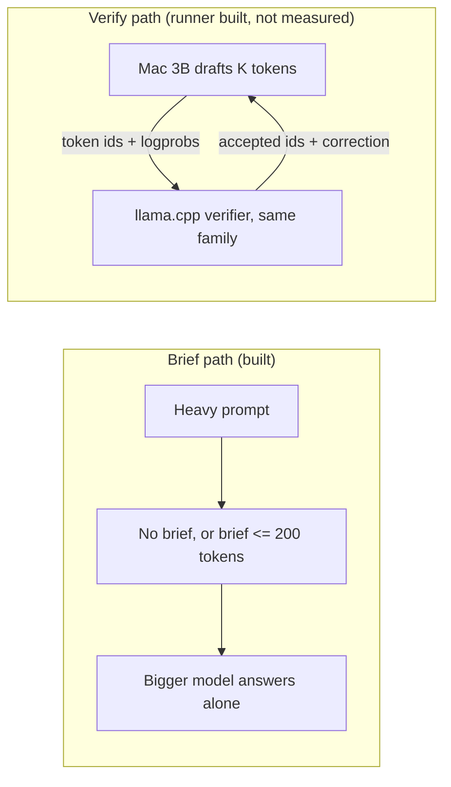

# Technical Architecture & System Design: CHIMERA

## 1. Tier ladder

## 2. Two ways a heavy task reaches a bigger model

- Brief path: works on any API. A long brief raised GPU tokens by 37% (`bench/results_gpu.md`), so it is capped.
- Verify path: needs a llama.cpp verifier on the GPU box (`bench/verify_server.py`). Ollama gives no prompt logprobs. Crusoe rejects `echo`. Same model family on both sides. No KV tensors cross the network.

## 3. Action firewall
Every proposed GUI or CLI action gets a score from 0 to 100 (`firewall/risk_scorer.py`). Below 70 it runs. At 70 or more it waits for a one-time token sent back by voice or SMS. Rule-based, so unusual phrasing can slip through.

## 4. Surfaces
- Kiro: `apps/kiro-trimmer/` (`cli.py`, `mcp_server.py`, `hook_interceptor.py`).
- HUD: static HTML plus Python SSE server reading the telemetry JSONL.
- Phone agent: planned.
