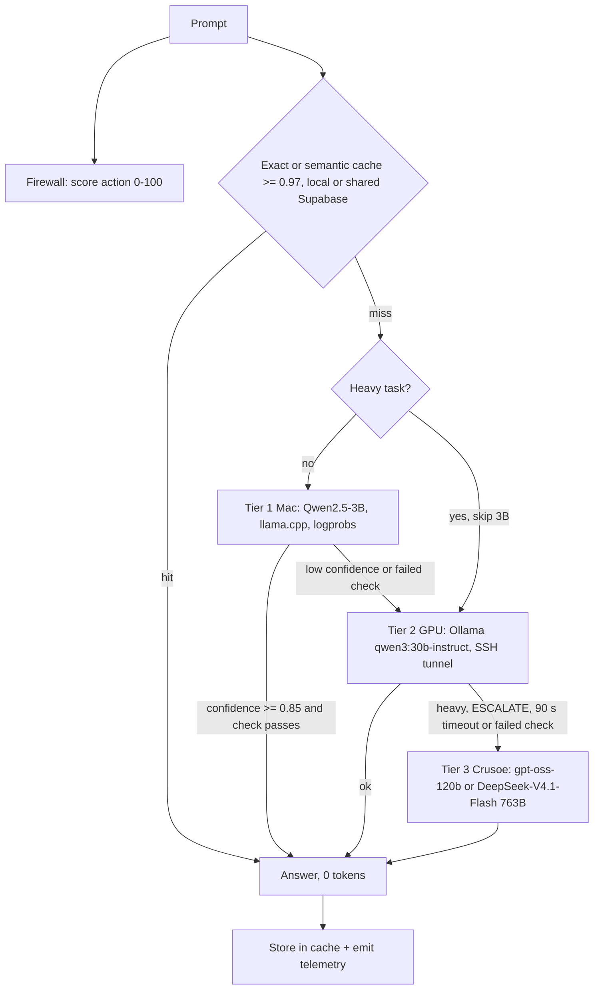
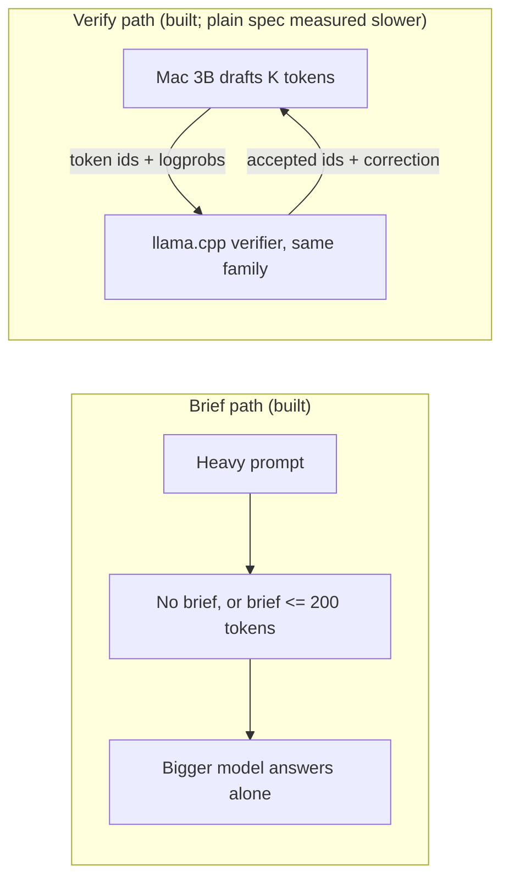

# Technical Architecture & System Design: CHIMERA

## 1. Tier ladder

## 2. Two ways a heavy task reaches a bigger model

- Brief path: works on any API. A long brief raised GPU tokens by 37% (`bench/results_gpu.md`), so it is capped. A 30B brief cost the same dollars and was 4.4x slower (`bench/results_ladder.md`), so the default is no brief.
- Verify path: needs a llama.cpp verifier on the GPU box (`bench/verify_server.py`). Ollama gives no prompt logprobs. Crusoe rejects `echo`. Same model family on both sides. No KV tensors cross the network. Measured over the internet: 4.5x to 7x slower than plain Ollama (`bench/spec_results.md`). Spec+ (`inference/specplus.py`) gained 1.14x to 1.22x over the best plain spec against a stand-in target, still below the big model alone (`bench/results_specplus.md`).

## 3. Action firewall
Every proposed GUI or CLI action gets a score from 0 to 100 (`firewall/risk_scorer.py`). Below 70 it runs. At 70 or more it waits for a one-time token sent back by voice or SMS. Rule-based, so unusual phrasing can slip through.

## 4. Surfaces
- Kiro: `apps/kiro-trimmer/` (`cli.py`, `mcp_server.py`, `hook_interceptor.py`).
- HUD: static HTML plus Python SSE server reading the telemetry JSONL.
- Gateway: `apps/gateway/`, OpenAI-compatible, keys per tenant, `/metrics`.
- Tier pool: `[[tiers]]` in `chimera.toml` lists the hardware (`tiers.py`). The Modal H200 entry never served a request (`bench/results_modal.md`). The Android tier is untested (`docs/android.md`).
- Phone agent: planned.

## 5. Correctness properties
Kiro property-based testing: each property reads "for any X where P, Y holds" and links to a requirement. Tests are Hypothesis tests in `tests/test_props_*.py` (about 200 examples, 50 for the statistical one, offline, fakes only). Status `xfail` means the property failed on real code; the shrunk counterexample is kept in the test and in `docs/handoff/property-tests.md`.

| # | Property | Requirement | Test | Status |
|---|---|---|---|---|
| P1 | For any string s, `normalize(normalize(s)) == normalize(s)`. | 1.1 | `test_props_cache.py::test_normalize_is_idempotent` | holds |
| P2 | For any two prompts that differ only in case and whitespace, the exact-cache key is equal; for any two with different normalized text, keys differ. | 1.1 | `test_equal_normalized_prompts_share_a_key`, `test_different_normalized_prompts_get_different_keys` | holds |
| P3 | For any two different namespaces or tenants, a prompt stored under one is never a hit under the other. | 1.5 | `test_exact_cache_namespaces_are_isolated`, `test_pgvector_tenants_never_share_a_hit`, `test_semantic_cache_namespaces_are_isolated`, `test_exact_cache_keys_differ_when_namespace_or_prompt_differ` | holds; NUL case xfail |
| P4 | For any stored vectors and any query, a semantic hit has cosine >= 0.97, is the best match, and any stored vector at >= 0.97 yields a hit. | 1.2 | `test_semantic_cache_never_hits_below_threshold` | holds |
| P5 | For any prompt in both caches, the exact answer is served, not the semantic one. | 1.2 | `test_exact_beats_semantic` | holds |
| P6 | For any prompt pair that differs only in a number, a negation word or a named entity, the guard rejects the hit; the guard is symmetric; for any prompt a, `consistent(a, a)`. | 1.6 | `test_guard_rejects_*`, `test_guard_is_symmetric`, `test_guard_is_reflexive` | holds; reflexive xfail |
| P7 | For any call through the ladder or the pool, one telemetry event is emitted with the five fields, and tokens, dollars and latency are >= 0 and alpha is null or in [0,1]. | 6.1, 6.2 | `test_props_router.py::test_ladder_emits_*`, `test_pool_router_telemetry_*` | holds |
| P8 | For any tier outcomes (confidence, failure), the ladder visits local, mid, top in order, calls the top at most once and nothing after it; the pool tries tiers cheapest first, each once, and raises when every tier is down. | 6.3 | `test_ladder_escalation_*`, `test_pool_escalation_*`, `test_pool_with_every_tier_down_*` | holds |
| P9 | For any call whose check fails, the answer is not cached and not stored as memory. | 6.4 | `test_pool_failed_check_*` (holds), `test_ladder_cache_only_holds_*` (holds), `test_ladder_does_not_cache_an_answer_that_failed_the_check` | pool holds; ladder top path xfail |
| P10 | For any draft q, target p and 1 to 3 kids, the emitted token has p > 0, and the residual `max(0, p-q)` normalized is a distribution. | 3.2, 3.3 | `test_props_spec.py::test_emitted_token_*`, `test_residual_is_a_distribution` | holds |
| P11 | For any p and q on a 4-token vocabulary, tokens emitted by tree verification follow p (chi-square, df 3, seeded). | 3.2, 3.3 | `test_output_follows_the_target_distribution` | holds |
| P12 | For any text with an email, API key, JWT, database URL or Luhn-valid card, scrub removes it; scrub is idempotent. | 7.1 | `test_props_safety.py::test_scrub_*` | holds; card glued to `_` or a letter xfail |
| P13 | For any action text, the score is in 0..100, `needs_approval` iff score >= 70, a token exists iff approval is needed, and adding a risky verb never lowers the score. | 7.2, 7.3 | `test_risk_score_range_and_approval_rule`, `test_adding_a_risky_verb_*` | holds |
| P14 | For any store call, memory stores iff verified by tests or a grader score >= 4 and not blank; any stored text is scrubbed. | 8.1, 8.3 | `test_memory_refuses_unverified_answers`, `test_memory_never_keeps_an_email` | holds |
| P15 | For any two tenants, purging one removes all its rows and leaves the other's stats unchanged. | 8.2 | `test_memory_purge_is_scoped_to_the_tenant` | holds |
| P16 | For any telemetry rows, the stats summary has every documented key with non-negative values. | 9.1 | `test_stats_summary_shape` | holds |
| P17 | For any action that scores >= 70, chat is refused with 403 before the router runs. | 9.2 | `test_chat_refuses_held_actions_*` | holds |
| P18 | For any prompt, the chat stream has documented steps and fields, in order, ending `answer`, `done`. | 9.3 | `test_props_api.py` | holds |
| P19 | For any bank lookup, a direct serve never happens without its tests passing. | (bank) | not written: no bank code exists yet | pending |
