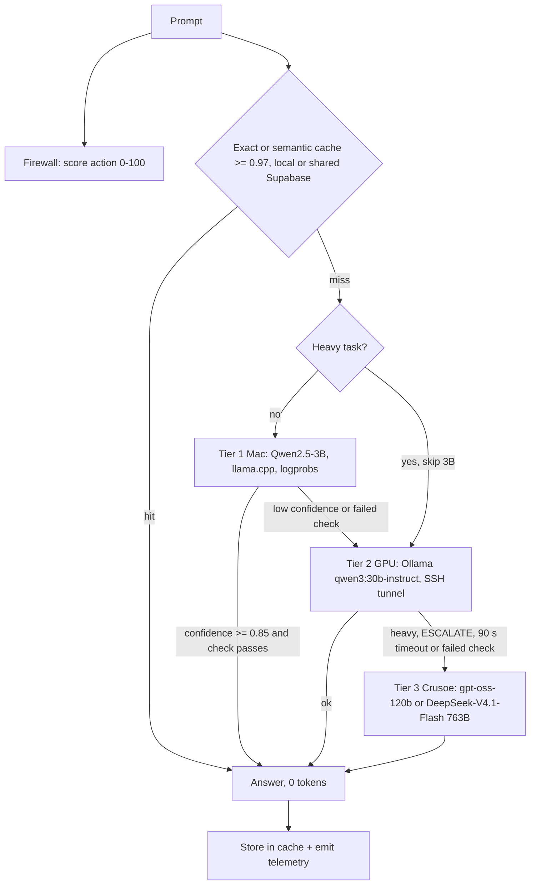
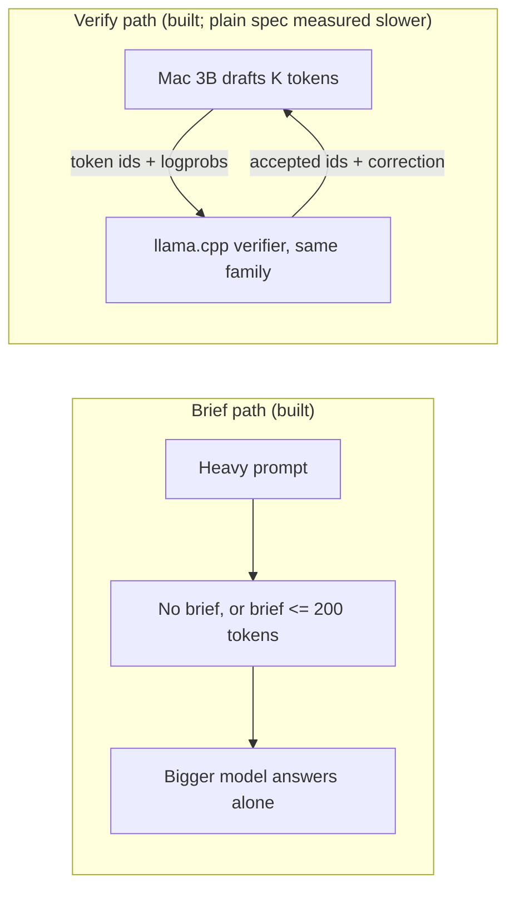

# Technical Architecture & System Design: CHIMERA

## 1. Tier ladder

## 2. Two ways a heavy task reaches a bigger model

- Brief path: works on any API. A long brief raised GPU tokens by 37% (`bench/results_gpu.md`), so it is capped. A 30B brief cost the same dollars and was 4.4x slower (`bench/results_ladder.md`), so the default is no brief.
- Verify path: needs a llama.cpp verifier on the GPU box (`bench/verify_server.py`). Ollama gives no prompt logprobs. Crusoe rejects `echo`. Same model family on both sides. No KV tensors cross the network. Measured over the internet: 4.5x to 7x slower than plain Ollama (`bench/spec_results.md`). Spec+ (`inference/specplus.py`) gained 1.14x to 1.22x over the best plain spec against a stand-in target, still below the big model alone (`bench/results_specplus.md`).

## 3. Action firewall
Every proposed GUI or CLI action gets a score from 0 to 100 (`firewall/risk_scorer.py`). Below 70 it runs. At 70 or more it waits for a one-time token sent back by voice or SMS. Rule-based, so unusual phrasing can slip through.

## 4. Surfaces
- Kiro: `apps/kiro-trimmer/` (`cli.py`, `mcp_server.py`, `hook_interceptor.py`).
- HUD: static HTML plus Python SSE server reading the telemetry JSONL.
- Gateway: `apps/gateway/`, OpenAI-compatible, keys per tenant, `/metrics`.
- Tier pool: `[[tiers]]` in `chimera.toml` lists the hardware (`tiers.py`). The Modal H200 entry never served a request (`bench/results_modal.md`). The Android tier is untested (`docs/android.md`).
- Phone agent: planned.
