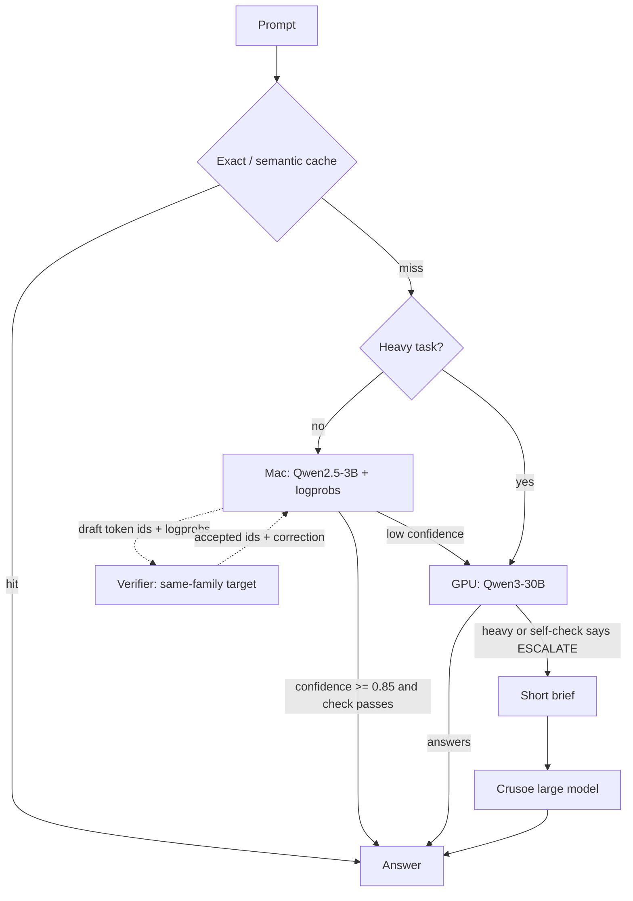

# CHIMERA

CHIMERA is a router for LLM calls. It tries the cheapest tier that can answer: an exact and semantic cache, then a small model on your own machine (Qwen2.5-3B on a Mac), then a 30B model on a GPU box, then a large cloud model. Each answer is logged with the tier used, tokens, latency and dollars. A separate firewall scores risky actions (pay, delete, merge) from 0 to 100 and asks for approval above 70. It is an experiment. The measured results below are mixed.

## Architecture



Dotted lines are the speculative-verify path: the small model drafts tokens, the larger model of the same family accepts or corrects them. Only `[token_id, logprob]` arrays cross the network. See [docs/architecture.md](docs/architecture.md).

## Quick start

```
make setup        # venv + install (add the embed extra for real semantic cache)
make test         # offline, no models or keys needed
make serve-local  # start the local llama.cpp server on 127.0.0.1:8080
make bench        # print the commands to rerun each benchmark
make demo         # HUD demo, if built
```

Cloud keys go in `.env` (copy `.env.example`). Models are not in the repo.

## Results

All numbers are single runs on 30 prompts (`bench/prompts.jsonl`): 10 easy facts, 3 exact repeats, 5 paraphrases, 6 small coding tasks, 6 heavy coding tasks. No repeats of runs, so no error bars.

**Mac 3B + caches + Crusoe Qwen3.8-27B vs cloud only** ([bench/results.md](bench/results.md))

| | Cloud only | Cascade |
|---|---|---|
| Calls that reached the cloud | 30 | 8 |
| Cost at list price | $0.01483 | $0.01047 (29% lower) |
| Median latency | 689 ms | 1,547 ms |
| Total wall time | 31.8 s | 145.0 s |
| Small coding tasks passed | 6/6 | 5/6 |

**Mac 3B + caches + GPU Qwen3-30B vs GPU only** ([bench/results_gpu.md](bench/results_gpu.md))

| | GPU only | Cascade |
|---|---|---|
| GPU calls | 30 | 9 |
| GPU tokens | 6,809 | 9,334 (+37%) |
| Median latency | 4,929 ms | 1,892 ms |
| Total wall time | 306 s | 1,206 s |
| Graded prompts passed | 24/24 | 20/24 |

### Where the cascade lost

- **Heavy tasks cost more.** The local brief and draft add input tokens. Heavy code cost $0.00976 with the cascade vs $0.00760 cloud only ([results.md](bench/results.md)). On the GPU, prompt tokens rose from 1,352 to 5,646 ([results_gpu.md](bench/results_gpu.md)).
- **The cache served 2 wrong answers** (`r2` exact, `p4` semantic) at the current thresholds, and the local 3B failed `c3` (it returned a generator, not a list) ([results_gpu.md](bench/results_gpu.md)).
- **It is slower overall.** Wall time was 145 s vs 31.8 s, and 1,206 s vs 306 s. Handoffs are the slowest path. The GPU tail (about 300 s for 4 handoffs) has no known cause and should be rerun.
- **Two easy prompts** fell below the 0.85 confidence gate and cost more than a direct call ([results.md](bench/results.md)).

### What the cascade did win

- 8 cache hits cost $0 and answered in 0 to 126 ms ([results.md](bench/results.md)).
- 14 of 30 prompts were answered locally at $0 cloud cost, 13 correct.
- GPU calls fell from 30 to 9 and median latency from 4.9 s to 1.9 s ([results_gpu.md](bench/results_gpu.md)).

### What changed in response

`packages/chimera-core/ladder.py` adds a mid tier (the GPU 30B). Heavy tasks skip the 3B, and the brief is capped at 200 tokens and can be turned off (`use_brief=False`). A failed check escalates one tier. No measured results for this ladder or for cross-device speculative decoding exist yet, so none are claimed here. Cache thresholds have not been retuned. Speculative verification was not run in the cloud-only comparison above.

## Repo layout

```
packages/chimera-core/   router, ladder, cache/, inference/, firewall/
apps/phantom-phone/      HUD server (hud-web/)
bench/                   prompts, runners, results (*.md, *.csv)
tests/                   offline pytest suite
docs/architecture.md     design note
```

The package directory is hyphenated; the root `conftest.py` loads it as `chimera_core`.

## Security

API keys live only in `.env`, which is git-ignored. Do not paste keys into issues or docs. GPU boxes are reached through an SSH tunnel bound to loopback. The firewall in `packages/chimera-core/firewall/risk_scorer.py` scores an action 0 to 100. At 70 or more it issues a one-time token that the user must send back by voice or SMS. It is a rule list, so it can miss actions that are phrased in unexpected ways.

## Roadmap

- Gemma 3 1B/4B tier on the phone.
- HUD: live telemetry dashboard.
- MCP server that exposes the router to Kiro.
- Retune cache thresholds; rerun the GPU tail latency.
- Measure the ladder and real speculative verification.

## License

MIT. See [LICENSE](LICENSE).
