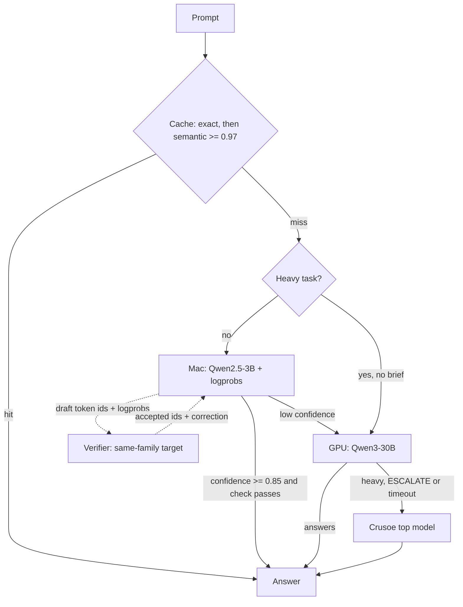

[](https://github.com/manvendersingh21/tremor-core/actions/workflows/ci.yml)

# CHIMERA

CHIMERA is a router for LLM calls. It tries the cheapest tier that can answer: an exact and semantic cache, then a small model on your own machine (Qwen2.5-3B on a Mac), then a 30B model on a GPU box, then a large cloud model. A tier pool lets a company list its own hardware, and a gateway serves the router to other apps. Each answer is logged with the tier used, tokens, latency and dollars. A separate firewall scores risky actions (pay, delete, merge) from 0 to 100 and asks for approval above 70. It is an experiment. The measured results below are mixed.

## Architecture



Dotted lines are the speculative-verify path: the small model drafts tokens, the larger model of the same family accepts or corrects them. Only token ids and log probabilities cross the network. See [docs/architecture.md](docs/architecture.md).

Parts, with their status:

| Part | Status | Where |
|---|---|---|
| Ladder router: cache, Mac 3B, GPU 30B, Crusoe top model | Built, measured ([results_ladder.md](bench/results_ladder.md)) | `packages/chimera-core/ladder.py` |
| Tier pool: hardware listed as `[[tiers]]` in `chimera.toml` | Built | `packages/chimera-core/tiers.py` |
| Gateway: OpenAI-compatible HTTP service, keys per tenant, `/metrics` | Built | `apps/gateway/`, [deploy/README.md](deploy/README.md) |
| Shared Supabase cache (Postgres + pgvector) | Built, one run ([vector-store.md](docs/vector-store.md)) | `cache/pgvector_cache.py` |
| Spec+ (adaptive K, token tree, pipelining, free drafts, compact wire) | Built. Measured only against a stand-in target ([results_specplus.md](bench/results_specplus.md)) | `inference/specplus.py` |
| Cross-device speculative verify (plain) | Measured: slower than no speculation ([spec_results.md](bench/spec_results.md)) | `bench/verify_server.py` |
| Cache false-hit guard | Built, off by default ([results_research_cache.md](bench/results_research_cache.md)) | `cache/guard.py` |
| Learned router | Built, off by default. No better than the confidence gate ([results_research_router.md](bench/results_research_router.md)) | `learned_router.py` |
| Modal H200 tier (`gpu-large`) | Deployed twice, never served a request. Retry pending ([results_modal.md](bench/results_modal.md)) | `deploy/modal/vllm_server.py` |
| Android phone tier | Setup written, not tested on a phone yet ([docs/android.md](docs/android.md)) | `scripts/android_setup.sh` |
| Action firewall (score 0 to 100, approval at 70) | Built, rule list | `firewall/risk_scorer.py` |

## Quick start

```
make setup        # venv + install (add the embed extra for real semantic cache)
make test         # offline, no models or keys needed
make serve-local  # start the local llama.cpp server on 127.0.0.1:8080
make bench        # print the commands to rerun each benchmark
make demo         # HUD demo, if built
```

Cloud keys go in `.env` (copy `.env.example`). Models are not in the repo.

## Results

The two tables below are the first cascade runs, made before the ladder and the 0.97 threshold. All numbers are single runs on 30 prompts (`bench/prompts.jsonl`): 10 easy facts, 3 exact repeats, 5 paraphrases, 6 small coding tasks, 6 heavy coding tasks. No repeats of runs, so no error bars.

**Mac 3B + caches + Crusoe Qwen3.8-27B vs cloud only** ([bench/results.md](bench/results.md))

| | Cloud only | Cascade |
|---|---|---|
| Calls that reached the cloud | 30 | 8 |
| Cost at list price | $0.01483 | $0.01047 (29% lower) |
| Median latency | 689 ms | 1,547 ms |
| Total wall time | 31.8 s | 145.0 s |
| Small coding tasks passed | 6/6 | 5/6 |

**Mac 3B + caches + GPU Qwen3-30B vs GPU only** ([bench/results_gpu.md](bench/results_gpu.md))

| | GPU only | Cascade |
|---|---|---|
| GPU calls | 30 | 9 |
| GPU tokens | 6,809 | 9,334 (+37%) |
| Median latency | 4,929 ms | 1,892 ms |
| Total wall time | 306 s | 1,206 s |
| Graded prompts passed | 24/24 | 20/24 |

### Where the cascade lost

- **Heavy tasks cost more.** The local brief and draft add input tokens. Heavy code cost $0.00976 with the cascade vs $0.00760 cloud only ([results.md](bench/results.md)). On the GPU, prompt tokens rose from 1,352 to 5,646 ([results_gpu.md](bench/results_gpu.md)).
- **The cache served 2 wrong answers** (`r2` exact, `p4` semantic) at threshold 0.94, and the local 3B failed `c3` (it returned a generator, not a list) ([results_gpu.md](bench/results_gpu.md)). At 0.97 the ladder run served no wrong cached answer, and `p4` missed the cache and was answered correctly ([results_ladder.md](bench/results_ladder.md)).
- **It is slower overall.** Wall time was 145 s vs 31.8 s, and 1,206 s vs 306 s. Handoffs are the slowest path. The GPU tail (about 300 s for 4 handoffs) has no known cause and should be rerun.
- **Two easy prompts** fell below the 0.85 confidence gate and cost more than a direct call ([results.md](bench/results.md)).

### What the cascade did win

- 8 cache hits cost $0 and answered in 0 to 126 ms ([results.md](bench/results.md)).
- 14 of 30 prompts were answered locally at $0 cloud cost, 13 correct.
- GPU calls fell from 30 to 9 and median latency from 4.9 s to 1.9 s ([results_gpu.md](bench/results_gpu.md)).

### What changed in response

The ladder ([packages/chimera-core/ladder.py](packages/chimera-core/ladder.py)) adds the GPU 30B as a mid tier. Heavy tasks skip the 3B and are sent up with no brief. The semantic cache threshold is 0.97. Each GPU call has a 90 s timeout, then the prompt climbs. A failed check escalates one tier.

## Ladder results

One pass per mode, same 30 prompts. T is the top model alone, L is the ladder ([bench/results_ladder.md](bench/results_ladder.md)).

| Top model | Mode | Top calls | Top tokens | Top $ | Median latency | p90 latency |
|---|---|---|---|---|---|---|
| gpt-oss-120b | T (top only) | 30/30 | 14,741 | $0.00307 | 880 ms | 3,865 ms |
| gpt-oss-120b | L (ladder) | 6/30 | 8,087 (-45.1%) | $0.00181 (-40.8%) | 2,205 ms | 46,164 ms |
| DeepSeek-V4.1-Flash, 763B | T4 (top only) | 30/30 | 6,365 | $0.00652 | 727 ms | 2,615 ms |
| DeepSeek-V4.1-Flash, 763B | L4 (ladder) | 4/30 | 2,192 (-65.6%) | $0.00213 (-67.3%) | 1,851 ms | 16,006 ms |

- **Win:** fewer top-model tokens and dollars, and the dearer the top model, the larger the dollar saving. Code checks passed 6/6 in every mode. Mean heavy-code grade (one model grader, noisy): T 3.83, L 4.00, T4 4.17, L4 4.17.
- **Loss:** the ladder is slower. Median 2.2 s against 0.9 s, p90 46 s against 3.9 s. The slow calls are the shared GPU 30B (25 to 90 s each). Two prompts (h2, h6) hit the 90 s timeout and climbed.
- **Loss:** a 30B-written brief cost the same dollars and was 4.4x slower, with a lower heavy grade (3.50). Briefs are off by default.
- The 120B saving is $0.0012 on 30 prompts, because that model costs little per token.

## Speculative decoding

| Run | Result | File |
|---|---|---|
| Plain, Mac 3B drafts, GPU box 30B verifies, over the internet | **4.5x to 7x slower** than plain Ollama (K=4: 0.15x, K=8: 0.22x). Round trip alone about 0.6 s. Alpha 0.68 at K=4, 0.52 at K=8 | [spec_results.md](bench/spec_results.md) |
| Spec+ against plain spec, simulated round trip 0 to 300 ms | 1.14x to 1.22x over the best plain setup | [results_specplus.md](bench/results_specplus.md) |

- **Loss:** neither plain spec nor Spec+ beat the big model alone. In the Spec+ run the big model alone made 19.27 tok/s and Spec+ 13.36 tok/s at 150 ms round trip.
- **Limit:** the Spec+ target is the same 3B with a sharpened distribution, not a real 30B model, and the network and server times are modelled. Its alpha and speed are not measured against a real big model.
- Spec+ cut big-model passes from 100 to 19 per 100 tokens, and a lossless check matched the target distribution (distance 0.013 to 0.015, noise floor about 0.01).

## Shared cache

A second machine with an empty local cache asked 60 prompts through the shared Supabase cache: hit rate 0.80, 48 of 60 GPU calls avoided, 0 false hits ([docs/vector-store.md](docs/vector-store.md)).

- **Loss:** a lookup took a median 121 ms against 8.9 ms for local SQLite. With a 150 ms budget it fell back to SQLite on 59 of 60 lookups and avoided 1 call. The default budget is 300 ms.
- Paraphrase hits were 12 of 18. All 6 near-miss prompts were correctly not served. 6 near-misses is too few to bound the false-hit rate.
- On 800 QQP pairs the false-hit guard cut wrong hits at 0.97 from 4 to 2, and lowered recall of duplicates from 10.1% to 9.1% ([results_research_cache.md](bench/results_research_cache.md)). The guard is off by default.

## Learned router

On 180 graded prompts (gsm8k, humaneval, mbpp, mmlu) the 3B alone was 69.4% correct and the top model alone 95.6%. The learned router reached 70.0%, the same as the confidence gate, so it stays off ([results_research_router.md](bench/results_research_router.md)).

## Modal H200

Not measured. The H200 never served a request in two cold starts, so there are no ladder, spec or cache numbers from it. A retry is pending ([results_modal.md](bench/results_modal.md)).

## Android

`docs/android.md` explains how to run Qwen2.5 on a phone through Termux. It has not been run on a phone yet, so there are no phone results ([docs/android.md](docs/android.md)).

Not measured anywhere: repeated runs, the short-brief token count, the GPU tail latency, cold-load time, and real Qwen-family speculative verify with Spec+.

## Research basis

Papers read, how each fits this stack, and two measured builds (semantic-cache false-hit guard, learned router; both off by default) are in [docs/research.md](docs/research.md). Results are summarised above.

## Repo layout

```
packages/chimera-core/   router, ladder, tiers, cache/, inference/, firewall/
apps/gateway/            OpenAI-compatible gateway
apps/kiro-trimmer/       CLI, MCP server, Kiro hook
apps/phantom-phone/      HUD server (hud-web/)
deploy/                  gateway Docker files, SQL for the shared cache, Modal app
site/                    the castle website
bench/                   prompts, runners, results (*.md, *.csv)
tests/                   offline pytest suite
docs/architecture.md     design note
```

The package directory is hyphenated; the root `conftest.py` loads it as `chimera_core`.

## Security

API keys live only in `.env`, which is git-ignored. Do not paste keys into issues or docs. GPU boxes are reached through an SSH tunnel bound to loopback. The firewall in `packages/chimera-core/firewall/risk_scorer.py` scores an action 0 to 100. At 70 or more it issues a one-time token that the user must send back by voice or SMS. It is a rule list, so it can miss actions that are phrased in unexpected ways.

## Roadmap

Built: Kiro tool, CLI, HUD, gateway, tier pool, shared cache, Spec+ (stand-in target only).

Next, in this order:
- Rerun the Modal H200 tier and fill [results_modal.md](bench/results_modal.md).
- Run Spec+ against a real Qwen-family verifier near the draft (a low round trip), and write the result.
- Test the Android tier on a real phone.
- Repeat the benchmarks so they have error bars. Find the cause of the GPU tail latency.
- Measure the token count with a short brief (200 tokens or fewer).
- Planned, not built: the phone agent modules and the GitHub auto-patcher.

## License

MIT. See [LICENSE](LICENSE).

## Publishing the site (GitHub Pages)

The `pages` workflow runs only by hand. Pages is off on a private repo without a paid plan. To turn it on, make the repo public (or use a paid plan), enable Pages with source "GitHub Actions" in the repo settings, then run the `pages` workflow from the Actions tab.
