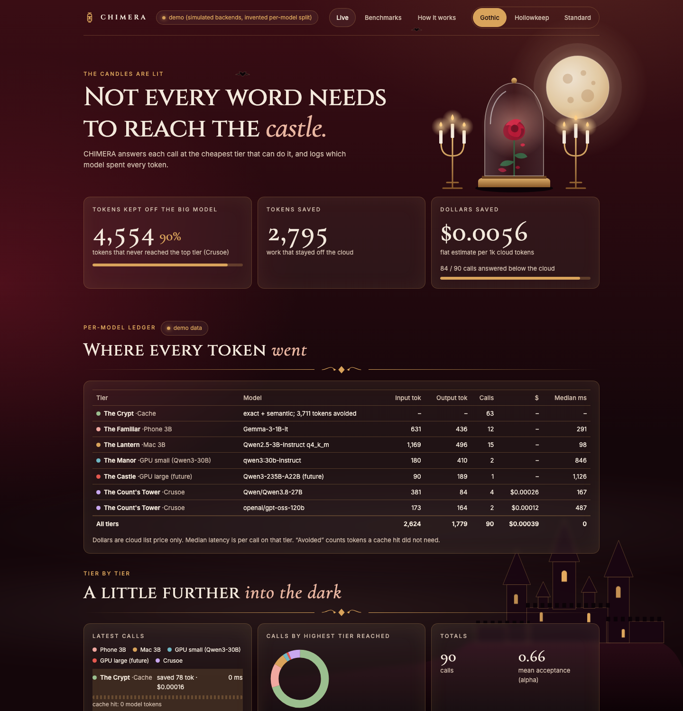

# HUD: live savings dashboard

A dark, mobile-first page (readable at 320 px) that shows what the router saves and which model spent each token. Three themes: **Gothic** (default; candlelit castle, enchanted rose under glass, full moon with slow bats, Cinzel and Cormorant type), **Hollowkeep** (the earlier dark green theme) and **Standard** (plain dark).

This replaces the Next.js HUD in the spec. The Mac has too little free disk for `npm install`, so this is one static `index.html` plus a stdlib Python server. No node, no new dependencies.




(The Hollowkeep and Standard screenshots predate the ledger.)

## Theme toggle

Three buttons in the top bar. The choice is saved in `localStorage` (`chimera-theme`: `gothic`, `hollowkeep`, `standard`; an old `halloween` value maps to Hollowkeep). `?theme=standard` forces a theme for one load. All motion (fog, bats, petals, candle flames, counter easing) stops under `prefers-reduced-motion`. Tiers show a themed name beside the real one (Standard shows the real name only):

| Tier | Themed label |
|---|---|
| Cache | The Crypt |
| Phone 3B | The Familiar |
| Mac 3B | The Lantern |
| GPU small (Qwen3-30B) | The Manor |
| GPU large (future) | The Castle |
| Crusoe | The Count's Tower |

## Per-model token ledger

The Live tab shows, per tier (each Crusoe model gets its own row): input tokens, output tokens, calls, dollars (cloud only) and median latency. The headline "Tokens kept off the big model" is all tokens that never reached Crusoe, as a share of all tokens plus tokens that cache hits avoided. Each call in the feed has a stacked bar of where its tokens went.

Data comes from the optional `per_tier` field on `Telemetry` (`packages/chimera-core/inference/telemetry.py`):
`per_tier: {"phone_3b"|"mac_3b"|"gpu_small"|"gpu_large"|"crusoe": {model, device, input_tokens, output_tokens, latency_ms, dollars}}`.
Old events without it still render from `local_tokens`, `gpu_tokens` and `cloud_tokens` (output only; input shows 0 and model shows "not logged"). `demo.py` invents a per-model split for all five tiers and labels it "demo". The router and ladder do not fill `per_tier` yet.

## What it shows

- **Live:** running tokens saved and dollars saved, call count, mean acceptance (alpha), a tier donut (cache, local, GPU, cloud), and a feed of the latest calls with latency. A badge says where the data comes from: `demo (simulated backends)` or `real backends`.
- **Benchmarks:** per run (`bench/results.csv`, `results_gpu.csv`, `results_ladder.csv`, `spec_results.csv`, whichever exist), one row per mode with mean latency, quality, dollars, remote and local tokens, tier counts and, where a CSV records them, input/output token columns per tier (CSV columns map: `local_tokens` to Mac 3B, `gpu_*` to GPU small, `cloud_*` to Crusoe; `/api/bench` adds `per_tier` per mode). The first mode in a file is the baseline. Anything worse than the baseline is red, and a "Where the baseline beat the others" list shows each category where the cascade lost.
  In the current data the cascade costs less but is slower on average than cloud-only, and the GPU-only run beats Mac+GPU on latency and quality. The page shows that as is.
- **How it works:** the cache, small-model, GPU, Crusoe ladder.

## Run

```
python apps/phantom-phone/hud-web/server.py      # http://127.0.0.1:8765 (HUD_PORT to change)
python apps/phantom-phone/hud-web/demo.py        # simulated backends, no network, no keys
python apps/phantom-phone/hud-web/demo.py --real # llama-server on :8080 + Crusoe (CRUSOE_API_KEY in .env)
```

- Binds `127.0.0.1` only.
- Telemetry file: `apps/phantom-phone/hud-web/telemetry.jsonl`, or `HUD_TELEMETRY=/path`. Set the same value for both scripts.
- `demo.py` resets that file when it starts. It writes one `_meta` line first (the source badge), then one `Telemetry` JSON line per call. Any code can feed the HUD with `TelemetryTracker.jsonl_sink(path)`.
- `/events` is Server-Sent Events (replays the file, then follows it). `/api/bench` is the merged CSV summary. The CSVs are only read.

## Tests

`.venv/bin/python -m pytest -q tests/test_hud.py` covers the CSV merge (with per-tier tokens), the `per_tier` telemetry field and the SSE tail (partial lines, missing file, truncation).

## Limits

- Dollars saved come from the router's flat `cloud_dollars_per_1k_tokens` estimate. The benchmark `usd` column is real Crusoe usage. They are different numbers.
- The demo's tier mix is invented. It shows the HUD works, not how the router performs.
- `docs/gothic.png` is the Live tab (1440 px, demo data); 320 px was checked by screenshot only during development. Screenshots, taken with headless Chromium from the Playwright cache. The Benchmarks tab was checked through `/api/bench` output and tests, not by screenshot.
