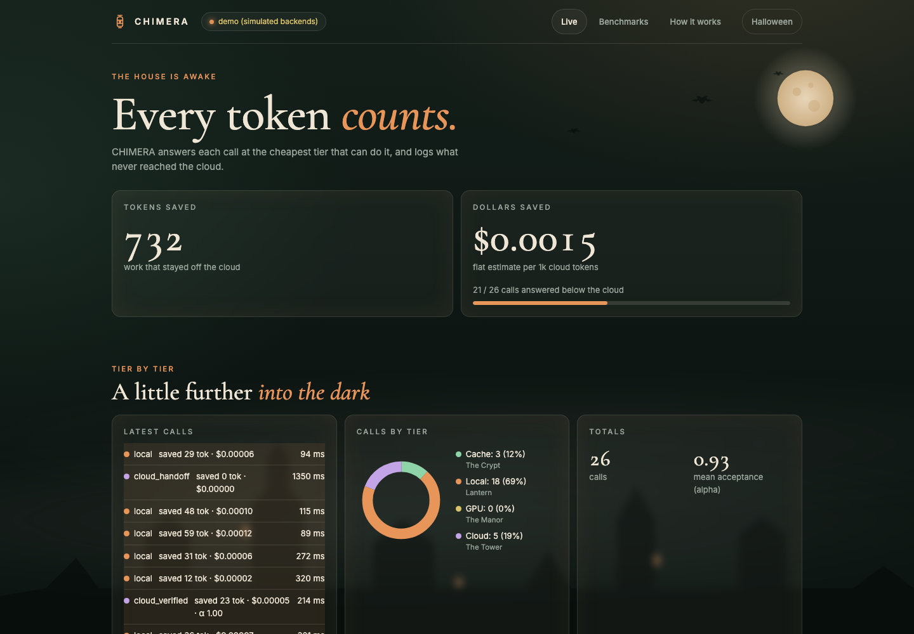
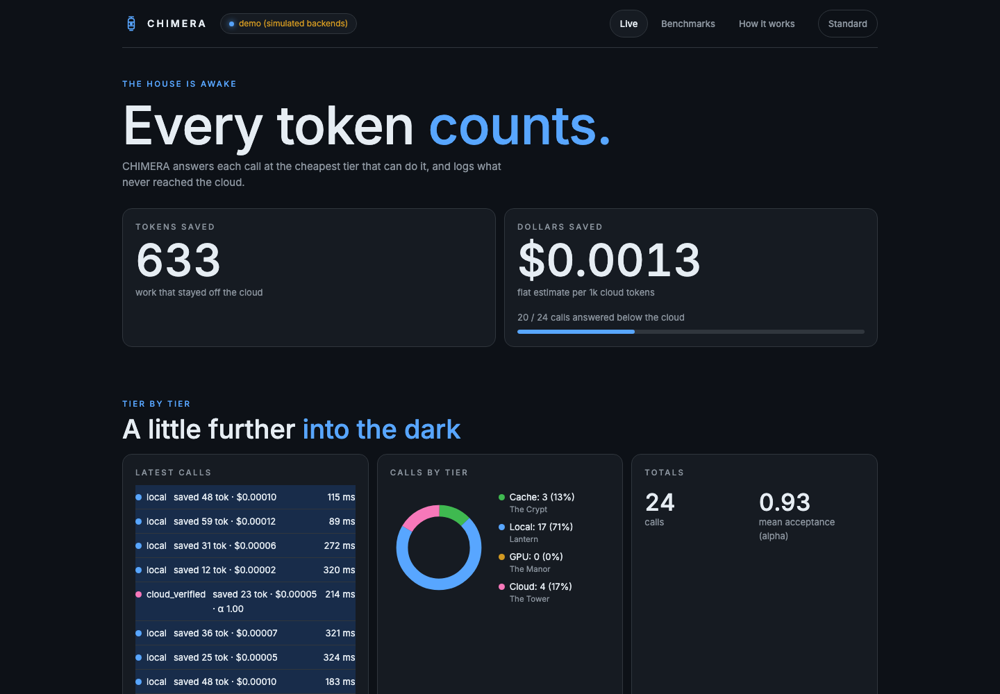

# HUD: live savings dashboard

A dark, mobile-first page (readable at 320 px) that shows what the router saves. Default theme is an elegant Halloween look (serif headings, lantern orange, inline SVG moon, manor and bats, slow fog). A plain dark Standard theme is one click away.

This replaces the Next.js HUD in the spec. The Mac has too little free disk for `npm install`, so this is one static `index.html` plus a stdlib Python server. No node, no new dependencies.





## Theme toggle

The button in the top bar switches Halloween and Standard. The choice is saved in `localStorage` (`chimera-theme`). `?theme=standard` forces a theme for one load. Halloween is the default. Motion (fog, bats, lantern flicker, counter easing) stops under `prefers-reduced-motion`. Tiers show a themed name next to the real one: Cache (The Crypt), Local 3B (Lantern), GPU 30B (The Manor), Cloud (The Tower).

## What it shows

- **Live:** running tokens saved and dollars saved, call count, mean acceptance (alpha), a tier donut (cache, local, GPU, cloud), and a feed of the latest calls with latency. A badge says where the data comes from: `demo (simulated backends)` or `real backends`.
- **Benchmarks:** per run (`bench/results.csv`, `results_gpu.csv`, `results_ladder.csv`, `spec_results.csv`, whichever exist), one row per mode with mean latency, quality, dollars, remote and local tokens, and tier counts. The first mode in a file is the baseline. Anything worse than the baseline is red, and a "Where the baseline beat the others" list shows each category where the cascade lost.
  In the current data the cascade costs less but is slower on average than cloud-only, and the GPU-only run beats Mac+GPU on latency and quality. The page shows that as is.
- **How it works:** the cache, local, GPU, top-cloud ladder.

## Run

```
python apps/phantom-phone/hud-web/server.py      # http://127.0.0.1:8765 (HUD_PORT to change)
python apps/phantom-phone/hud-web/demo.py        # simulated backends, no network, no keys
python apps/phantom-phone/hud-web/demo.py --real # llama-server on :8080 + Crusoe (CRUSOE_API_KEY in .env)
```

- Binds `127.0.0.1` only.
- Telemetry file: `apps/phantom-phone/hud-web/telemetry.jsonl`, or `HUD_TELEMETRY=/path`. Set the same value for both scripts.
- `demo.py` resets that file when it starts. It writes one `_meta` line first (the source badge), then one `Telemetry` JSON line per call. Any code can feed the HUD with `TelemetryTracker.jsonl_sink(path)`.
- `/events` is Server-Sent Events (replays the file, then follows it). `/api/bench` is the merged CSV summary. The CSVs are only read.

## Tests

`.venv/bin/python -m pytest -q tests/test_hud.py` covers the CSV merge and the SSE tail (partial lines, missing file, truncation).

## Limits

- Dollars saved come from the router's flat `cloud_dollars_per_1k_tokens` estimate. The benchmark `usd` column is real Crusoe usage. They are different numbers.
- The demo's tier mix is invented. It shows the HUD works, not how the router performs.
- The screenshots are the Live tab with demo data, taken with headless Chromium from the Playwright cache. The Benchmarks tab was checked through `/api/bench` output and tests, not by screenshot.
