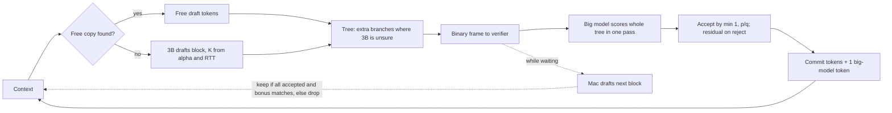

# Spec+ results

## Plain words

Plain speculative decoding: a small model on the Mac guesses K tokens. The big model on a far-away GPU checks all K in one pass. It keeps the guesses that match and adds one token of its own. Each pass costs one network round trip (50 to 300 ms).

Spec+ keeps that idea and cuts the cost of the trips: it picks K from the measured network time and hit rate, sends a small tree instead of one chain where the draft is unsure, drafts the next block while the last one is in flight, copies free tokens from the prompt or a similar earlier answer, and sends a compact binary message. Output is still exactly what the big model would write (see the proof below).



## What is real and what is modelled

- **Real:** the Mac Qwen2.5-3B Q4_K_M on llama.cpp (`127.0.0.1:8080`, `n_probs` top-16) generates every draft token. Its measured call latency is charged to a virtual clock. 18482 real llama calls were made in this run (the rest came from the memo of earlier calls).
- **Stand-in target, not a real big model:** no Qwen-vocabulary verifier that returns full distributions was reachable. `bench/results_modal.md` and `bench/spec_results.md` did not exist, and the Modal app serves Qwen3.5-122B, whose vocabulary differs from Qwen2.5-3B. So the target is the same 3B with its distribution sharpened (temperature 0.6, top-16). Acceptance rate alpha therefore reflects that stand-in, not a real 30B or 122B.
- **Modelled:** network round trip (RTT) and verifier compute. Verify pass = server base time + 0.5 ms per tree node. Big model alone = one streamed request: one RTT, then one server step per token. Server step is 50 ms (20 tok/s, a V100 class box with CPU offload) in the main table and 25 ms in the fast-server table.
- 17 prompts (edit1, edit2, edit3, edit4, edit5, math1, math2, math3, chat1, chat2, c1, c2, c5, e5, p4, e9, p5), 96 new tokens each, one run per setup, sampled output (noisy). Mix: 5 code edits, 3 math, 2 chat, 3 code writing, 4 short factual (two paraphrase pairs for the cache-neighbour draft).

- Plain spec here uses the same exact verify code (residual correction) with a chain of fixed K and the old JSON protocol, so the comparison isolates the Spec+ features. The older `SpecVerifierBackend` path samples its correction from the target instead of the residual.

Columns: `tok_s` virtual-clock tokens/s; `rt_per_100` round trips per 100 tokens; `alpha` accepted / (accepted + rejections); `tok_per_rt` tokens committed per round trip; `bytes_per_rt` up + down; `passes_per_100` big-model forward passes per 100 tokens (100 when it decodes alone); `free_frac` share of sent draft tokens that cost no draft-model call.

## Ablation (RTT 150 ms, server step 50 ms)

| setup | tok_s | rt_per_100 | alpha | tok_per_rt | bytes_per_rt | passes_per_100 | free_frac |
|---|---|---|---|---|---|---|---|
| big model alone | 19.27 | - | - | - | - | 100.0 | - |
| plain spec K=4 | 9.06 | 22.4 | 0.949 | 4.47 | 695 | 22.4 | 0.0 |
| plain spec K=8 | 11.25 | 14.5 | 0.945 | 6.91 | 791 | 14.5 | 0.0 |
| + adaptive K | 11.66 | 17.5 | 0.952 | 5.7 | 686 | 17.5 | 0.0 |
| + token tree (K=4) | 10.71 | 22.6 | 0.957 | 4.43 | 697 | 22.6 | 0.0 |
| + pipelining (K=4) | 12.9 | 22.9 | 0.947 | 4.37 | 696 | 22.9 | 0.0 |
| + free drafts (K=4) | 12.17 | 24.5 | 0.91 | 4.08 | 689 | 24.5 | 0.175 |
| + compact wire (K=4) | 9.06 | 22.4 | 0.949 | 4.47 | 223 | 22.4 | 0.0 |
| Spec+ all lossless | 13.36 | 19.0 | 0.937 | 5.25 | 298 | 19.0 | 0.038 |
| Spec+ all + lossy (LOSSY) | 15.76 | 15.6 | 0.957 | 6.41 | 378 | 15.6 | 0.053 |

## Same table, fast server (25 ms per step)

| setup | tok_s | rt_per_100 | alpha | tok_per_rt | bytes_per_rt | passes_per_100 | free_frac |
|---|---|---|---|---|---|---|---|
| big model alone | 37.19 | - | - | - | - | 100.0 | - |
| plain spec K=4 | 9.54 | 22.4 | 0.949 | 4.47 | 695 | 22.4 | 0.0 |
| plain spec K=8 | 11.73 | 14.5 | 0.945 | 6.91 | 791 | 14.5 | 0.0 |
| + adaptive K | 11.09 | 20.5 | 0.945 | 4.87 | 664 | 20.5 | 0.0 |
| + token tree (K=4) | 11.4 | 22.6 | 0.957 | 4.43 | 697 | 22.6 | 0.0 |
| + pipelining (K=4) | 11.86 | 22.9 | 0.945 | 4.36 | 695 | 22.9 | 0.0 |
| + free drafts (K=4) | 13.15 | 24.5 | 0.91 | 4.08 | 689 | 24.5 | 0.175 |
| + compact wire (K=4) | 9.54 | 22.4 | 0.949 | 4.47 | 223 | 22.4 | 0.0 |
| Spec+ all lossless | 15.49 | 19.5 | 0.93 | 5.14 | 298 | 19.5 | 0.043 |
| Spec+ all + lossy (LOSSY) | 15.9 | 16.6 | 0.953 | 6.01 | 330 | 16.6 | 0.062 |

## RTT sweep (tokens/s, server step 50 ms)

| RTT ms | big model alone | plain spec K=4 | plain spec K=8 | Spec+ all lossless | best Spec+ / best plain |
|---|---|---|---|---|---|
| 0 | 20.0 | 13.02 | 14.89 | 16.91 | 1.14x |
| 50 | 19.75 | 11.36 | 13.44 | 15.77 | 1.17x |
| 150 | 19.27 | 9.06 | 11.25 | 13.36 | 1.19x |
| 300 | 18.6 | 6.95 | 9.04 | 11.06 | 1.22x |

## Lossy mode (off by default)

Accepts any token with draft probability above 0.98 without testing it. | setup | tok_s | lossy_unchecked_per_100 | lossy_wrong_per_100 |
|---|---|---|---|
| Spec+ all + lossy (LOSSY) | 15.76 | 52.1 | 3.58 |

`lossy_wrong_per_100` is the summed probability, per 100 tokens, that the big model would have rejected the unchecked tokens. It is a measure of expected tokens that differ from the big model's output.

## Lossless proof

Toy Markov model, 5 tokens, draft and target differ. We generate the first two tokens many times and compare the empirical joint distribution with the exact target joint. TV = total variation distance. Sampling noise floor for 25 cells and 20,000 draws is about 0.01. Control: replacing the residual by a plain target sample on rejection gives TV 0.24.

| setup | draws | TV distance to target |
|---|---|---|
| plain chain K=3 | 20000 | 0.0134 |
| tree + adaptive | 20000 | 0.0147 |
| all lossless features | 20000 | 0.0127 |

Also covered by `tests/test_specplus.py::test_lossless_output_distribution_matches_target`. Multiple children per node are drawn without replacement; after a reject the target is replaced by norm(max(r - q, 0)) and the rejected token is removed from q.

## Reproduce

```
bench/serve_local.sh &
.venv/bin/python bench/run_specplus.py
```

## Verdict

**Spec+ beats plain speculative decoding, but neither beat the big model alone in this run.**

- All lossless features together: 13.4 tok/s vs 11.3 (plain K=8) and 9.1 (plain K=4) at RTT 150 ms. That is 1.14x to 1.22x over the best plain setup, and the gap grows with RTT.
- Helped: pipelining (+42% over K=4), free drafts (+34%), adaptive K (+3% over K=8, with fewer big-model passes than K=4). Compact wire cut bytes per round trip from 695 to 223 (-68%), but gave no speed at these sizes.
- Did not help: the token tree alone (+18% over K=4, about the same as plain K=8, and passes did not drop). Free drafts lowered alpha (0.91) because copied tokens are wrong more often.
- Lossy mode is faster (15.8 tok/s) but it is not lossless. Keep it off.
- Why the big model alone wins: the Mac 3B is slow to draft (measured llama.cpp latency is charged), and the stand-in server is quick (50 ms per token). Speculation only pays when the big model is slow per token, or the draft is cheap. Plain spec is enough when RTT is low and the draft is fast.
- GPU work saved is real: big-model passes drop from 100 to 19 per 100 tokens.
- Limit: the target is a sharpened copy of the 3B, not a real 30B+ model. No Qwen-vocabulary verifier with prompt logprobs was ready. Alpha and speed vs a real big model are not measured. Single run, sampled output, noisy.
- Lossless check: total variation distance 0.013 to 0.015, at the noise floor of about 0.01.
