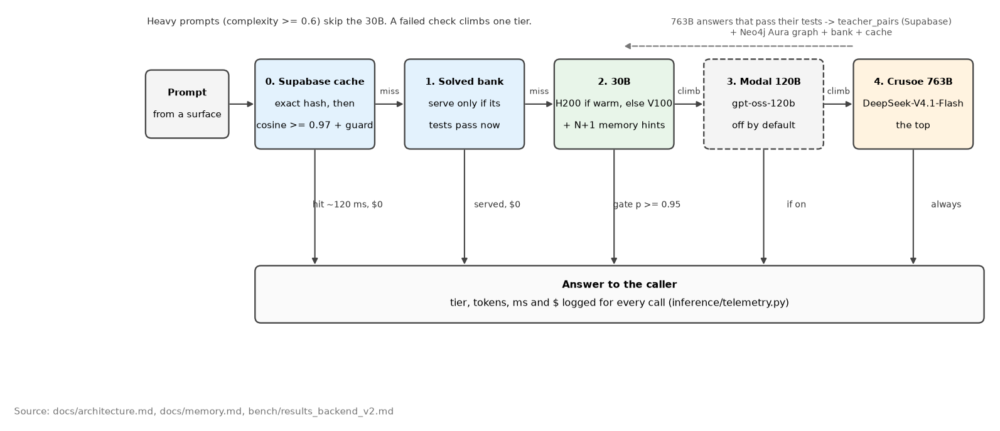
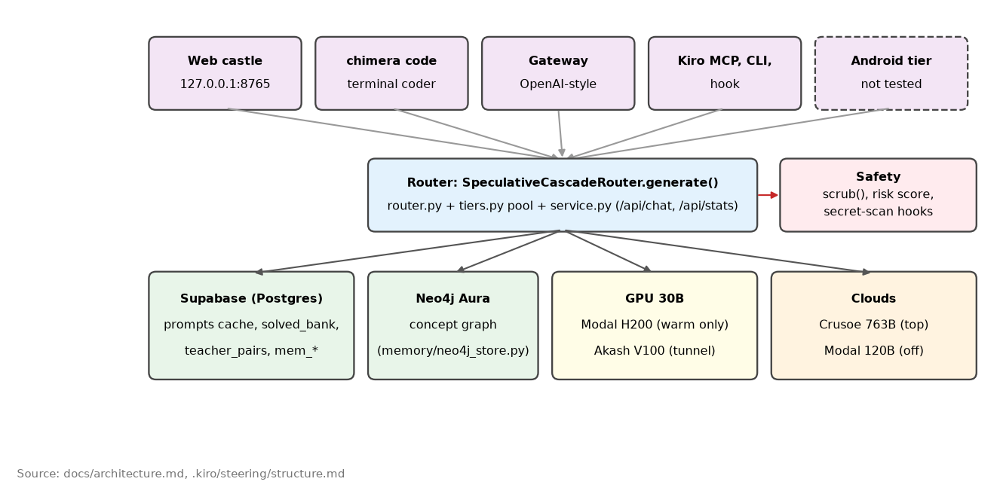
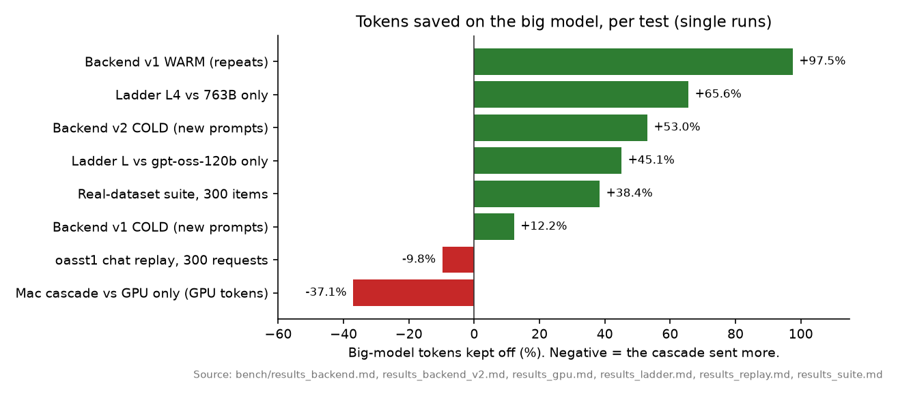
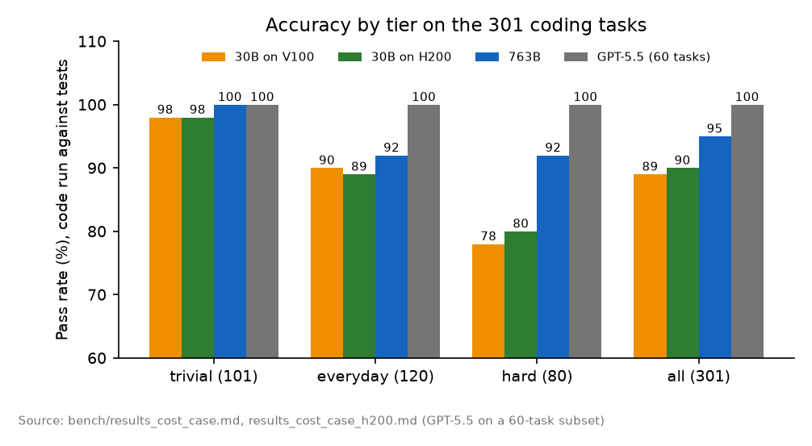
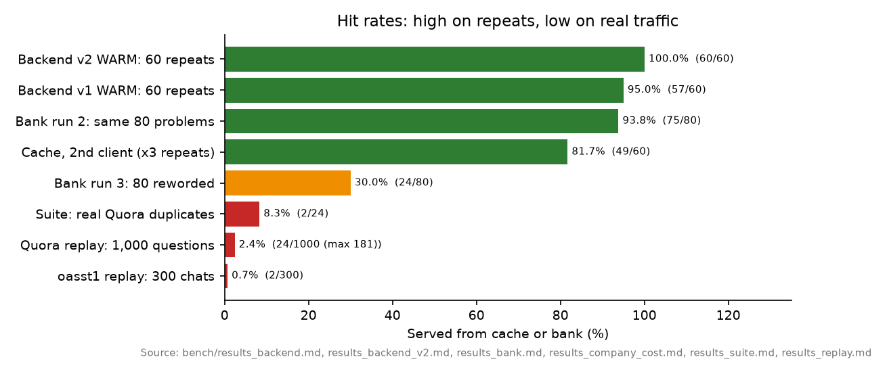
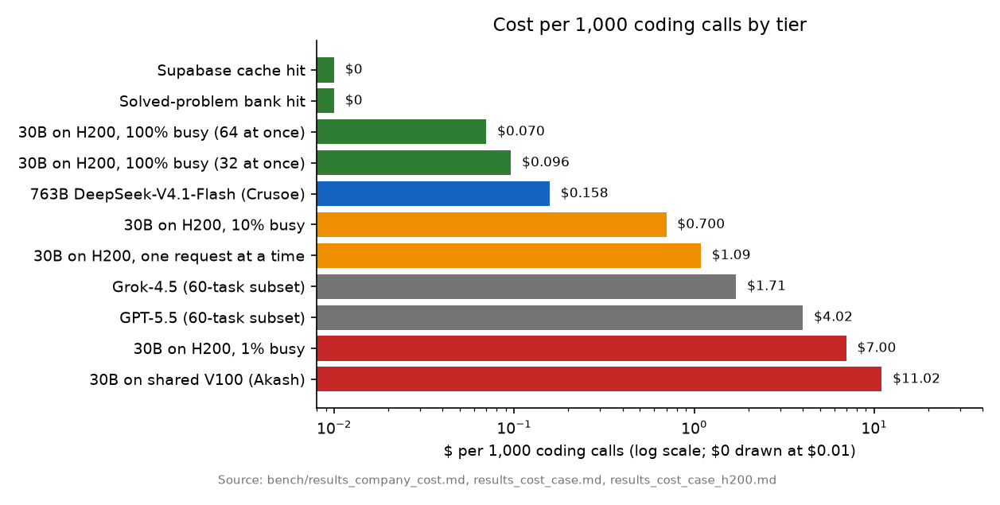
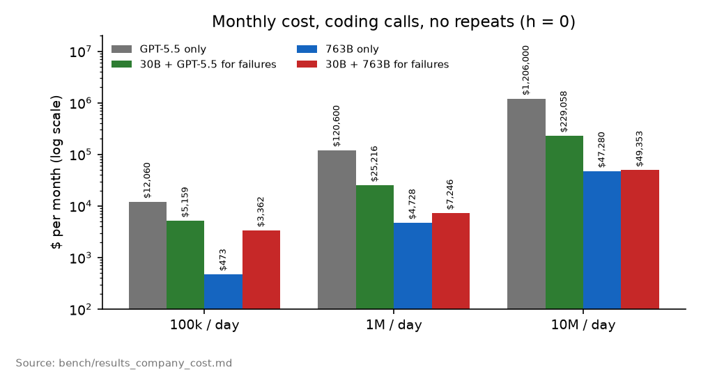
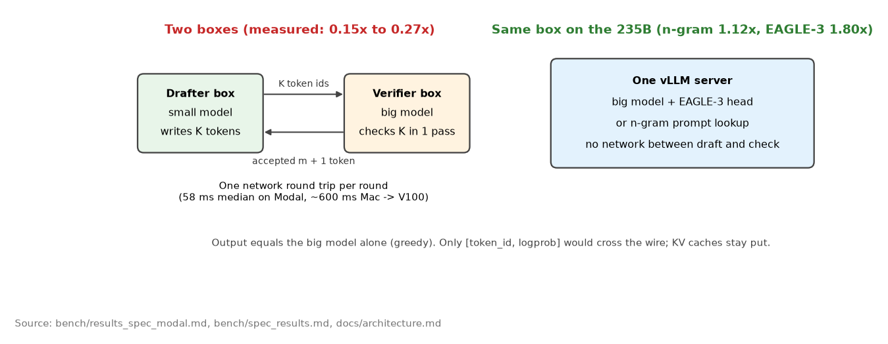
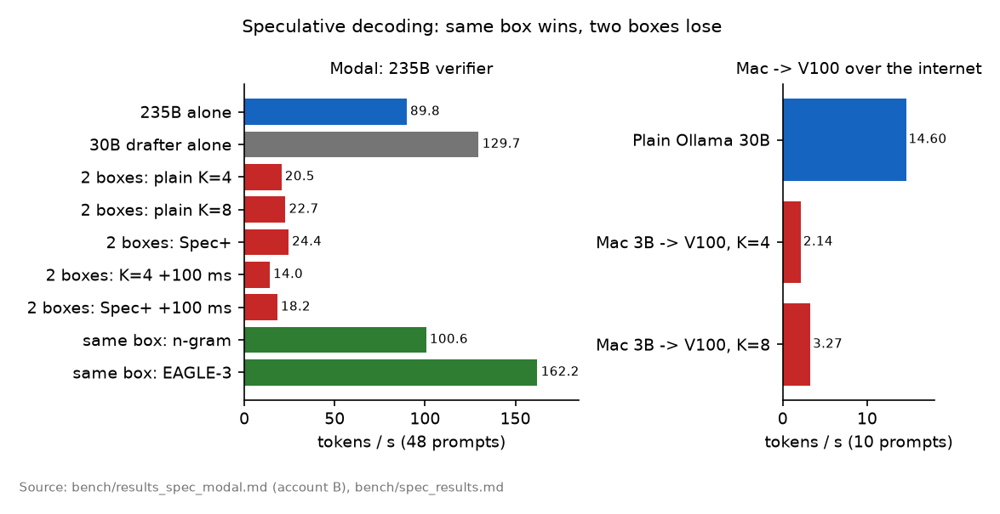
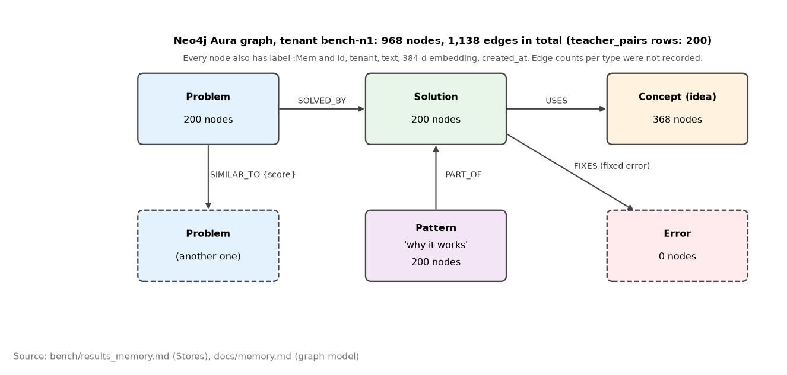

# CHIMERA: product requirements and architecture

Date: 2026-11-16. Owner: manvendersingh21. Repo: [github.com/manvendersingh21/tremor-core](https://github.com/manvendersingh21/tremor-core) (public, MIT, branch `dev`).

This file is the source. `docs/PRD_chimera.pdf` is built from it by `scripts/prd_pdf.py`. The workbook `docs/chimera_tracker.xlsx` holds the same numbers as sheets. Every number here comes from a file in the repo, and the file is named next to it. Almost every test ran once. Read small gaps as noise.

## 1. Pitch

CHIMERA answers each AI call at the cheapest place that can get it right, and shows the tokens and dollars saved.

## 2. Problem and who it is for

Companies send every AI call to one big, paid model. That includes easy work like FizzBuzz. A self-hosted 30B model passes 98% of trivial coding tasks (`bench/results_cost_case.md`). GPT-5.5 costs $4.02 per 1,000 coding calls. A busy H200 running the 30B costs $0.070 (`bench/results_company_cost.md`).

Who it is for:

- Engineering teams that pay a frontier API for many small coding calls.
- Platform teams that want one OpenAI-style endpoint with cost logs per tenant.
- Developers in Kiro or a terminal who want cheap answers for easy work.

## 3. Goals and non-goals

Goals:

1. Serve repeats from a shared cache or a solved-problem bank, at $0 in tokens.
2. Send easy work to a self-hosted 30B. Send hard work, or failed checks, to the big model.
3. Log tier, tokens, latency and dollars for every call. Show losses next to wins.
4. Never serve an answer that failed its tests. Never store secrets.
5. Show it all in one web page (the castle) at 127.0.0.1:8765.

Non-goals:

- Beating the 763B on price. It is already cheap ($0.1576 per 1,000 calls, `bench/results_cost_case.md`).
- Training our own models. LoRA made the 30B worse (`bench/results_distill.md`).
- Speculative decoding across the internet. It was 4.5x to 7x slower (`bench/spec_results.md`).
- A phone agent. It is planned and not built.

## 4. The ladder

Each call climbs only as far as it must. Heavy prompts (complexity 0.6 or more) skip the 30B. A failed check climbs one tier.



| Step | What | Status | Proof |
|---|---|---|---|
| 0 | Supabase cache: exact hash, then cosine 0.97 with the guard | measured | `docs/vector-store.md`, `bench/results_backend.md` |
| 0b | 30B yes/no check on a cosine hit | planned | none |
| 1 | Solved-problem bank: served only if its tests pass now | measured | `bench/results_bank.md` |
| 2 | N+1 memory: solved examples as hints for the 30B (Supabase `teacher_pairs` + Neo4j Aura graph) | measured, no gain | `bench/results_memory.md` |
| 3a | Modal H200 30B (`gpu-h200`), used only while warm | measured | `bench/results_backend_v2.md`, `bench/results_cost_case_h200.md` |
| 3b | Akash V100 30B (Ollama `qwen3:30b-instruct`), over an SSH tunnel | measured | `bench/results_cost_case.md` |
| 4 | Modal H200 120B (`gpt-oss-120b`), off by default | measured, lost | `bench/results_modal.md` |
| 5 | Crusoe 763B (`DeepSeek-V4.1-Flash`), the top | measured | `bench/results_cost_case.md` |

Default pool order: cache, then `gpu-h200` only while warm, then `gpu-small` (V100 30B), then `cloud-deepseek` (763B) (`bench/results_backend_v2.md`). Thinking is off on every tier.

### Data flow



1. A surface (castle chat, `chimera code`, gateway, Kiro MCP) calls `SpeculativeCascadeRouter.generate()`.
2. The router embeds the prompt (MiniLM, 384 numbers) and asks Supabase for an exact or near match.
3. On a miss, coding callers with tests ask the bank.
4. On a miss, memory adds solved examples, and the 30B answers. It keeps the answer if mean token probability is 0.95 or more.
5. Otherwise the call climbs to the 763B.
6. Answers that pass their tests are stored: cache, bank, `teacher_pairs` and the Aura graph. Everything is scrubbed first.
7. Telemetry goes to `/api/stats` and the castle dashboard.

## 5. Components

| Component | Owner file | Status | Proof |
|---|---|---|---|
| Router | `packages/chimera-core/router.py` | measured | `bench/results_backend.md`, `bench/results_suite.md` |
| Tier pool | `packages/chimera-core/tiers.py` | measured | `bench/results_backend_v2.md` |
| Web API service | `packages/chimera-core/service.py` | built | `docs/api.md`, `bench/results_backend_v2.md` (41 of 41 live checks) |
| Old ladder router | `packages/chimera-core/ladder.py` | measured | `bench/results_ladder.md` |
| Exact cache key | `packages/chimera-core/cache/exact_cache.py` | built | `tests/test_props_cache.py` |
| Shared Supabase cache | `packages/chimera-core/cache/pgvector_cache.py` | measured | `docs/vector-store.md`, `bench/results_company_cost.md` |
| Cache guard | `packages/chimera-core/cache/guard.py` | measured | `bench/results_research_cache.md`, `bench/results_backend.md` |
| Solved-problem bank | `packages/chimera-core/memory/bank.py` | measured | `bench/results_bank.md` |
| N+1 memory | `packages/chimera-core/memory/memory.py` | measured, no gain | `bench/results_memory.md` |
| Neo4j Aura graph | `packages/chimera-core/memory/neo4j_store.py` | built | `bench/results_memory.md` (Stores) |
| Scrub | `packages/chimera-core/memory/safety.py` | built | `tests/test_props_safety.py` |
| Risk scorer | `packages/chimera-core/firewall/risk_scorer.py` | built | `tests/test_props_safety.py` |
| Telemetry | `packages/chimera-core/inference/telemetry.py` | built | `tests/test_props_router.py` |
| Crusoe and Ollama backends | `packages/chimera-core/inference/cloud_verifier.py` | measured | `bench/results_cost_case.md` |
| H200 30B app | `deploy/modal/vllm_qwen30b.py` | measured | `bench/results_cost_case_h200.md` |
| H200 120B app | `deploy/modal/vllm_server.py` | measured, off | `bench/results_modal.md` |
| GPU tunnel self-heal | `scripts/gpu_tunnel_keep.sh` | measured | `bench/results_backend_v2.md` |
| Learned router | `packages/chimera-core/learned_router.py` | measured, off | `bench/results_research_router.md` |
| Spec+ | `packages/chimera-core/inference/specplus.py` | measured (stand-in target) | `bench/results_specplus.md` |
| Cross-box spec on Modal | `deploy/modal/spec_modal.py`, `bench/spec_modal_core.py` | measured in part | `bench/results_spec_modal.md` |
| Verifier server | `bench/verify_server.py` | measured | `bench/spec_results.md` |
| LoRA distill | `deploy/modal/distill.py` | measured, lost | `bench/results_distill.md` |
| Terminal coder | `apps/terminal/agent.py` | measured | `bench/results_terminal_agent.md` |
| Savings replay | `apps/replay/cli.py` | measured | `bench/results_replay.md` |
| Gateway | `apps/gateway/app.py` | built, no benchmark | `docs/architecture.md` |
| Kiro MCP, CLI, hook | `apps/kiro-trimmer/mcp_server.py` | built | `docs/handoff/kiro-setup.md` |
| Web castle | `site/game/walk.js`, `apps/phantom-phone/hud-web/server.py` | built | `site/docs/ui_polish.md` |
| Evals log | `bench/evallog.py` | built | `docs/handoff/evals-tab.md` |
| Secret scan hook | `.kiro/hooks/scripts/secret_scan.py` | built | `docs/handoff/kiro-setup.md` |
| Android tier | `docs/android.md`, `scripts/android_setup.sh` | written, not tested | none |
| 30B yes/no cache check | none | planned | none |
| GitHub autopatcher | `apps/kiro-trimmer/github_autopatcher.py` (not in the tree) | planned | none |
| Phone agent | none | planned | none |

## 6. Measured results

Every row is one run unless it says repeats. Win means the cascade beat the big model alone on what the test measured.

| Test | Setup | Number | Win or loss | File |
|---|---|---|---|---|
| Shared cache on repeats | 60 repeats, second pass | 57 of 60 from cache, 97.5% fewer 763B tokens, 0 wrong of 50 graded | win | `bench/results_backend.md` |
| Cache, 3 repeats | second client asks 60 | 49 of 60 hits in all 3, 0 wrong, lookup 122 ms | win | `bench/results_company_cost.md` |
| Ladder on new prompts (v1) | 60 prompts, shared V100 | 763B tokens -12.2%, p90 91.6 s vs 3.0 s | loss | `bench/results_backend.md` |
| Ladder on new prompts (v2) | same 60, idle V100 | 763B tokens -53.0%, 48/48 graded, p50 8.6 s vs 1.2 s | mixed | `bench/results_backend_v2.md` |
| Bank, same problems | 80 problems, 3 repeats | 75 of 80 served in all 3, 0 wrong | win | `bench/results_company_cost.md` |
| Bank, reworded problems | 80 reworded, 3 repeats | 24 of 80 served in all 3 | mixed | `bench/results_company_cost.md` |
| N+1 memory | 80 coding problems | 68 to 70 of 80; 3 random examples also gave 70 | loss | `bench/results_memory.md` |
| LoRA on 763B answers | 566 held-out problems | pass 92.2% to 88.3% | loss | `bench/results_distill.md` |
| Cost case, V100 30B | 301 coding tasks | pass 89% vs 95% (763B), $11.02 vs $0.158 per 1,000 | loss | `bench/results_cost_case.md` |
| Cost case, H200 30B | 301 tasks, 64 at once | pass 90%, $0.070 per 1,000 | win only while busy | `bench/results_cost_case_h200.md` |
| Router with no check | 301 tasks | pass 87.7% vs 95.0%, 37 wrong answers served | loss | `bench/results_cost_case.md` |
| Real-dataset suite | 300 items | 763B tokens -38.4%, $ -28.1%, pass 90% vs 93%, median 86 s vs 1.1 s | mixed | `bench/results_suite.md` |
| Chat replay (oasst1) | 300 real chats | 30B answered 18; 763B tokens +9.8%; p50 82.7 s vs 10.6 s | loss | `bench/results_replay.md` |
| Terminal coder | 15 tasks | 15/15 both; $0.00102 vs $0.00415; median 92 s vs 5.5 s | mixed | `bench/results_terminal_agent.md` |
| H200 30B live tier | 6 warm calls | 4 of 6 on the H200 in 0.7 to 1.9 s; cold start 845 s | mixed | `bench/results_backend_v2.md` |
| Ladder vs 763B (old 3B path) | 30 prompts | top tokens -65.6%, $ -67.3%, median 1.9 s vs 0.7 s | mixed | `bench/results_ladder.md` |
| Ladder vs 120B (old 3B path) | 30 prompts | top tokens -45.1%, $ -40.8% | mixed | `bench/results_ladder.md` |
| Mac cascade vs GPU only | 30 prompts | GPU tokens +37%, passed 20/24 vs 24/24 | loss | `bench/results_gpu.md` |
| Mac cascade vs cloud only | 30 prompts | cost -29%, wall 145 s vs 31.8 s | mixed | `bench/results.md` |
| H200 120B before 763B | 30 prompts | about $0.11 vs $0.0058; 1,352 ms vs 728 ms | loss | `bench/results_modal.md` |
| Learned router | 180 graded prompts | 70.0%, same as the confidence gate | loss (no gain) | `bench/results_research_router.md` |
| Cache guard | 800 Quora pairs at 0.97 | wrong hits 4 to 2, recall 10.1% to 9.1% | win (small) | `bench/results_research_cache.md` |
| Spec, two boxes, Modal 235B | 48 prompts | 20.5 to 24.4 tok/s vs 89.8 alone | loss | `bench/results_spec_modal.md` |
| Spec, same box, Modal 235B | 48 prompts | EAGLE-3 162.2 tok/s (1.80x), n-gram 100.6 (1.12x) | win | `bench/results_spec_modal.md` |
| Spec, Mac to V100 | 10 prompts | 2.14 to 3.27 tok/s vs 14.60 Ollama | loss | `bench/spec_results.md` |
| Spec+ vs plain spec | 17 prompts, stand-in target | 1.14x to 1.22x over plain, below big model alone | mixed | `bench/results_specplus.md` |
| GPU link self-heal | killed and frozen tunnel | back in 5 s and 17 s | win | `bench/results_backend_v2.md` |

The single-run caveat: only the cache and bank tests in `bench/results_company_cost.md` were repeated (3 times). Every other row is one run. Several 30B runs used a shared V100, so their latency says more about the box than the model.







## 7. Cost model

Cost per 1,000 coding calls, from `bench/results_company_cost.md`:



An idle H200 still bills $4.54 an hour, so $108.96 a day. Its price per call is the full price divided by how busy it is: `$ per 1k = $0.0700 / busy share` at 64 at once. One H200 serves about 1,557,269 short coding calls a day at 100% busy (`bench/results_company_cost.md`).

Break-even busy share = H200 $ per 1k when full / API $ per 1k. Against the 763B: 44%. Against GPT-5.5: 1.7% (`bench/results_company_cost.md`).

The math (30 days a month, D = calls a day, h = share served by cache or bank):

```
frontier only  = D x 30 x P_api / 1000
H200s          = ceil(D x (1 - h) / (1,557,000 x 0.5))
cascade        = H200s x $108.96 x 30
               + D x (1 - h) x 0.103 x 30 x P_fail / 1000
               + $25  (Supabase Pro)
P_api:  GPT-5.5 $4.02, 763B $0.1576 per 1,000
P_fail: GPT-5.5 $6.04, 763B $0.221 per 1,000 (priced where the 30B fails)
```

Worked example, 1,000,000 calls a day, h = 0, failures to GPT-5.5: GPU 2 x $108.96 x 30 = $6,538. Failures 102,990 a day x 30 x $6.04 / 1000 = $18,654. Add $25. Total $25,216, against $120,600 for GPT-5.5 only.

| Calls a day | GPT-5.5 only | 30B + GPT-5.5 | Saved | 763B only | 30B + 763B | Saved |
|---|---|---|---|---|---|---|
| 100,000 (h = 0) | $12,060 | $5,159 | $6,901 (57%) | $473 | $3,362 | -$2,889 |
| 1,000,000 (h = 0) | $120,600 | $25,216 | $95,384 (79%) | $4,728 | $7,246 | -$2,518 |
| 10,000,000 (h = 0) | $1,206,000 | $229,058 | $976,942 (81%) | $47,280 | $49,353 | -$2,073 |
| 100,000 (h = 30%) | $12,060 | $4,600 | $7,460 (62%) | $473 | $3,342 | -$2,869 |
| 1,000,000 (h = 30%) | $120,600 | $16,351 | $104,249 (86%) | $4,728 | $3,772 | $956 (+20%) |
| 10,000,000 (h = 30%) | $1,206,000 | $160,021 | $1,045,979 (87%) | $47,280 | $34,228 | $13,052 (+28%) |

Monthly dollars, from `bench/results_company_cost.md`. h = 30% is the bank's rate on reworded problems, not a measured company rate. Open chat repeated under 1% (`bench/results_replay.md`).



What this says in plain words:

- Against GPT-5.5, the cascade saves 57% to 87% a month at every volume.
- Against the 763B, the cascade loses money unless repeats are high and volume is 1M a day or more.
- The 30B fails about 10% of tasks. Tests must catch them, or users get wrong code.

## 8. Speculative decoding

A small model writes a few tokens. The big model checks them all in one pass. The output equals the big model alone.





Phase A on Modal (Qwen3-30B-A3B drafts on an L40S, Qwen3-235B-A22B verifies on 4 H100s, account B, 48 prompts, `bench/results_spec_modal.md`):

| Run | tok/s | vs 235B alone | alpha | Same output |
|---|---|---|---|---|
| 235B alone | 89.8 | 1.00x | | |
| 30B drafter alone | 129.7 | 1.44x | | |
| Two boxes, plain K=4 | 20.5 | 0.23x | 0.80 | 26/48 |
| Two boxes, plain K=8 | 22.7 | 0.25x | 0.67 | 30/48 |
| Two boxes, Spec+ | 24.4 | 0.27x | 0.60 | 23/48 |
| Two boxes, K=4 + 100 ms | 14.0 | 0.16x | 0.80 | 26/48 |
| Two boxes, Spec+ + 100 ms | 18.2 | 0.20x | 0.57 | 25/48 |
| Same box, EAGLE-3 | 162.2 | 1.80x | 0.63 | 27/48 |
| Same box, n-gram | 100.6 | 1.12x | 0.09 | 48/48 |

Why two boxes lose: each round needs one network trip. The median network part was 58 to 59 ms, and the big box spent 41 ms per round at K=4 (`bench/results_spec_modal.md`). At 89.8 tok/s the big model alone writes a token about every 11 ms (1000 / 89.8).

Not measured yet: the 4B drafter, the 2-level chain, the Coder-480B and the Qwen3.5-397B runs. Account B's $30 of free credits ran out mid-job (`bench/results_spec_modal.md`). Phase B (Llama, gpt-oss, DeepSeek-V3) has no numbers. The smoke check found 6 output differences. All 6 were near-ties under 0.5 nats, not bugs (`bench/results_spec_modal.md`). On the 235B, plain K=4 matched the big model alone on 26 of 48 outputs. The file does not yet say whether those gaps are near-ties.

The 763B on Crusoe cannot verify drafts. Its API rejects `echo`, and its tokenizer differs from Qwen (`bench/results_spec_modal.md`). So spec decoding is not in the product ladder today.

## 9. N+1 memory graph

Big-model answers that pass their tests go to Supabase `teacher_pairs` and to a graph in Neo4j Aura (`docs/memory.md`).



Real counts from the benchmark tenant `bench-n1` (`bench/results_memory.md`, Stores):

| Node or edge | Count |
|---|---|
| Problem | 200 |
| Solution | 200 |
| Concept (idea) | 368 |
| Pattern | 200 |
| Error | 0 |
| All edges (SOLVED_BY, USES, SIMILAR_TO, FIXES, PART_OF) | 1,138 |
| teacher_pairs rows | 200 |

The file gives no count per edge type. Error has 0 nodes, so no FIXES edges exist in that tenant. The live check later saw 2,156 Neo4j nodes across all tenants (`bench/results_backend_v2.md`).

Result: memory moved the 30B from 68 to 70 of 80. Three random stored answers also gave 70 (`bench/results_memory.md`). So the gain is not from retrieval.

## 10. Safety

- Scrub: everything stored passes `scrub()` in `memory/safety.py`. It removes emails, API keys, JWTs, DB URLs, `password=` values, SSNs, card numbers and phone numbers (`docs/memory.md`). A card glued to `_` was missed. That bug is fixed (`bench/results_backend_v2.md`).
- Risk scorer: `firewall/risk_scorer.py` scores an action 0 to 100. Pay, delete, merge and send at 70 or more need a one-time token. It is a rule list. It can miss odd wording. The token can be used twice: `verify_approval` is stateless (`docs/handoff/property-tests.md`).
- Secrets: keys live only in `.env`. The `secret-scan` hooks block a commit that holds a key, host or key path (`docs/handoff/kiro-setup.md`).
- Database: clients use the `chimera_app` role under row level security. A tenant sees only its own rows (`docs/vector-store.md`).
- Tests gate serving: a bank match is served only if it passes the new problem's tests. At cosine 0.70, 34 of 36 matches would have been wrong (`bench/results_bank.md`).

## 11. Surfaces

| Surface | What | Status | Proof |
|---|---|---|---|
| Web castle | One page at 127.0.0.1:8765 (`make web`). Hold W to walk in. Doors open rooms with live numbers. The Observatory is the Halloween dashboard. Count Cuspid chats through the router. | built | `site/docs/ui_polish.md`: WebKit and Chrome checks pass, 57.8 to 60 fps |
| Terminal coder | `chimera code`: edits files, runs tests, climbs a tier on a failed test, checks the bank first | measured | `bench/results_terminal_agent.md`, `bench/results_backend_v2.md` |
| Gateway | OpenAI-style API, keys per tenant, `/metrics` | built, no benchmark | `docs/architecture.md` |
| Kiro | MCP server, CLI, hook, steering, 7 specs, hooks, 4 agents, a Power | built | `docs/handoff/kiro-setup.md` |
| Android | Qwen 3B or 1.5B in Termux over USB | written, not tested on a phone | `docs/android.md` |

## 12. Risks and failures

1. **The 763B is too cheap to beat.** At $0.1576 per 1,000 calls, the cascade loses money against it unless the H200 is 44% busy (`bench/results_company_cost.md`).
2. **The V100 30B is slow.** About 78 s per call on the shared box (`bench/results_cost_case.md`). Every failed 30B try adds that wait before the 763B.
3. **The confidence gate does not catch wrong code.** Wrong 30B code passed the gate in the suite (`bench/results_suite.md`). With no check, the router served 37 wrong answers (`bench/results_cost_case.md`).
4. **Open chat climbs anyway.** The 30B answered 18 of 300 chats (`bench/results_replay.md`).
5. **Non-English cache hits are wrong.** 81 of 84 non-ASCII near pairs were not interchangeable (`bench/results_replay.md`). The embedder and guard read English only.
6. **Real traffic repeats little.** 24 of 1,000 Quora questions hit the cache. 181 could have (`bench/results_suite.md`).
7. **H200 cold starts are long.** 845 s, about $1.07 before the first answer (`bench/results_backend_v2.md`).
8. **Memory and LoRA did not help.** No real gain, and LoRA lost 3.9 points (`bench/results_memory.md`, `bench/results_distill.md`).
9. **Most tests ran once.** Several used a shared GPU.
10. **Docs drift.** `.kiro/steering/tech.md` still calls the bank planned, and `docs/architecture.md` still names a SQLite fallback. Both are out of date (`docs/memory.md`, `docs/vector-store.md`).
11. **Modal spend.** Account A hit its spend limit. Account B used its $30 of credits (`bench/results_spec_modal.md`). Weight volumes cost about $110 a month while kept (`docs/status_2026-11-15.md`).

## 13. Roadmap, in order

1. Make the H200 30B the main 30B tier, and keep it warm only under steady traffic (`bench/results_cost_case_h200.md`).
2. Put a test gate in front of every coding answer. The bound was 96.0% pass with 81.7% of 763B tokens kept off (`bench/results_cost_case.md`).
3. Send open chat straight to the 763B with a cheap pre-check (`bench/results_replay.md`).
4. Pitch against frontier APIs, not the 763B (`bench/results_company_cost.md`).
5. Use same-box spec decoding (EAGLE-3) for any big model we host (`bench/results_spec_modal.md`).
6. Fix non-English cache hits: a multilingual embedder, or reject mostly non-ASCII near hits (`docs/handoff/replay.md`).
7. Build the 30B yes/no check on cosine hits (planned).
8. Repeat the key tests 3 times on an idle GPU.
9. Ship the hackathon build (section 14).
10. Stop memory hints and LoRA in their current form.
11. Finish Phase A and Phase B spec runs only if credits allow.

## 14. Kiroween 2026 hackathon plan

Deadline: Friday, December 4, 2026, 2:00 PM PT (from the brief). Today is Monday, November 16, so 18 days remain.

Needs, and where we stand:

| Need | State | Next step |
|---|---|---|
| Public repo with MIT license | done: `gh repo view` shows PUBLIC and MIT | keep it |
| `/.kiro` at the repo root | done: 45 tracked files (steering, specs, hooks, agents) | commit `.kiro/settings/mcp.json` after a secret scan; it is untracked |
| Working app URL | not done: the castle runs only on 127.0.0.1:8765 | deploy the web server with a demo tenant and no private hosts |
| YouTube demo under 3 minutes | not done | script, record, upload |
| Kiro-use write-up | partial: `docs/handoff/kiro-setup.md` | write how specs, hooks, steering, agents and MCP built the project |
| Category | not chosen | Frankenstein fits best: many models stitched into one ladder. Costume Contest fits the Halloween castle |

Judging and how we answer it:

| Criterion | Our answer |
|---|---|
| Impact | 57% to 87% a month saved against GPT-5.5 on coding calls (`bench/results_company_cost.md`) |
| Kiro depth | 7 specs, hooks that test on save and block secrets, 4 custom agents, a Power, an MCP server |
| Design | The painted walk-in castle and the Halloween dashboard (`site/docs/ui_polish.md`) |
| Innovation | Test-gated bank and cache, live savings per call, same-box vs two-box spec results |
| Presentation | One URL, a 3-minute video, losses shown next to wins |

Timeline:

| Dates | Work |
|---|---|
| Nov 16 to 20 | Public URL live, demo tenant, H200 tier warm only during the demo |
| Nov 21 to 25 | Kiro write-up, README update, fix docs drift |
| Nov 26 to Dec 1 | Record and edit the video, dry run the URL from a clean browser |
| Dec 2 to 3 | Buffer and final checks |
| Dec 4, before 2:00 PM PT | Submit |

## 15. Open questions for the user

1. Is the goal lower cost or lower latency? The ladder cuts cost and adds latency on new prompts.
2. Should we pitch only against frontier APIs, since the 763B is hard to beat?
3. Keep the H200 30B warm during demos only, or always? Always-on costs $108.96 a day.
4. Which hackathon category: Frankenstein or Costume Contest?
5. Where should the public demo URL live, and may it use the paid tiers?
6. Should spec decoding enter the product at all? Only a self-hosted big model can verify.
7. Delete the Modal weight volumes after review (about $110 a month)?
8. What Modal spend limit should we set for the rest of the month?
9. Should memory hints and LoRA stop, given no measured gain?
