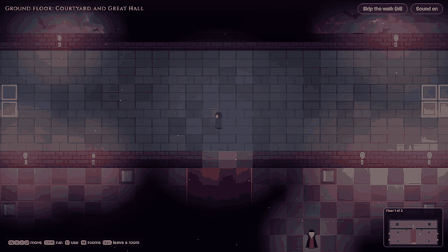
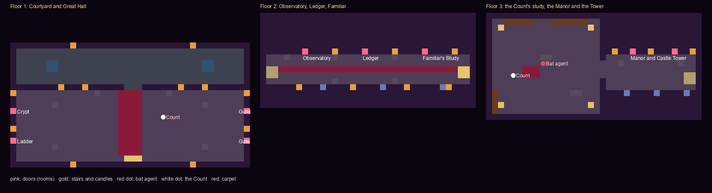

# CHIMERA site: the walkable castle

One page, one port. You walk a cloaked figure through a painted gothic castle with W A S D. Rooms hold the posters (real benchmark numbers), the live dashboard and the evals. On the top floor a bat answers questions through the router, and a trace shows every step it takes.

No framework, no npm. The only external request is Google Fonts.



## Run

```
make web       # http://127.0.0.1:8765  (CHIMERA_PORT to change)
make demo      # same, plus demo telemetry so the Observatory moves
```

`make web` runs `apps/phantom-phone/hud-web/server.py`. That one server serves `site/`, the telemetry stream (`/events`), `/api/bench`, `/api/evals`, and the backend API (`/api/chat`, `/api/health`, `/api/stats`, from `chimera_core.service`, see `docs/api.md`). It binds `127.0.0.1`.

Opening `index.html` as a file, or on a static host, still works. The walk needs `map.json` over HTTP. Without it the page falls back to the click-through tour (`tour.js`). The bat then shows a labelled MOCK reply, because there is no `/api/chat`.

## Controls

| Key | Does |
|---|---|
| W A S D, arrows | walk |
| Shift | run |
| E, Enter | open a door, use the stairs, talk |
| Esc | leave a room |
| M, "Skip the walk" | list of all rooms (keyboard and screen reader path) |
| click or tap | walk there (A* on the tile grid) |

Phones get a joystick and an E button. Walking onto stairs also climbs them.

## Floors and rooms

| Floor | Rooms |
|---|---|
| Ground: courtyard and Great Hall | The Crypt (cache), The Ladder (how routing works), The Guild (companies), The Gate (get started). The Count stands in the hall. Grand stairs at the south end. |
| First | The Observatory (live dashboard), The Ledger (benchmarks and evals), The Familiar's Study (phone) |
| Tower | The Count's study with the bat agent, The Manor and The Castle (GPUs), The Tower (cloud) |



## The bat (talk to the agent)

The chat posts to `/api/chat` and reads the SSE steps from `docs/api.md`. The trace shows: embedding, the shared cache (cosine score against 0.97 and the guard), the GPU 30B (self-hosted) with its confidence against the gate, the N+1 memory (examples retrieved, stored as teacher data or not), the decision with its reason, each call, and the final tier, model, tokens, $, ms and tokens kept off the big model. Totals for the chat: hit rate, GPU calls avoided, $ saved. The strip on top polls `/api/health` every 2 s: GPU tunnel, Supabase, Crusoe, RAM, Modal.

If the self-hosted tier that answered is the Mac 3B, the lane title says "Mac 3B (experiment, not the 30B)". The 3B is not in the product ladder.

## Add a room

- Map: `site/world/map.json`. Floors are rows of tiles (`#` wall, `t` torch, `w` window, `b` books, `f` furniture, `c` candles, `~` fountain, `D` door, `.` floor, `,` courtyard, `=` carpet, `U` stairs up, `d` stairs down). A door entry links a `D` tile to a room. `tests/test_world.py` checks the schema, that the art exists, and that every door, NPC and stair can be reached.
- Posters: `site/rooms.js` (`window.ROOMS`). Then run `python3 site/build.py`. It writes the no-JS fallback (one plain section per room) into `index.html`. `--check` fails if it is out of date. Use only real numbers from `bench/*.md`.
- Dashboard blocks: `.dash[data-dash=<room id>]` in `#dash-store` in `index.html`. A room borrows its block while it is open (Observatory: live ledger; Ledger: benchmarks and evals; Ladder: how it works).

## Files

- `index.html`: page, dashboard blocks, generated no-JS fallback.
- `world/`: `world.js` (engine), `grid.js` (tiles, A*), `chat.js` (bat room, trace, monitor), `world.css`, `map.json`, `player.png` and `count.png` (drawn by `scripts/gen_sprites.py`).
- `dashboard.js`, `dashboard.css`: the dashboard (SSE ledger, donut, benchmarks, evals, themes).
- `rooms.js`, `build.py`, `styles.css`, `tour.js` (fallback tour), `art/` (painted Seedream images).
- `docs/walk.gif`, `docs/walk_map.png`: made by `scripts/capture_walk.py` against a running server.

## Motion

The loop is one `requestAnimationFrame`. It never pauses: not behind panels, not with reduced motion. Bats and clouds cross the sky, torches and candles flicker and cast light, the courtyard has fog, and dust drifts in every room.

## Limits

- Only Chromium was checked (headless, over the DevTools protocol). No phone was tested. The frame rate was not measured.
- The rooms are drawn tiles with painted art as backdrop and banners. The painted rooms are not walkable scenes.
- The light layer is dark. Some corners are hard to see.
- The fallback tour does not show the dashboard blocks.
