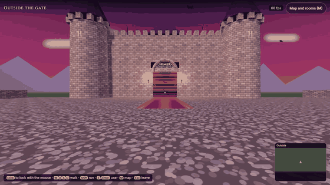

# CHIMERA site: the 3D castle

One page, one port: http://127.0.0.1:8765. You start outside a castle. Press Enter at the gate and it opens. Inside the Great Hall, a guide sits at a desk: walk up and press E to talk. He answers through the real router. A savings board on the wall shows the totals. Climb the grand staircase. On the upper gallery three doors open the **Dashboard**, the **Chat** (the Count's room) and the **Evals**.

No framework, no npm. three.js is vendored in `vendor/` (MIT, licence in `vendor/three.LICENSE.txt`). Every model in the scene is built in `castle/castle.js` from three.js primitives and canvas textures. No downloaded 3D models or textures are used, so the scene has no asset licences. The painted images in `art/` were generated for this project (Seedream via GMI) and are used by the no-WebGL fallback. Google Fonts is the only external request, with system fallbacks.



Proof, screenshots and fps: [docs/one_url_gates.md](docs/one_url_gates.md).

## Run

```
make web       # http://127.0.0.1:8765  (CHIMERA_PORT to change)
make demo      # the same page fed by invented demo telemetry, labelled demo
```

`make web` runs `apps/phantom-phone/hud-web/server.py`. That one server serves `site/`, the telemetry stream (`/events`, from the real log `~/.chimera/telemetry.jsonl`), `/api/bench`, `/api/evals`, and the backend API (`/api/chat`, `/api/health`, `/api/stats`, from `chimera_core.service`; see `docs/api.md`). It binds `127.0.0.1`.

## Controls

| Key | Does |
|---|---|
| Click | look with the mouse (pointer lock). Esc releases it. |
| W A S D, arrows | walk |
| Shift | run |
| E, Enter | open the gate, talk to the guide, read the board, open a door |
| Esc | leave a panel |
| M, "Map and rooms" | map of both floors, plus a list of places to go to (keyboard and screen-reader path) |

Phones get a joystick, an E button, and drag-to-look. The corner minimap follows you and shows the floor you are on, the doors, the stairs and your facing.

## What each place shows

| Place | Data |
|---|---|
| Savings board (hall) | `/api/stats`: tokens kept off the big model, dollars saved, GPU calls avoided, cache hit rate |
| Guide (hall) | chat over `/api/chat`, with the live trace, plus a short guide to the castle |
| Dashboard door | `/api/stats` totals, tokens saved over time (`/events`), database size, "how it answered" for recent questions, the live ledger |
| Chat door | chat with the live trace. Side panel: cache hit rate, tokens used today, tokens per task |
| Evals door | benchmarks and the eval log (`/api/bench`, `/api/evals`) |

The trace shows each step `/api/chat` sends: embedding, the Supabase cache (exact, then cosine against 0.97, the guard, ms), N+1 memory, each tier tried, the GPU 30B's confidence against the gate, and the final tier, model, tokens, $, ms and tokens kept off the big model.

Fields the backend does not serve yet are marked **pending API** (requested in `docs/api.md`). Until they arrive, the page shows only what it measures itself. Traces, tokens today and tokens per task come from this browser's own questions (localStorage) and say so.

## Files

- `index.html`: the page, the dashboard blocks (`#dash-store`), the generated plain fallback.
- `castle/`: `castle.js` (scene, controls, minimap), `physics.js` (walking rules, also tested in node), `panels.js` (the HTML panels), `layout.json` (walls, zones, stairs, doors, places), `castle.css`.
- `vendor/three.module.min.js` (r170).
- `world/chat.js`, `world/world.css`: the chat, trace and panel styles, shared with the 2D castle.
- `world/`: the earlier 2D castle. It is off the main path and kept for its tests.
- `dashboard.js`, `dashboard.css`, `rooms.js`, `build.py`, `styles.css`, `tour.js`, `art/`.

## Add a door or a place

Edit `castle/layout.json`: a door needs `id`, `label`, `x`, `z`, `use`, and a panel in `castle/panels.js` with the same id. `tests/test_castle.py` checks the layout and walks gate → hall → stairs → gallery with the real `physics.js`. Posters for the plain fallback live in `rooms.js`. Run `python3 site/build.py` after editing it; `--check` fails if `index.html` is out of date.

## Without WebGL

The page drops the 3D root and shows the plain HTML version: every room as a section with its posters. No 2D game runs in that case.

## Motion

One `requestAnimationFrame` loop that never pauses: torches flicker, flags and banners wave, clouds drift, bats circle the towers, the chandelier sways, and the guide breathes and turns his head toward you.

## Limits

- Only Chromium was checked, headless, with the Mac GPU (58 to 60 fps). Touch was not tried on a phone.
- The figures are simple low-poly shapes.
- The fallback page has no chat.
