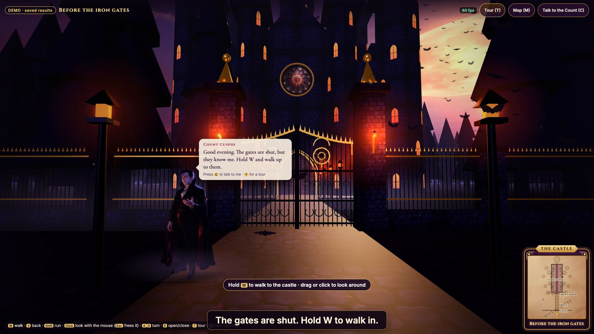
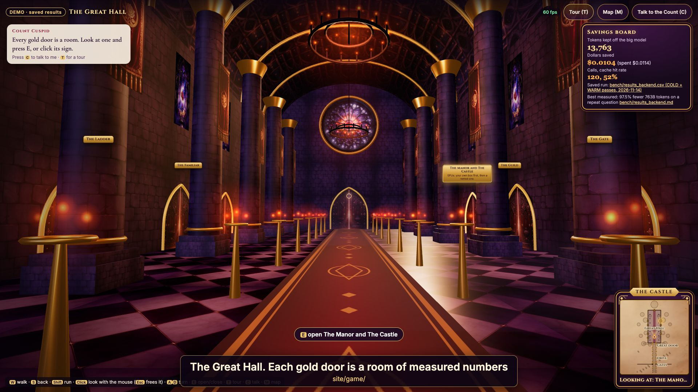
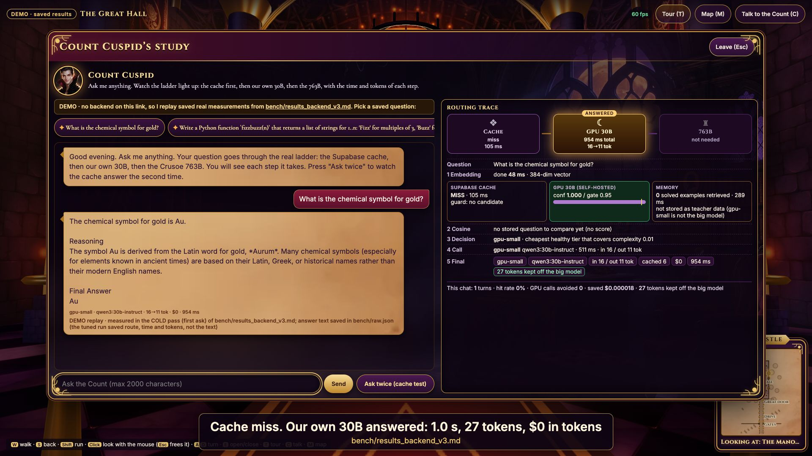
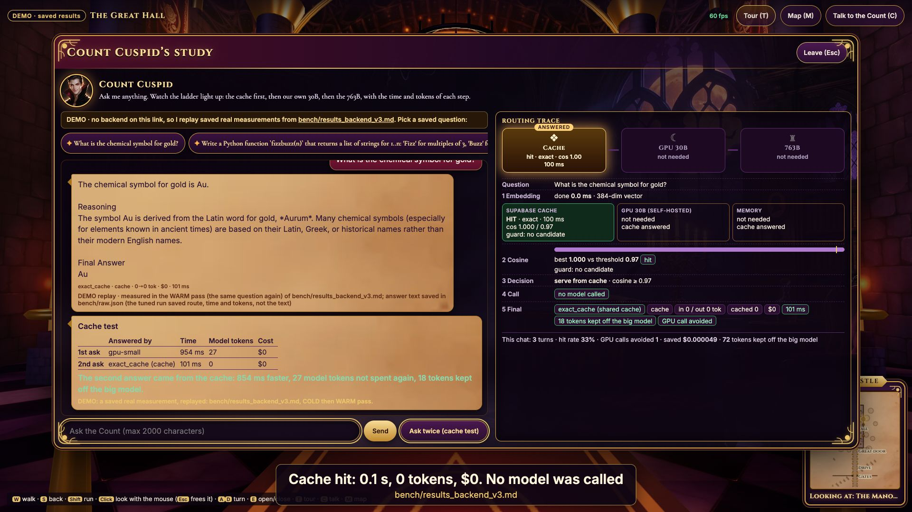
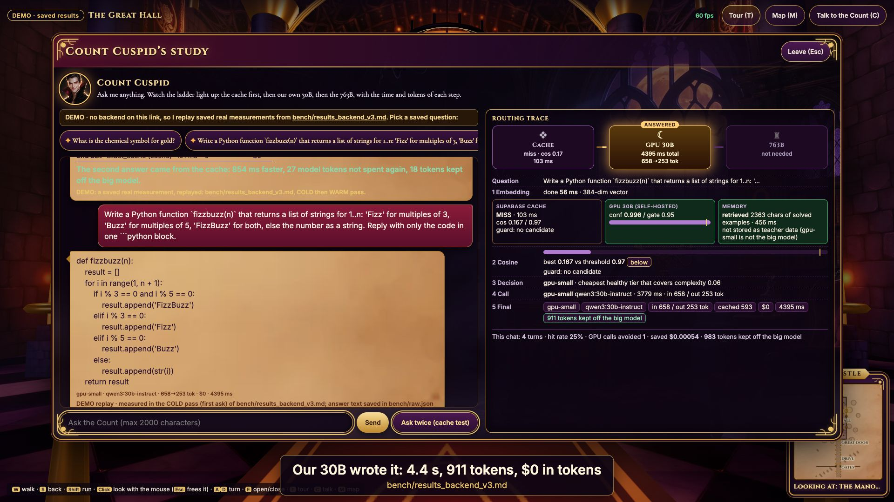
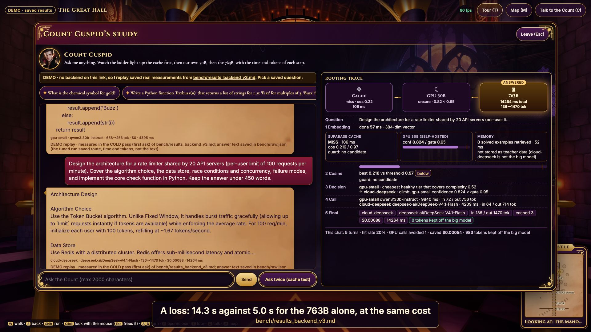
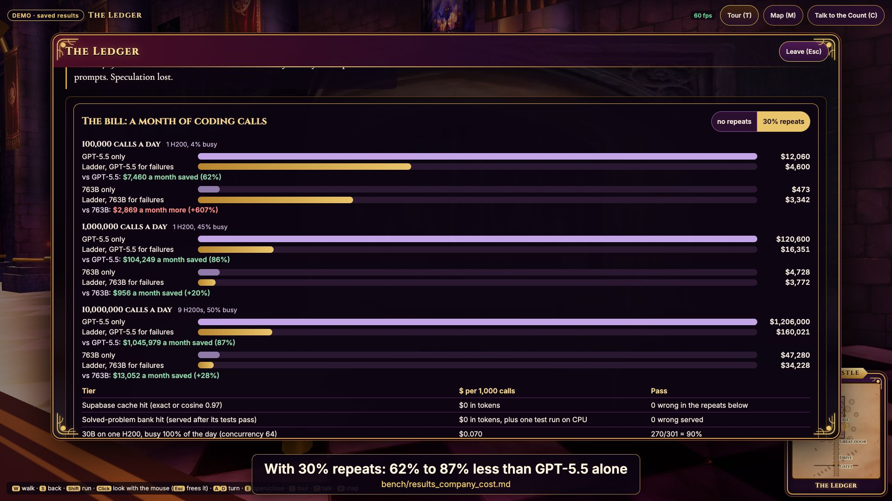
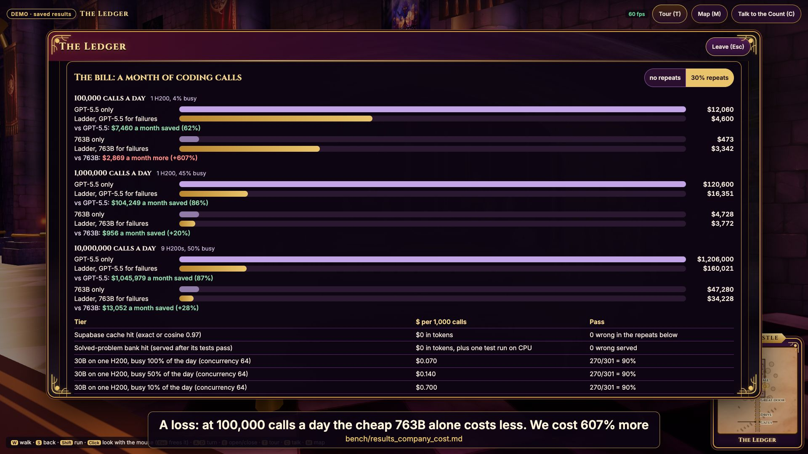
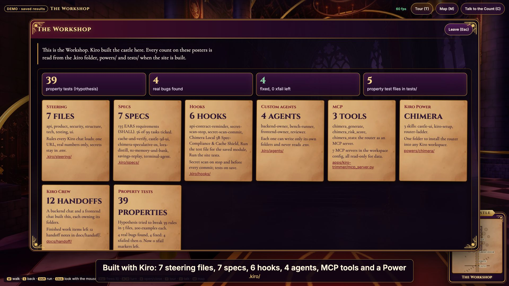
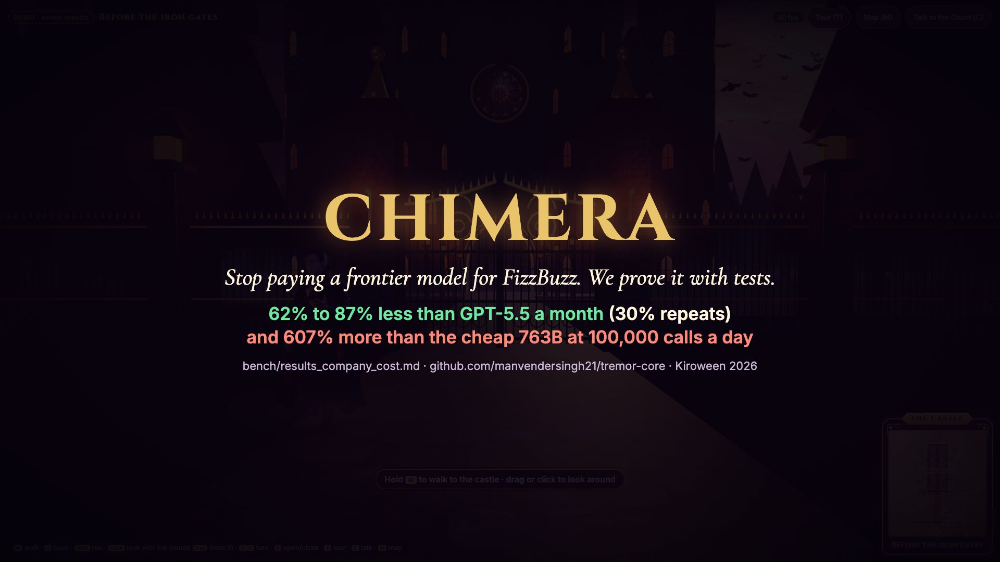

# Demo video for Kiroween 2026

The video is a silent screen recording with captions burned in. You read the narration below over it, then upload it.

| File | What |
|---|---|
| `site/docs/demo_cut.mp4` | The video. 1920x1080, 30 fps, H.264, 2:46, no sound, captions burned in. |
| `site/docs/demo_cut.srt` | The same captions as soft subtitles, for YouTube. |
| `site/docs/demo_cut.json` | When each shot and caption really started. |
| `site/docs/demo_shots/` | One still per shot. |
| `scripts/demo_record.py` | Records it again: `.venv/bin/python scripts/demo_record.py` (about 3 minutes). |

## How it was made

- The page is the castle site in DEMO mode (`?demo=1`). Every `/api/*` request was blocked, as on GitHub Pages. No model, no GPU and no network job ran.
- The Count's chat replays saved events. For this video its saved questions are the real `/api/chat` events of the tuned ladder run, repeat 1 (`bench/results_backend_v3.md`; the rows sit in the git-ignored `bench/.scratch/backend_v3/repeats/ladder_r1/`). The chat says on screen that it is a replay and names that file.
- The answer text in the chat comes from `bench/raw.json`, because the tuned run saved route, time and tokens, not the text. The chat says this on screen too.
- The public link's chat still offers its own 6 saved questions (from `bench/results_backend.csv`). FizzBuzz and the climb are only in this video.
- Frames come from the Chrome DevTools screencast at 59.9 fps on the Mac GPU. ffmpeg made them a steady 30 fps. The walk-in took 3.9 s of held W.

## Shots and timings

| # | Time | Screen | Caption on screen | Number | Source |
|---|---|---|---|---|---|
| 1 | 0:00-0:10 | Painted landing, gates shut, "Hold W" | the pitch, then "Hold W to walk in" | none | `site/` |
| 2 | 0:10-0:22 | One walk-in: gates open, drive, great door, Great Hall | "Each gold door is a room of measured numbers" | none | `site/game/` |
| 3 | 0:22-0:44 | Count's chat: "What is the chemical symbol for gold?" | cache miss, 30B answered | 0.95 s, 27 tokens, $0 | `bench/results_backend_v3.md` |
| 4 | 0:44-1:00 | Same question, "Ask twice" | cache hit | 0.10 s, 0 tokens, $0 | `bench/results_backend_v3.md` |
| 5 | 1:00-1:20 | FizzBuzz | 30B wrote it; 763B alone; GPU box price | 4.4 s, 911 tokens, $0 in tokens; 763B 1.5 s, $0.00013; box $0.18-0.52 per 1,000 calls | `bench/results_backend_v3.md`, `bench/results_akash_tuning.md` |
| 6 | 1:20-1:45 | Hard task (rate limiter design) | 30B unsure, climbs; a loss | confidence 0.82 < 0.95; 14.3 s vs 5.0 s, same cost ($0.00088) | `bench/results_backend_v3.md` |
| 7 | 1:45-2:13 | The Ledger: monthly bill, 30% repeats | win, then loss | 62% to 87% less than GPT-5.5; 607% more than the 763B at 100,000 calls a day | `bench/results_company_cost.md` |
| 8 | 2:13-2:33 | The Workshop | built with Kiro; bugs | 7 steering, 7 specs, 6 hooks, 4 agents; 4 bugs found, 4 fixed | `.kiro/`, `docs/handoff/property-tests.md` |
| 9 | 2:33-2:46 | Closing card over the landing | pitch, win, loss | 62% to 87%; 607% more | `bench/results_company_cost.md` |

The saved rows behind shots 3 to 6 (repeat 1 of the tuned run):

| Shot | Prompt id | First ask | Second ask | 763B alone (BASE) |
|---|---|---|---|---|
| 3, 4 | `e2` | gpu-small, 955.6 ms, 16 in / 11 out, $0 | exact cache, 101.9 ms, 0 tokens | 1,023 ms, $0.0000155 |
| 5 | `c2` FizzBuzz | gpu-small, 4,396.6 ms, 658 in / 253 out, confidence 0.996, $0 | | 1,543 ms, $0.000132 |
| 6 | `h2` rate limiter | 30B 9,840 ms (72 in / 756 out, confidence 0.824), then 763B 4,209 ms (64 in / 714 out); 14,264.5 ms, $0.000875 | | 5,043 ms, $0.000878 |

## Narration to read

Read at a calm pace. Start each line when its shot starts. About 330 words.

**Shot 1 (0:00).** "Companies pay a frontier model for every coding call, even FizzBuzz. CHIMERA answers each call at the cheapest place that gets it right."

**Shot 2 (0:10).** "The whole app is one page. You walk in like a movie. Hold W. The gates open, then the great door. Every gold door is a room of measured numbers."

**Shot 3 (0:22).** "I ask the Count a question. The call climbs a ladder: our shared cache first, then our own 30B, then the big 763B. The cache has not seen this one. So our 30B answers, in about one second. No token bill."

**Shot 4 (0:44).** "Now the same question again. The cache answers in a tenth of a second. Zero tokens. No model was called. In three repeats, 58 or 59 of 60 repeat questions came from the cache, with zero wrong answers."

**Shot 5 (1:00).** "FizzBuzz. Our own 30B writes it in 4.4 seconds, with no token bill. The 763B alone is faster, 1.5 seconds, but it bills every call. Our tuned GPU box costs 18 to 52 cents per thousand calls when it is kept busy."

**Shot 6 (1:20).** "Now a hard design task. The 30B tries first, but it is not sure: 0.82, under our 0.95 bar. So the call climbs to the 763B. Here is a loss. That took 14 seconds, against 5 for the 763B alone, at the same cost."

**Shot 7 (1:45).** "Here is the bill for a month of coding calls. With a 30B on rented H200s, and 3 in 10 calls being repeats, we spend 62 to 87 percent less than GPT-5.5 alone. Now the loss. Against the cheap 763B, at 100 thousand calls a day, we cost more: 607 percent more. And our 30B fails about 1 in 10 coding tasks, so tests must catch those."

**Shot 8 (2:13).** "We built this with Kiro. Seven steering files, seven specs, six hooks, four custom agents, MCP tools and a Power. Property tests from the specs found four real bugs. All four are fixed."

**Shot 9 (2:33).** "Stop paying a frontier model for FizzBuzz. We prove it with tests. CHIMERA, for Kiroween 2026."

Numbers to check before you read them:

| Said | File | Line |
|---|---|---|
| about one second, a tenth of a second | `bench/results_backend_v3.md` rows (table above) | `e2` COLD 955.6 ms, WARM 101.9 ms |
| 58 or 59 of 60, zero wrong | `bench/results_company_cost.md` | WARM 58.7 ± 0.6 (58.0-59.0), 0 wrong |
| 4.4 s; 1.5 s | rows above | `c2` COLD 4,396.6 ms, BASE 1,543 ms |
| 18 to 52 cents per 1,000 | `bench/results_akash_tuning.md` | $0.18 to $0.52 per 1,000 calls |
| 0.82 under 0.95; 14 s vs 5 s | rows above | `h2` confidence 0.8242, 14,264.5 ms vs 5,042.7 ms |
| 62% to 87% | `bench/results_company_cost.md` | "If 30% of calls are repeats, the saving is 62%, 86% and 87%" |
| 607% more | `bench/results_company_cost.md` | h = 30% table, 100,000 row: -$2,869 (-607%) |
| 1 in 10 wrong | `bench/results_company_cost.md` | failed 31 of 301 |
| 4 bugs, 4 fixed | `docs/handoff/property-tests.md` | 4 found, 4 fixed, 0 xfail left |

## The A6000 result (not in yet)

`bench/results_a6000.md` does not exist yet. When it lands:

1. Take one line from it, with its number, for example the "0 wrong answers" result.
2. Record again with that line on the closing card:
   `.venv/bin/python scripts/demo_record.py --closing-extra "<the line> (bench/results_a6000.md)"`
3. Add one sentence to the shot 9 narration, before "Stop paying…": the same line, said aloud.

The card prints the line in green under the win and the loss. Everything else stays the same.

## YouTube

**Title:** CHIMERA: stop paying a frontier model for FizzBuzz (Kiroween 2026)

**Description:**

> CHIMERA sends each AI coding call to the cheapest place that gets it right: a shared Supabase cache, then a self-hosted 30B, then the 763B DeepSeek-V4.1-Flash on Crusoe. Every number in this video comes from a result file in the repo, and the losses are shown next to the wins.
>
> - A repeat question comes from the cache in about 0.1 s with 0 tokens (bench/results_backend_v3.md).
> - With 30% repeats, a month of coding calls costs 62% to 87% less than GPT-5.5 alone (bench/results_company_cost.md).
> - Against the cheap 763B at 100,000 calls a day we cost 607% more, and the 30B fails about 1 in 10 coding tasks (bench/results_company_cost.md).
> - A hard task that climbs from the 30B to the 763B took 14.3 s against 5.0 s for the 763B alone.
>
> Built with Kiro: steering, specs, hooks, custom agents, an MCP server and a Power. Property tests from the specs found 4 real bugs; all 4 are fixed.
>
> Code: https://github.com/manvendersingh21/tremor-core
> Try it: https://manvendersingh21.github.io/tremor-core/
> Made for Kiroween 2026.

## Steps only you can do

1. **Record your voice.** Play `site/docs/demo_cut.mp4` and read the narration above into QuickTime (File, New Audio Recording). Save it as `voice.m4a`.
2. **Join voice and video.** In the repo folder:
   `ffmpeg -i site/docs/demo_cut.mp4 -i voice.m4a -map 0:v -map 1:a -c:v copy -c:a aac -b:a 192k demo_final.mp4`
   Keep `demo_final.mp4` out of git. It holds your voice.
3. **Upload to YouTube.** Paste the title and description. Set it to Public. Under Subtitles, upload `site/docs/demo_cut.srt`.
4. **Paste the link into Devpost.** Put the YouTube link in the video field of the Kiroween submission (`docs/hackathon/submission.md`).

## Stills

| | |
|---|---|
|  |  |
|  |  |
|  |  |
|  |  |
|  |  |
