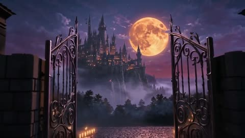
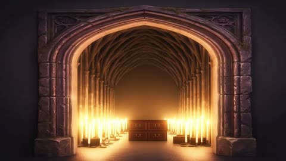
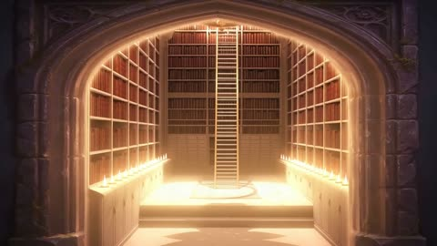
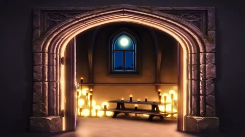
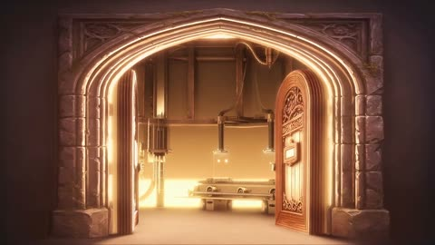
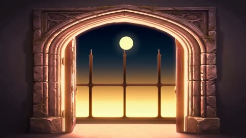
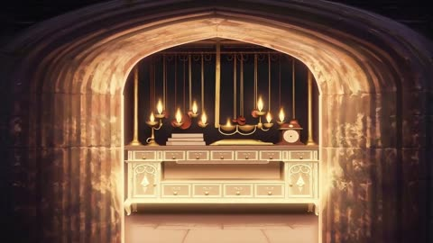
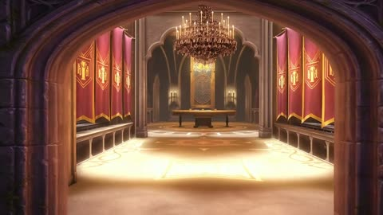
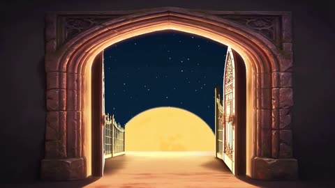

# Walk-in game clips (open model on Modal)

The walk-in game (`site/game/walk.js`, served at 127.0.0.1:8765) plays one video clip per stretch.
`a-approach` came from Seedance 2.0 on GMI. GMI then ran out of credits (HTTP 402).
The clips below came from an open model on Modal.

## Setup

| Item | Value |
|---|---|
| Model | Wan 2.1 I2V 14B 720P (`Wan-AI/Wan2.1-I2V-14B-720P-Diffusers`, diffusers) |
| GPU | 1 x H200 per clip, Modal app `chimera-video-wan` (`deploy/modal/wan_video.py`) |
| Weights | Modal volume `chimera-video-cache`, never on the Mac |
| Output | 81 frames at 16 fps (5.06 s), 1280x720, guidance 5.0, seed 7 |
| Steps | 40 for walk clips, 30 for rooms |
| Walk clips | 720p upscaled to 1920x1080 (lanczos); rooms stay 1280x720 |
| Encode | x264 crf 22, keyframe every 6 frames, no B-frames, so S scrubs backwards fast |
| Chaining | First frame of each walk clip = last frame of the clip before. Rooms start on `site/art/door.webp` |
| Run | `VIDEO_PROVIDER=modal .venv/bin/python scripts/gen_video.py run <clip>` |
| Log | `bench/.scratch/video/calls.jsonl` (git-ignored) |

Cost is H200 wall time at about $4.54 per hour (Modal list price). It includes container start and model load.
`b-gates` also includes the first weight download. The 9 rooms ran at the same time on 9 H200s.

## Clips

| Clip | Frame | Size | Wall time | About $ | Used by the game | What looks wrong |
|---|---|---|---|---|---|---|
| a-approach (Seedance, GMI) |  | 1280x720, 8 s | 269 s | 2.99 | yes | nothing seen |
| b-gates |  | 1920x1080, 5 s | 2,119 s | 2.67 | yes | gates open well, moon, sky and cliff castle kept; camera barely moves forward |
| c-drive |  | 1920x1080, 5 s | 1,479 s | 1.87 | no, moved to scratch | a stray figure in a red coat at the left in the first second; the camera stays at the gates and never walks the drive |
| d-door |  | 1920x1080, 5 s | 1,479 s | 1.87 | no, moved to scratch | colours burn out and rainbow noise spreads (error grows each chained step); still at the gates, no door |
| e-hall | none | | | | painted dolly | not made: the Modal workspace was disabled mid-run |
| room-observatory |  | 1280x720, 5 s | 1,188 s | 1.50 | yes | door opens cleanly; moon is pale, not orange; a radio mast outside |
| room-crypt |  | 1280x720, 5 s | 1,186 s | 1.50 | yes | vaulted candle crypt, fits; camera stops in the doorway |
| room-ladder |  | 1280x720, 5 s | 1,187 s | 1.50 | yes | ladder and shelves, fits; washed-out cream light |
| room-familiar |  | 1280x720, 5 s | 1,186 s | 1.50 | yes | long table and moon window, but no perches or trinkets |
| room-gpus |  | 1280x720, 5 s | 1,202 s | 1.52 | yes | workshop is pale beige, little machinery glow |
| room-tower |  | 1280x720, 5 s | 1,228 s | 1.55 | yes | moon window, but plain and flat |
| room-ledger |  | 1280x720, 5 s | 1,184 s | 1.49 | yes | candle desk, fits; walls look washed out |
| room-guild |  | 1280x720, 5 s | 1,179 s | 1.49 | yes | banners, chandelier and long table, best of the rooms |
| room-gate |  | 1280x720, 5 s | 1,198 s | 1.51 | yes | opens onto a flat yellow moon and small gates, no castle |

Modal total: about $19.95 for 12 clips.

All rooms share one look: the same arch, bright cream light, and the camera stops in the doorway. They do not end on their own painting. Wan 2.1 I2V takes a first frame only.

## Browser check (headless Chromium, real key presses, 2026-11-15)

- All 13 clips load in the page. Seeks to 20, 50, 90, 60, 30 and 5 % landed within 0.15 s on every clip.
- W held 8 s, then S held 4 s, on 127.0.0.1:8765: 58 to 60 fps (17 one-second samples, min 58).
- `walk.js` sees `a-approach` and `b-gates` as clips. `c-drive`, `d-door` and `e-hall` stay painted dollies, as set in `walk.js` (`clip: false`).
- New play-through: `site/docs/game_walk.mp4` (6.2 s, 60 fps captured, W to the hall doors in 4.4 s). It does not open a room.

## What still looks wrong

- The drive and door stretch: Wan does not move the camera far from a first frame. c-drive and d-door are not usable, and chaining made d-door worse.
- e-hall was never made.
- c-drive.mp4 and d-door.mp4 were moved to `bench/.scratch/video/rejected/`, so `gen_video.py run` makes them again.
- Fix to try: pin both ends with Wan 2.1 FLF2V (first and last frame), with `site/art/drive.webp` and `site/art/hall-grand-1.webp` as anchors, instead of chaining last frames.

## GPU off

The Modal workspace was disabled at 02:42 PST during e-hall. `modal app stop -y chimera-video-wan` was run.
`modal app list` then showed `chimera-video-wan` as `stopped`, 0 tasks, stopped 2026-11-15 02:42 PST.
