# One URL, a 3D castle: proof

Everything is one page at http://127.0.0.1:8765, started by `make web`. Captured 2026-11-14 with `scripts/capture_castle.py` (headless Chromium driven over the DevTools protocol, real key events, the Mac GPU through ANGLE Metal, 1280x720).


`castle3d.gif`: 193 frames, 29.6 s, 6.85 MB. Waits for the model are sped up.

## Frame rate

| Measured | Value |
|---|---|
| fps over the whole walk (1 s samples) | min 58, mean 60 |
| Renderer | WebGL 2, pixel ratio capped at 1.25, one 1024 shadow map, 13 point lights |
| Where | headless Chromium on this Mac (ANGLE Metal). A visible browser window was not measured. |

Open `/?dev` to see the fps counter in the top bar.

## The walk

| Step | Screenshot |
|---|---|
| Outside the gate | 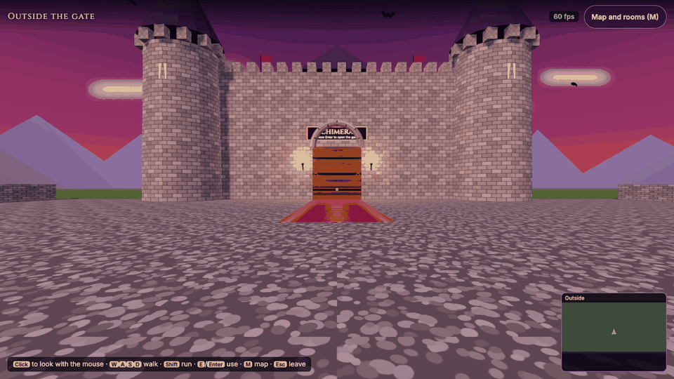 |
| Enter opens the gate | 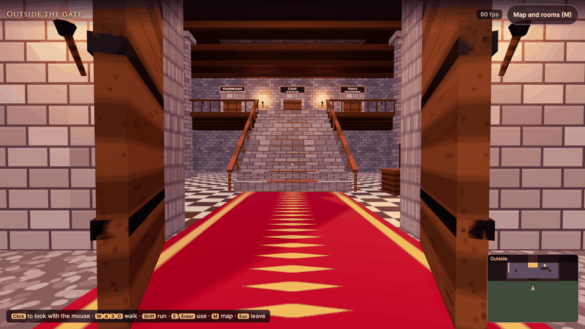 |
| The guide's desk in the Great Hall | 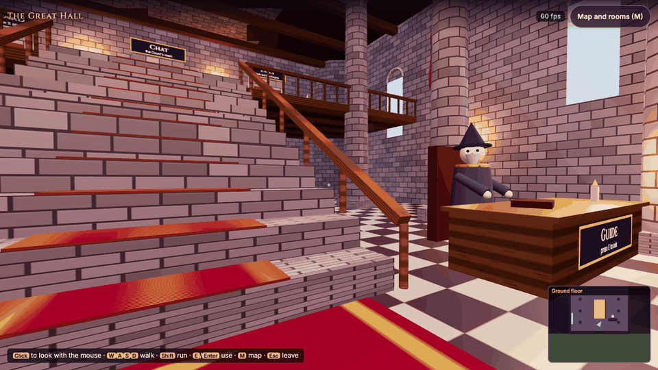 |
| The savings board (live `/api/stats`) | 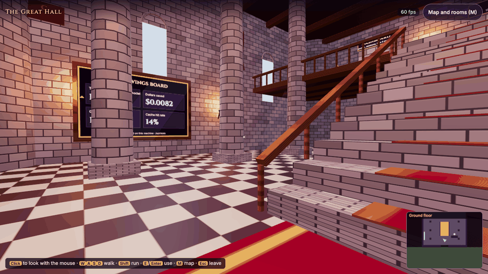 |
| The grand staircase | 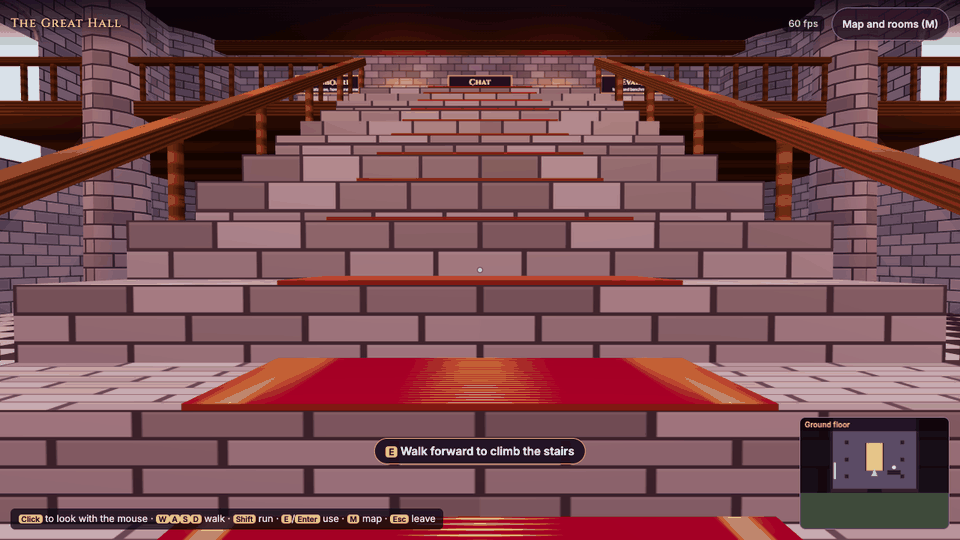 |
| The three doors on the upper gallery | 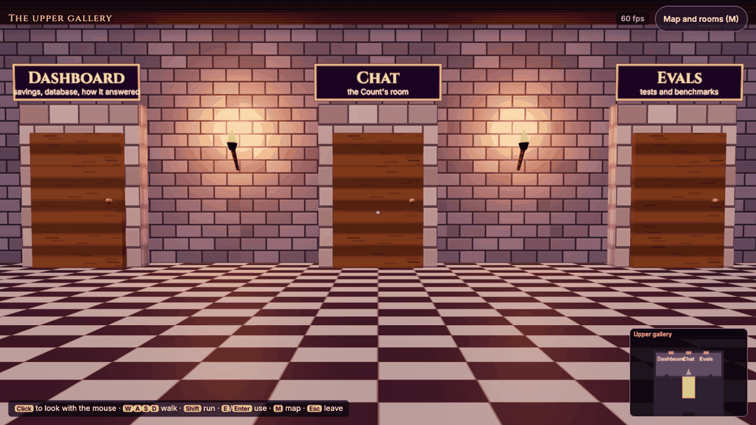 |
| Map (M): both floors, doors, stairs, you | 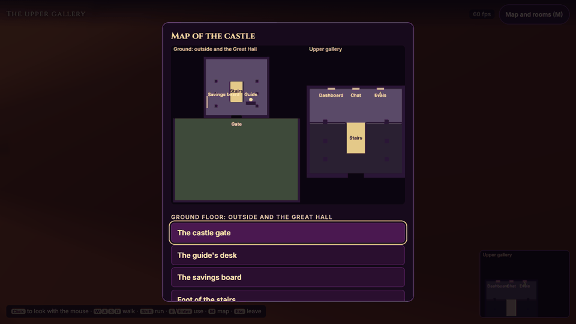 |

## The guide answers through the real ladder

Close to the desk, E opens the guide's chat ([castle_guide_near.png](castle_guide_near.png)). The question "What is the capital of Kenya?" missed the Supabase cache (best cosine 0.582 against 0.97). The self-hosted GPU 30B answered it: "The capital of Kenya is Nairobi." The tag reads `gpu-small · qwen3:30b-instruct · 15→8 tok · $0 · 83505 ms`. The GPU box is shared, so the call was slow.

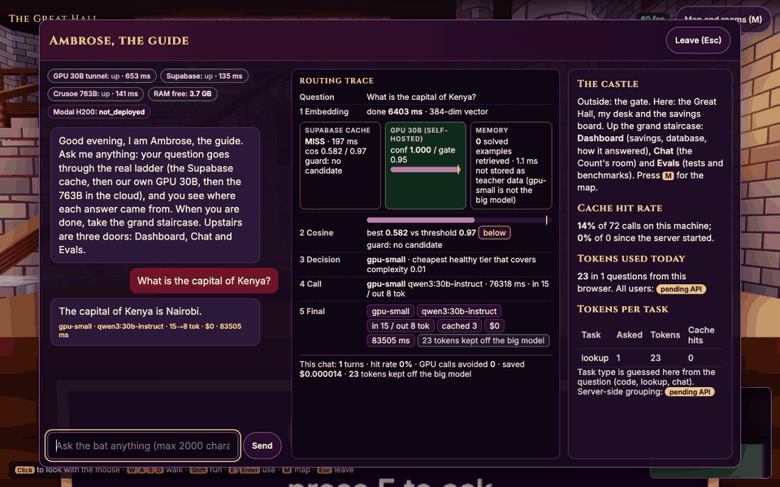

## The three doors

| Door | What it shows | Screenshot |
|---|---|---|
| Chat (the Count's room) | Chat over `/api/chat` with the live trace. "What is the capital of Poland?" was a Supabase exact HIT (cos 1.000) in 110 ms with "GPU call avoided". Side panel: cache hit rate, tokens used today, tokens per task. | 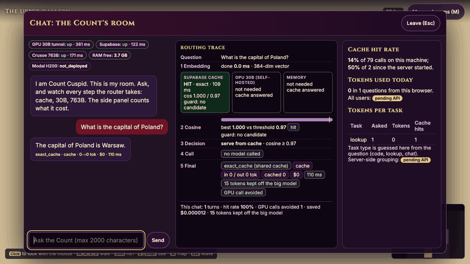 |
| Dashboard | `/api/stats` totals, tokens saved over time (`/events`), database size, "how it answered" traces for recent questions, then the live ledger | 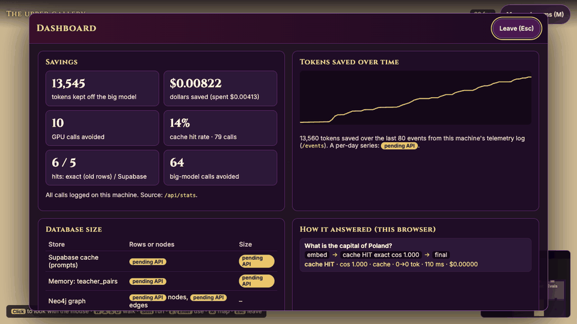 |
| Evals | Benchmarks and the eval log (`/api/bench`, `/api/evals`) | 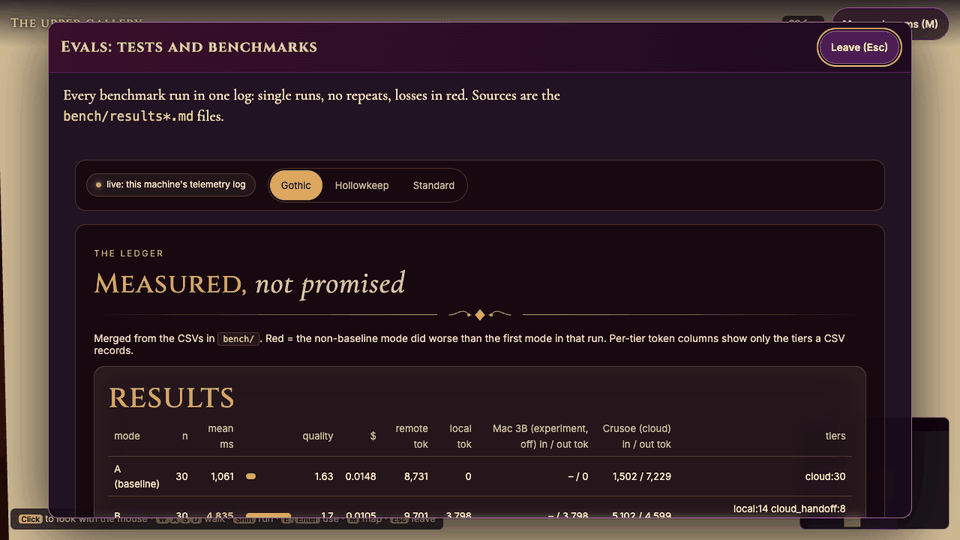 |

Fields marked "pending API" are not served by the backend yet. They are requested in `docs/api.md` ("Requested by the frontend"): Supabase rows and size, teacher_pairs rows, Neo4j node and edge counts, recent traces from the server, tokens used today for all users, and tokens per task. Until they arrive, the page shows only what it can measure itself. Hit rate and totals come from `/api/stats`. Traces, tokens today and tokens per task come from this browser's own questions, and are labelled that way.

## No second UI

```
$ curl -s -m 3 -o /dev/null -w '%{http_code}' http://127.0.0.1:9000/
000
exit 7
$ curl -s -m 3 -o /dev/null -w '%{http_code}' http://127.0.0.1:9001/
000
exit 7
$ curl -s -m 3 -o /dev/null -w '%{http_code}' http://127.0.0.1:8765/
200
```

Exit 7 means nothing is listening. `git grep` finds no reference to ports 9000 or 9001 in the repo, so those were ad-hoc servers that are gone now. The old dashboard file `apps/phantom-phone/hud-web/index.html` only redirects to `/#walk/observatory`, which opens the Dashboard door.

## Not checked

- Only Chromium was tried, headless. No phone, no visible window, no Safari or Firefox.
- The touch joystick and drag-to-look were not tested on a touch screen.
- The plain fallback (no WebGL) was checked only by the test that the static sections stay in `index.html`.
