# One URL: the walk-in castle

Everything is one page at http://127.0.0.1:8765, started by `make web`. You are the camera. You walk from the painted landing through the iron gates, up the lantern drive, in at the great door, and along the Great Hall. Each gold-plated door opens a room.

Captured 2026-11-14 by `scripts/capture_game.py walk`: headless Chromium driven over the DevTools protocol with real key presses, the Mac GPU through ANGLE Metal, 1280x720.

**Play-through video: [game_walk.mp4](game_walk.mp4)** (49.8 s, 6.9 MB). It runs from W at the landing to the Observatory, then a room, a question to the Count, and the map.

## What is real video and what is a painted dolly

| Stretch | Now | Source |
|---|---|---|
| a. The landing, walking up to the iron gates | **video**, Seedance 2.0, 8 s at 1080p | `site/game/clips/a-approach.mp4` |
| b. The gates open, walk through | painted dolly | `clips/a-approach-last.jpg`, with the gate leaves parting |
| c. The lantern drive, the castle grows | painted dolly | `art/gate.webp`, zooming into the castle |
| d. The great door opens | painted dolly | `art/door.webp`, with gold light pouring out |
| e. Along the Great Hall | painted dolly | `art/hall.webp` |
| Rooms (9) | fade into the room's painting | `art/room-*.webp` |

GMI refused the next video call with HTTP 402 (out of credits) after $3.27 of spend; see `site/art/README.md`. When credits return, run `.venv/bin/python scripts/gen_video.py run`. The page checks for each clip file and plays it instead of the dolly, with no code change.

## Frame rate

| Measured | Value |
|---|---|
| fps during the play-through (1 s samples) | min 57, mean 59.8 |
| Where | headless Chromium on this Mac (ANGLE Metal). A visible browser window was not measured. |

## Controls

| Key | Does |
|---|---|
| W (hold) | walk forward: the clip plays under your feet |
| S (hold) | walk back |
| Shift | run (double speed) |
| A, D, mouse | look around (the frame is wider than the screen); in the hall, pick a door |
| E, Enter | open the gates, the great door, the chosen door |
| T | talk to Count Cuspid (the real `/api/chat` ladder) |
| M | the map: jump to any stretch or door |
| Esc | leave a room, a panel or the map |
| Phone | joystick and an E button |

## The walk

| Step | Screenshot |
|---|---|
| The landing | 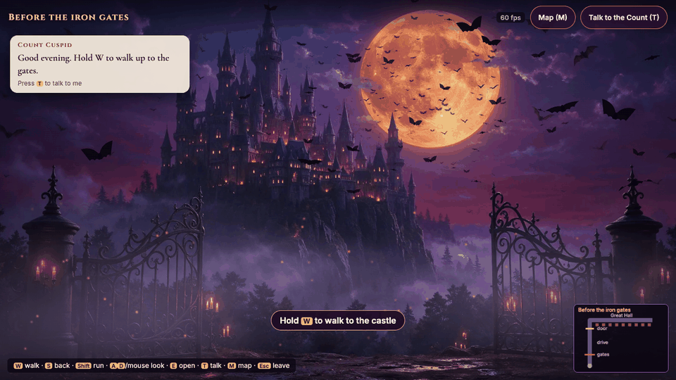 |
| At the iron gates (E opens them) | 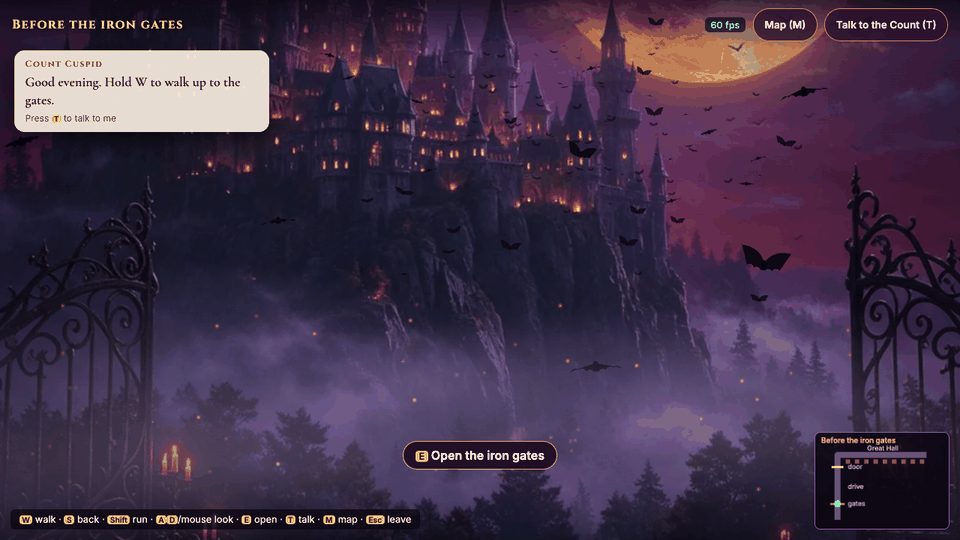 |
| Through the gates | 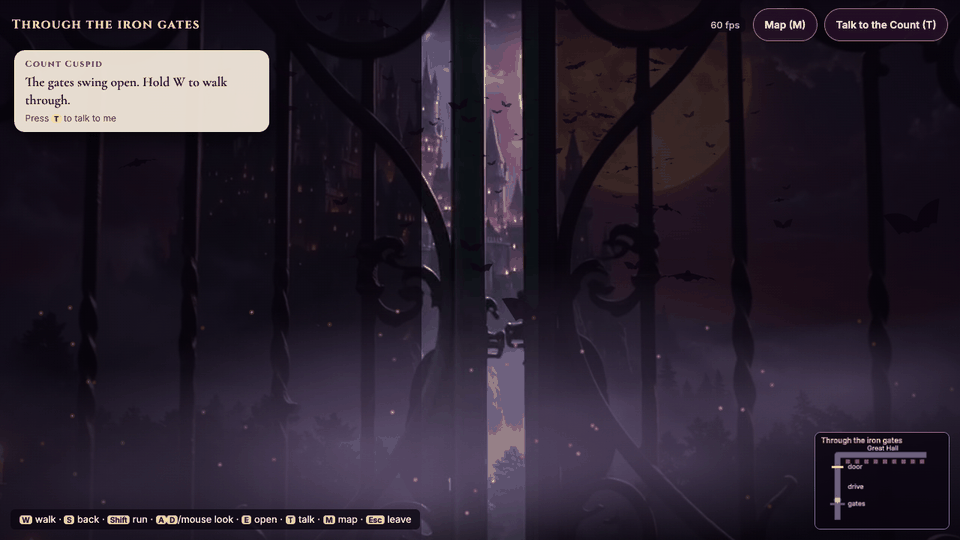 |
| The lantern drive, the castle grows | 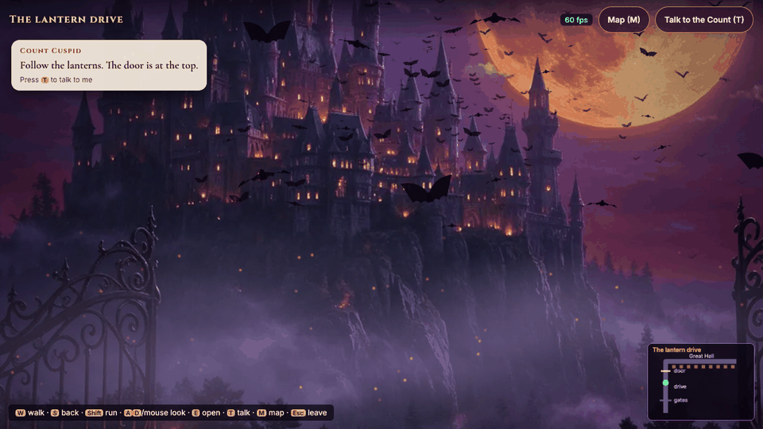 |
| Before the great door (E opens it) | 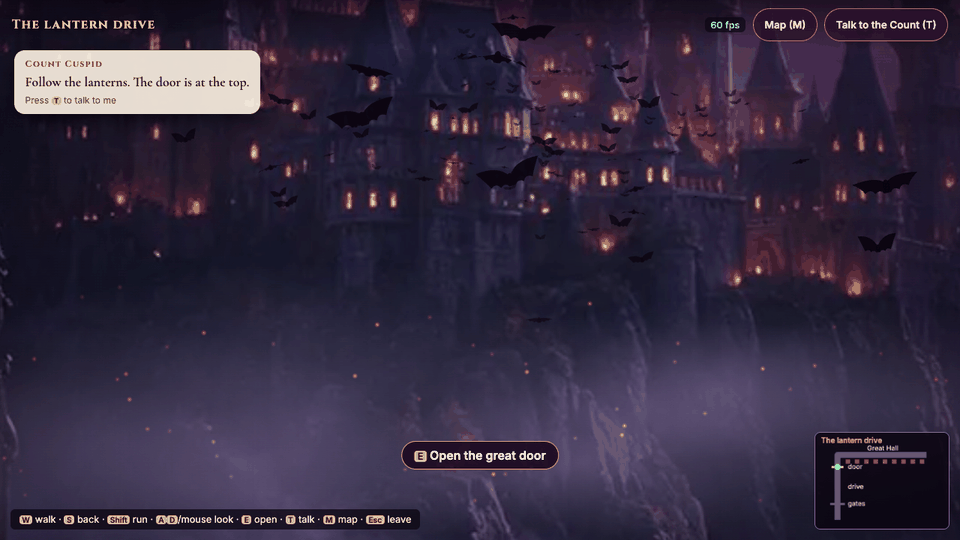 |
| The door opens | 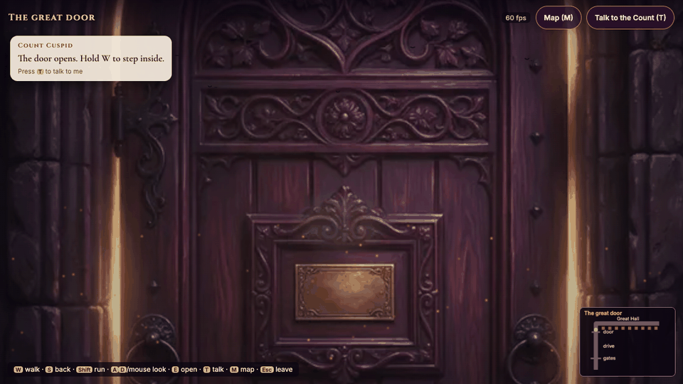 |
| The Great Hall: gold-plated doors, signs in real text | 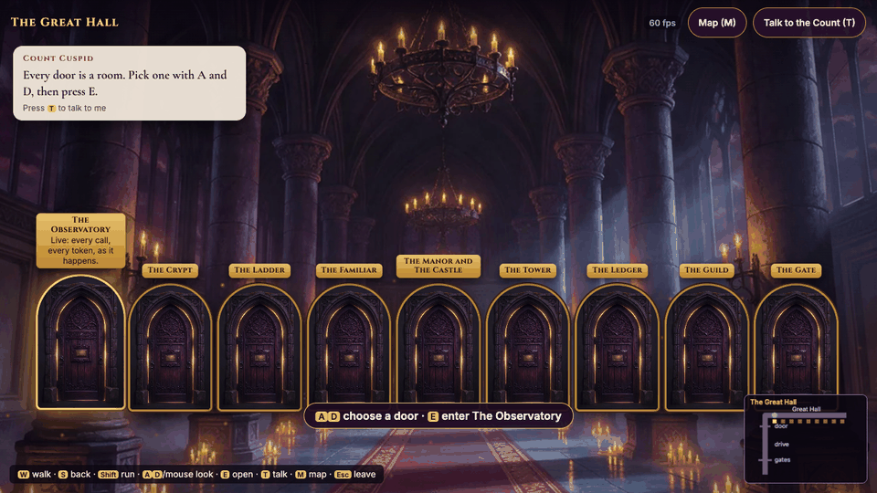 |
| The map (M) | 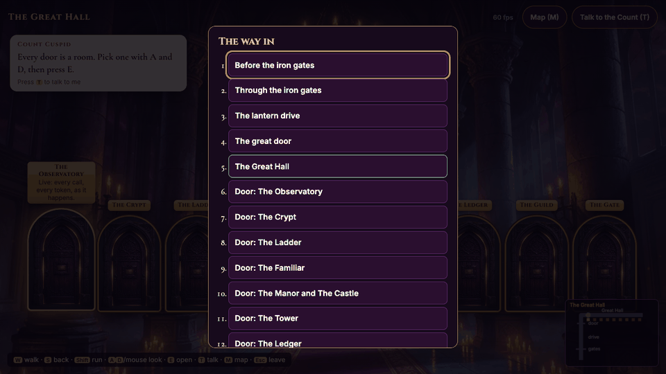 |

The corner map shows the path (gates, drive, door, hall, the doors) and a green dot for you. It is in every screenshot.

## Rooms with live data

| Room | What it shows | Screenshot |
|---|---|---|
| The Observatory | the Halloween dashboard, live from `/api/stats` and `/events`: 22,490 tokens kept off the big model, $0.0141 saved | 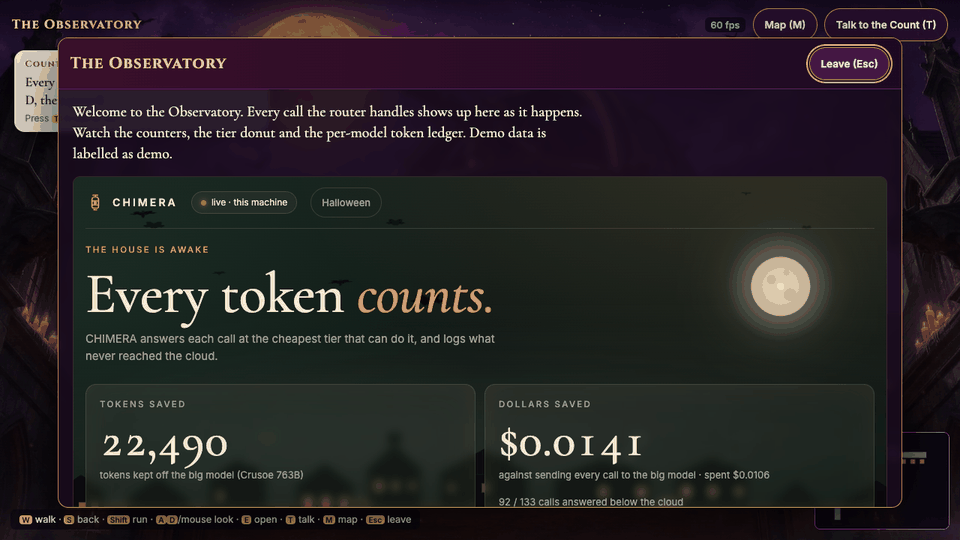 |
| The Familiar (any room) | its posters, every number linked to its `bench/*.md` source | 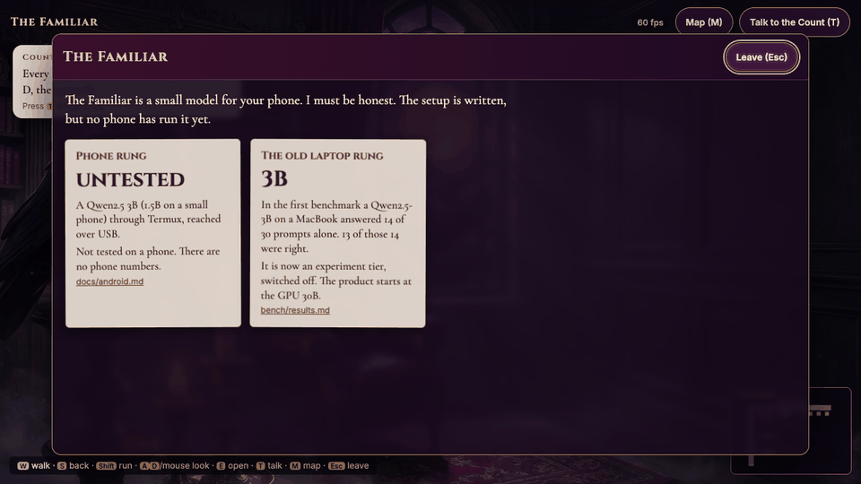 |
| The Ledger | the posters plus the dashboard's Evals tab (`/api/evals` leaderboard) | |
| The Ladder | the posters plus "How it works" with today's ladder | |

## The Count answers through the real ladder

T opens the chat. "What is the capital of Poland?" was a Supabase cache HIT (exact, cosine 1.000 against 0.97) in about 300 ms. The trace says "GPU call avoided". The answer: "The capital of Poland is Warsaw."

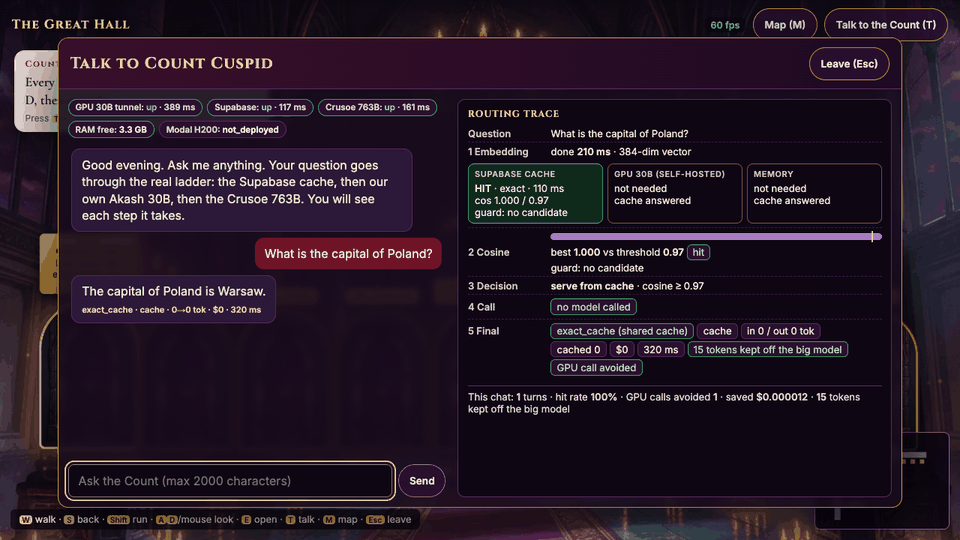

## The dashboard (also on its own at `/dashboard/halloween.html`)

Restored from commit 91205b4. Halloween is the default; the toggle switches to Standard for company demos. It shows real data, and the "demo" badge appears only when the feed is demo data. Bats flap across the sky and a small village moves along the bottom. New sections: savings over time, cache hits exact vs cosine, database size, and how it answered. Fields the backend does not serve yet carry a "pending API" chip.

| Halloween | Standard |
|---|---|
| 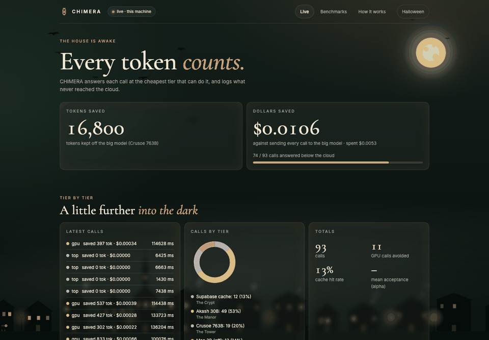 | 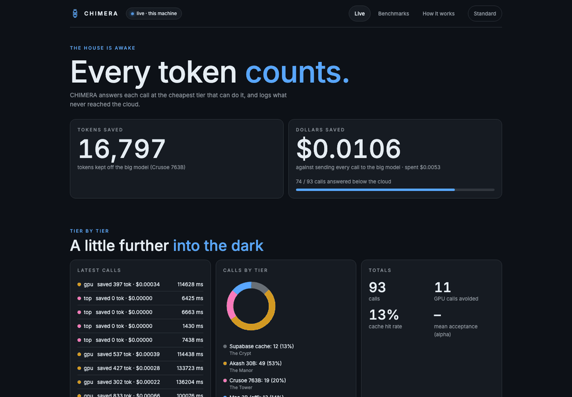 |

## No second UI

```
$ curl -s -m 3 -o /dev/null -w '%{http_code}' http://127.0.0.1:9000/
000
exit 7
$ curl -s -m 3 -o /dev/null -w '%{http_code}' http://127.0.0.1:9001/
000
exit 7
$ curl -s -m 3 -o /dev/null -w '%{http_code}' http://127.0.0.1:8765/
200
```

Exit 7 means nothing is listening.

## Not checked

- Only Chromium was tried, headless. No phone, no Safari or Firefox, no visible window.
- Four of the five walk stretches and all nine rooms use the painted dolly, not video, until GMI credits return.
- The touch joystick was not tried on a touch screen.
