# Demo mode, the Workshop, the tour and the cache test

The public link [manvendersingh21.github.io/tremor-core](https://manvendersingh21.github.io/tremor-core/) opens the castle with no backend. The same page on `127.0.0.1:8765` (`make web`) shows live data. One page, one URL each, no second server.

## What was built

| Part | Where | What it does |
|---|---|---|
| Saved results | `site/demo.py` -> `site/demo.json` (built by `python3 site/build.py`) | Reads committed files only: `bench/results_backend.csv` (COLD + WARM passes, 120 calls), `bench/results_company_cost.md` (cost per 1,000 calls; monthly bill at 100k, 1M and 10M calls a day, with 0% and 30% repeats), `bench/results_backend.md` and `docs/vector-store.md` (cache hit rates), `bench/results_bank.csv` and `.md` (bank runs), `bench/results_spec_modal.md` (Phase A table), `bench/results_memory.md` (stored counts), `bench/raw.json` and `bench/prompts.jsonl` (saved questions and answers), and git-tracked `.kiro/`, `powers/`, `tests/test_props_*.py`, `docs/handoff/` (Workshop counts). No number is typed: a report that changes shape fails the build. |
| LIVE or DEMO | `site/mode.js` | `GET /api/stats` answers: LIVE badge and live numbers. No answer (Pages, or backend down): "DEMO · saved results" and `demo.json`. If the backend drops mid-session the page falls to DEMO within one board refresh (5 s) and goes back to LIVE when `/api/stats` answers again (checked every 10 s). `?demo=1` forces DEMO. |
| Demo chat | `site/world/chat.js` | In DEMO the Count replays 6 saved questions. The first ask replays the COLD row, asking again replays the WARM row, each labelled with its file. Any other question gets "In demo mode I can only replay the saved questions". The old made-up MOCK reply is gone. |
| Ask twice (cache test) | `site/world/chat.js` | Asks one question twice and shows a table: who answered, time, model tokens, cost, then the verdict. Live: a real miss then a real hit. Demo: the saved COLD then WARM rows, labelled as a replay. |
| The Workshop | new gold door in the Great Hall (`site/rooms.js`, `site/game/scene.js`), panel in `site/game/panels.js` | Counted at build time: 7 steering files, 7 specs (135 EARS SHALL lines, 56 of 99 tasks ticked), 6 hooks, 4 custom agents, 3 MCP tools (7 MCP servers in the workspace config), the `chimera` Power with 3 skills, 11 handoff notes, 39 Hypothesis properties in 5 files, 4 real bugs found and 4 fixed (0 xfail left). |
| The tour | `site/game/tour.js`, stops in `demo.json`, script in `site/docs/tour_script.md` | T or the Tour button. The Count walks you in (the real 4 s walk), then opens every door in hall order and ends on the cost chart in the Ledger. 13 stops, 152 s of narration, 179-183 s measured with the door clips. Esc or T ends it. The narration's numbers come from the same files. |
| Room data | `site/game/panels.js` | Crypt: cache and bank tables. Tower: Phase A with key numbers (1.80x in green, 0.23x in red). Manor: the 30B's cost per 1,000 calls on each box. Ledger: the monthly bill chart; losses in red ("$2,518 a month more (+53%)" against the 763B at 1M calls a day). |
| Pages | `.github/workflows/pages.yml` | Runs on every push to `dev` (and by hand), checks `python3 site/build.py --check`, then deploys `site/`. |

The Count chat moved from T to C, because the brief gives T to the tour. `.kiro/steering/ui.md` still says "T talks to the Count"; this worker was told not to touch `.kiro/`, so its owner should update that line.

## Screenshots (from the round runs, `site/docs/ui_rounds.md`)

| Landing on the public link (WebKit) | The Great Hall, DEMO, saved run on the board |
|---|---|
| 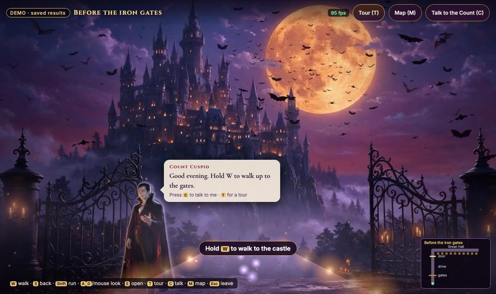 | 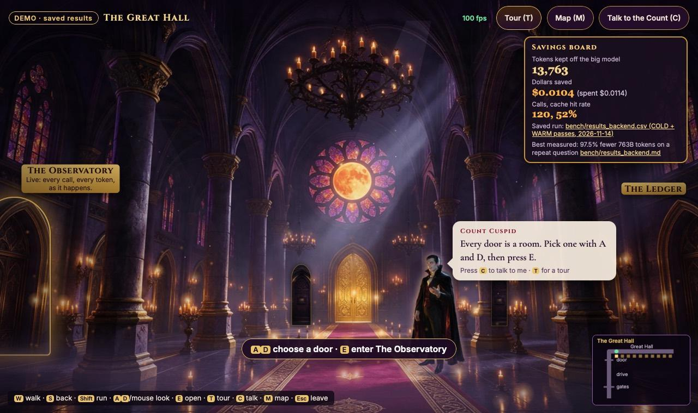 |

| The Workshop | The Crypt |
|---|---|
| 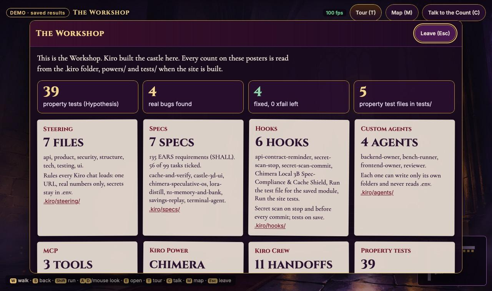 | 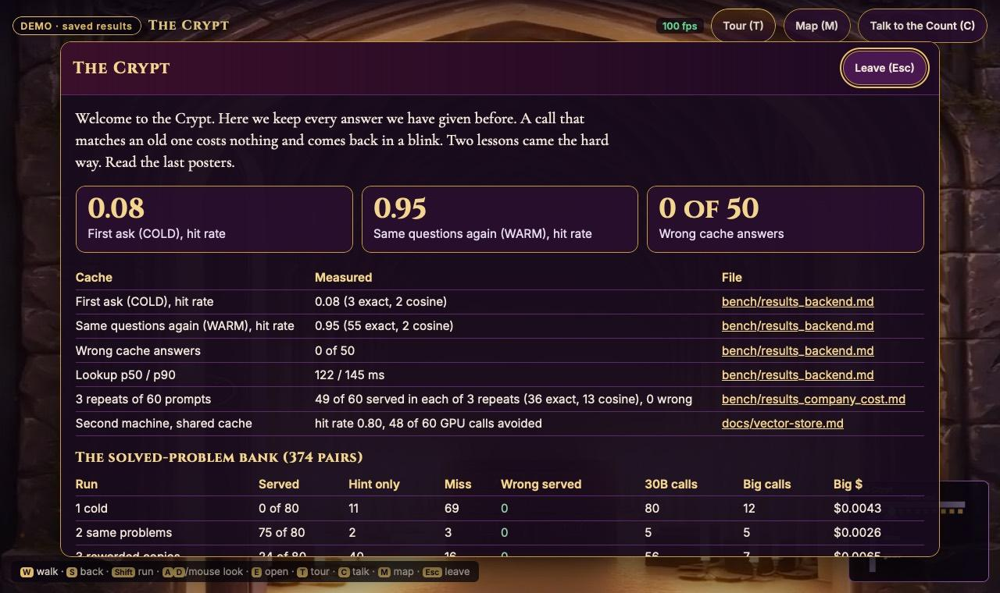 |

| Ask twice, DEMO (saved COLD then WARM) | Ask twice, LIVE (real backend: 17,220 ms on the 30B, then 217 ms from the cache) |
|---|---|
| 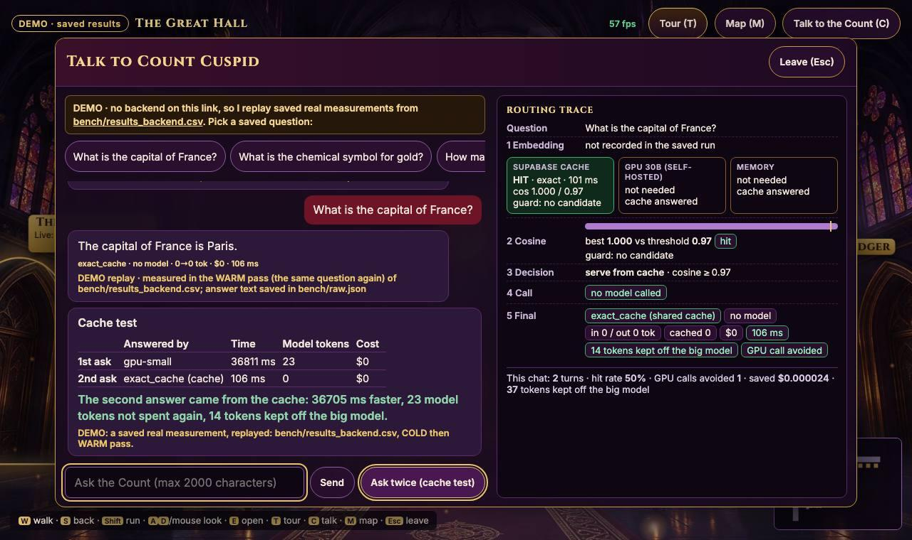 | 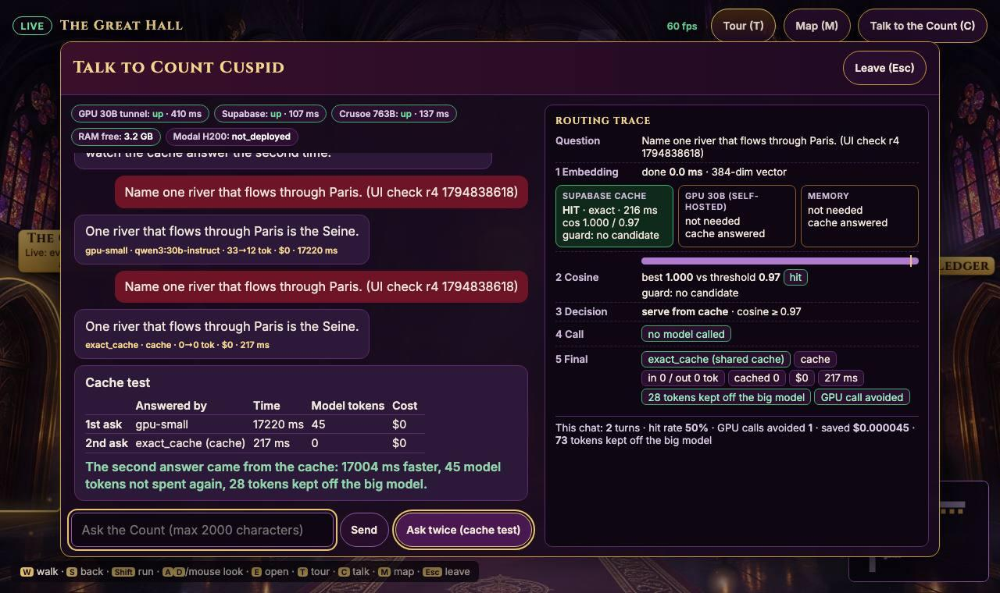 |

| The tour's last stop: the bill | Backend cut mid-session: the page falls to DEMO |
|---|---|
| 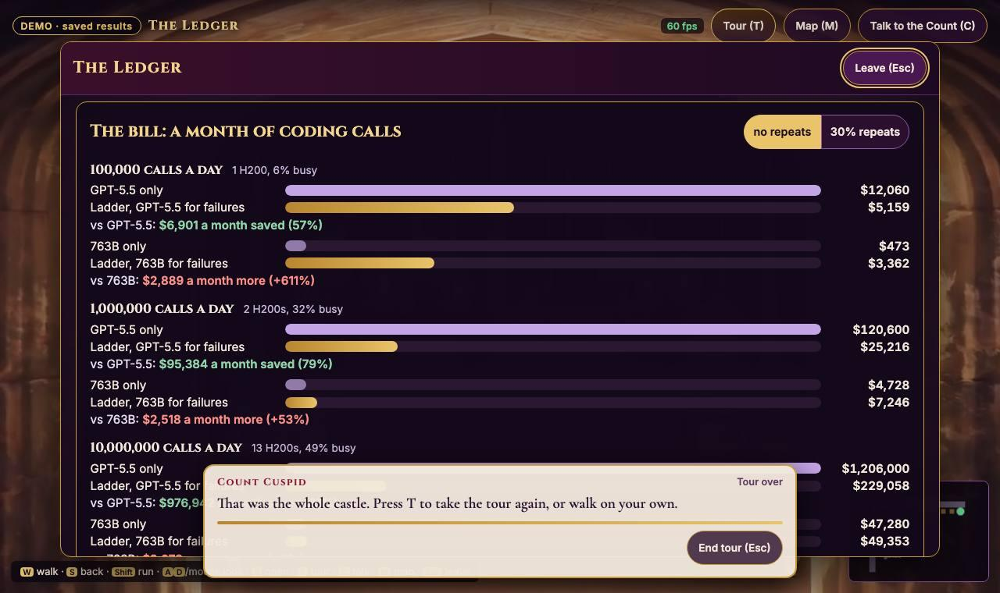 | 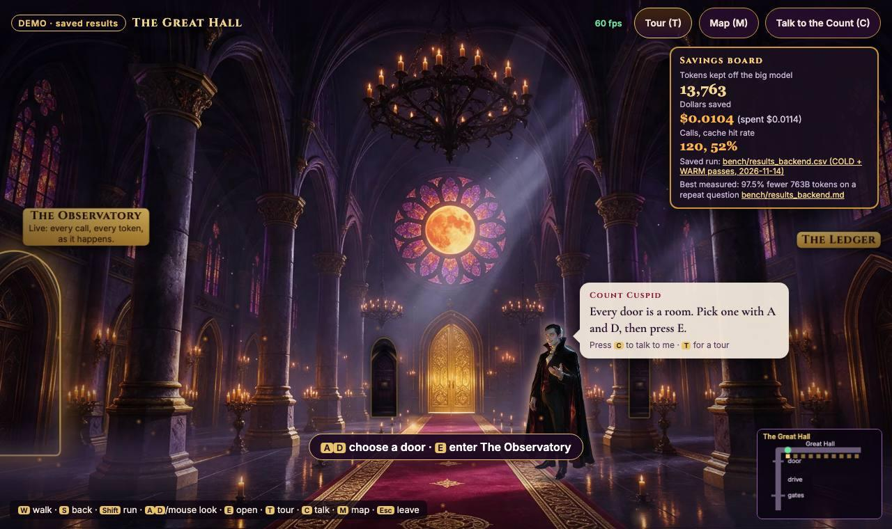 |

| Phone: landing | Phone: the hall's named doors | Phone: chat |
|---|---|---|
| 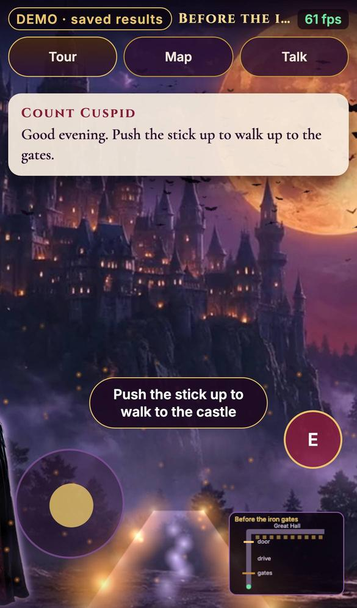 | 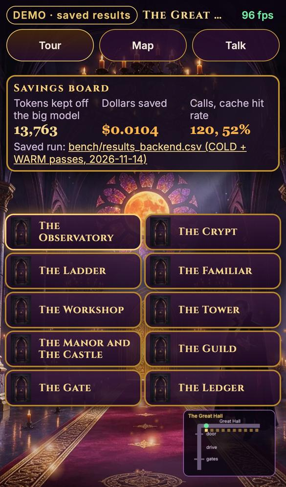 | 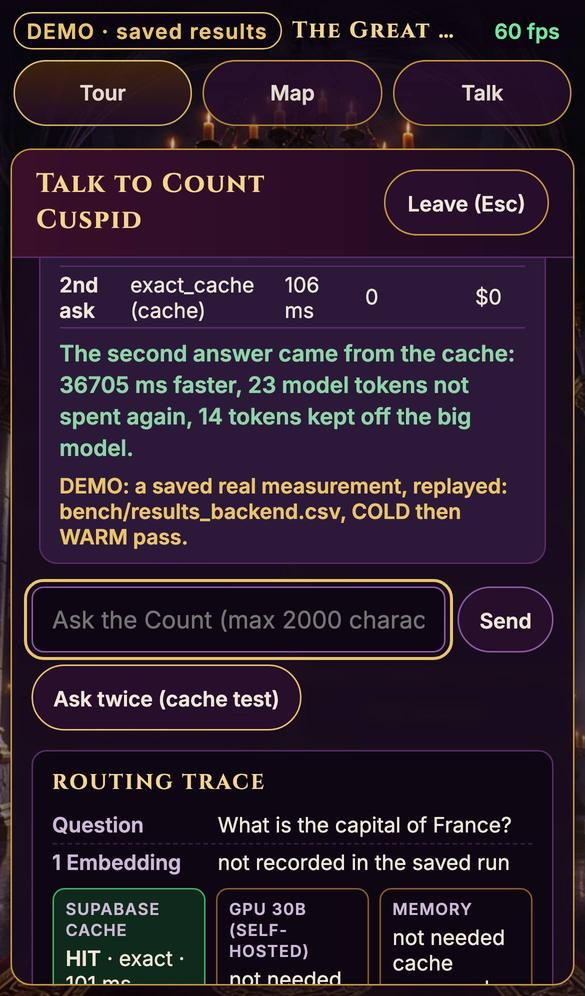 |

Videos: [the walk-in](ui_walk_in.mp4) (10 s) and [the whole tour](ui_tour.mp4) (188 s), recorded headless on the public link, build 4ce39ac.

## Measured (round 5, the Pages build of 7e54761; the final build 4ce39ac gave 0 automatic defects again: Chromium desktop full tour 182 s, WebKit phone walk-in 3.90 s)

| Browser | View | First paint | W held to the Great Hall | fps (median) | Automatic defects |
|---|---|---|---|---|---|
| Chromium | desktop 1280 x 760 | 428 ms | 3.76 s | 60 | 0 |
| Chromium | iPhone 13 (390 x 664) | 364 ms | 3.92 s | 60 | 0 |
| WebKit | desktop 1280 x 760 | 346 ms | 3.73 s | 100 (headless WebKit is not vsynced) | 0 |
| WebKit | iPhone 13 | 255 ms | 3.93 s | 100 (same) | 0 |

On a slow line (Chromium, 4 Mbit/s, 150 ms round trip, cache off; round 3) first paint was 696 ms and the walk-in 3.89 s. Each run checks: the badge, the walk prompt, every door opens and Esc leaves, the dashboards have content, the map, the chat cache test, the tour, no text under 14 px on the phone, every control has a name, no page or console errors, no failed asset request.

## Commands run

```
python3 site/build.py                 # writes index.html, results.json, demo.json, docs/tour_script.md
python3 site/build.py --check         # what CI and the Pages job run
.venv/bin/python -m pytest -q tests/test_site_demo.py tests/test_castle.py tests/test_hud.py tests/test_world.py tests/test_site_results.py
.venv/bin/playwright install chromium-headless-shell     # WebKit was already installed
.venv/bin/python scripts/ui_rounds.py r5 chromium desktop demo --url https://manvendersingh21.github.io/tremor-core/ --full-tour --video
.venv/bin/python scripts/ui_rounds.py r5 chromium phone demo --url https://manvendersingh21.github.io/tremor-core/
.venv/bin/python scripts/ui_rounds.py r5 webkit desktop demo --url https://manvendersingh21.github.io/tremor-core/
.venv/bin/python scripts/ui_rounds.py r5 webkit phone demo --url https://manvendersingh21.github.io/tremor-core/
.venv/bin/python scripts/ui_rounds.py r4 chromium desktop live          # the real backend on 127.0.0.1:8765, then /api/stats cut to 503
.venv/bin/python scripts/ui_rounds.py r3 chromium desktop demo --url https://manvendersingh21.github.io/tremor-core/ --slow
ffmpeg -ss <start> -t <len> -i <recorded.webm> -vf scale=960:-2 -c:v libx264 -crf 32 -pix_fmt yuv420p -an site/docs/ui_tour.mp4
python3 .kiro/hooks/scripts/secret_scan.py --staged                    # before every commit
gh run list --branch dev                                                # ci and pages green on each push
```

Tests added: `tests/test_site_demo.py` (demo.json and the tour script are up to date; cost rows match the report cells; chat replays are the saved CSV rows; the stats block has the `/api/stats` shape; Workshop counts match the tree; one tour stop per hall door, 150 to 200 s, ending on the chart; parsers fail loudly; Pages deploys on push to dev).
