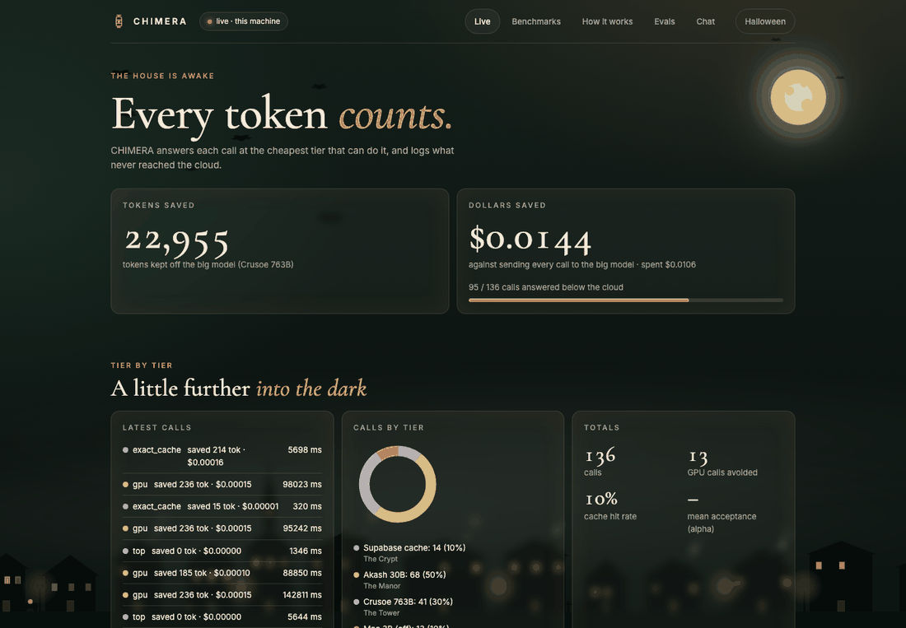
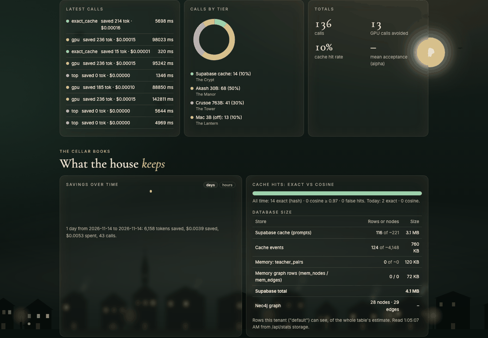
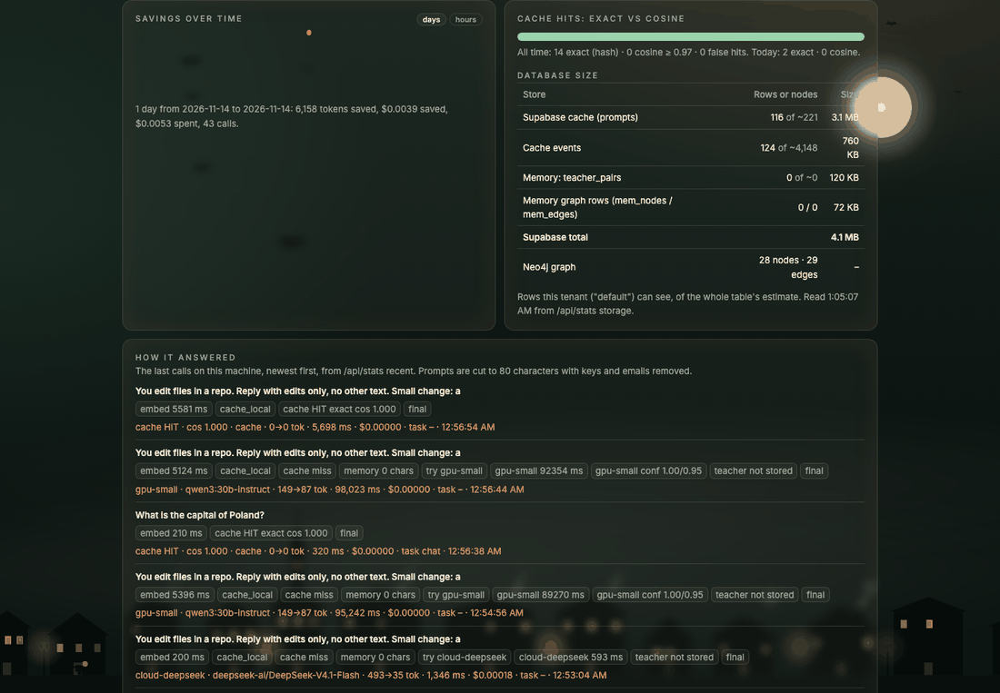
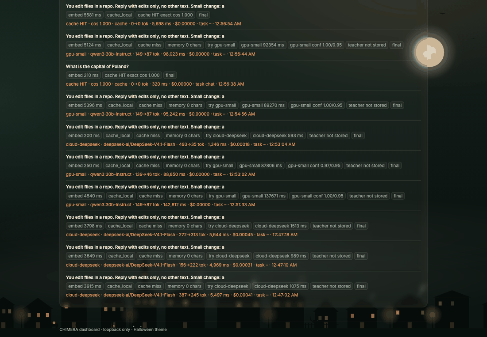
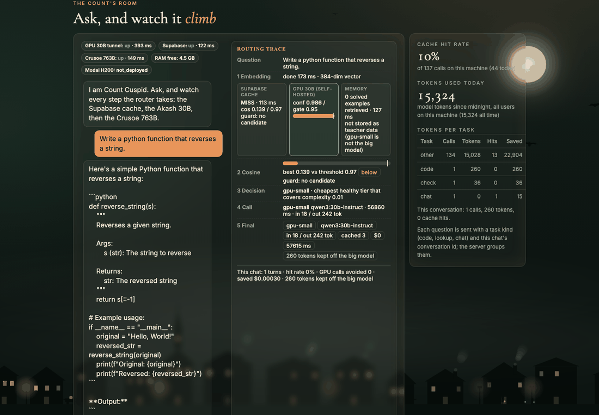
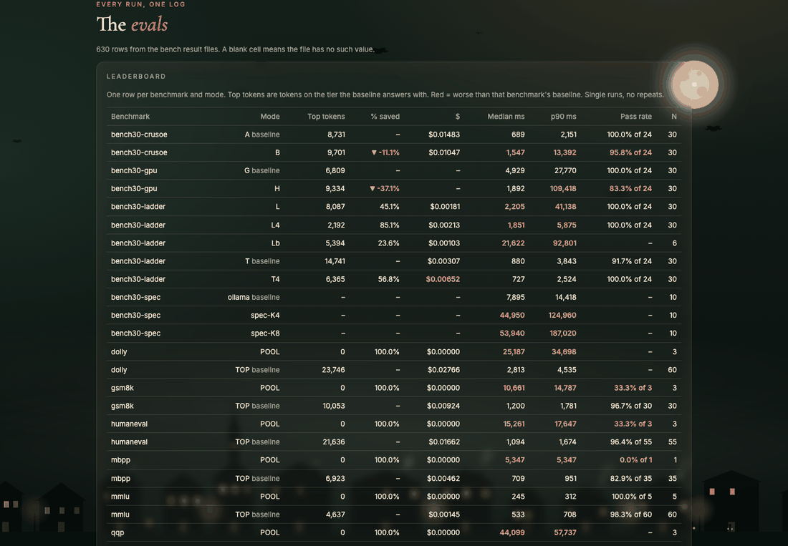
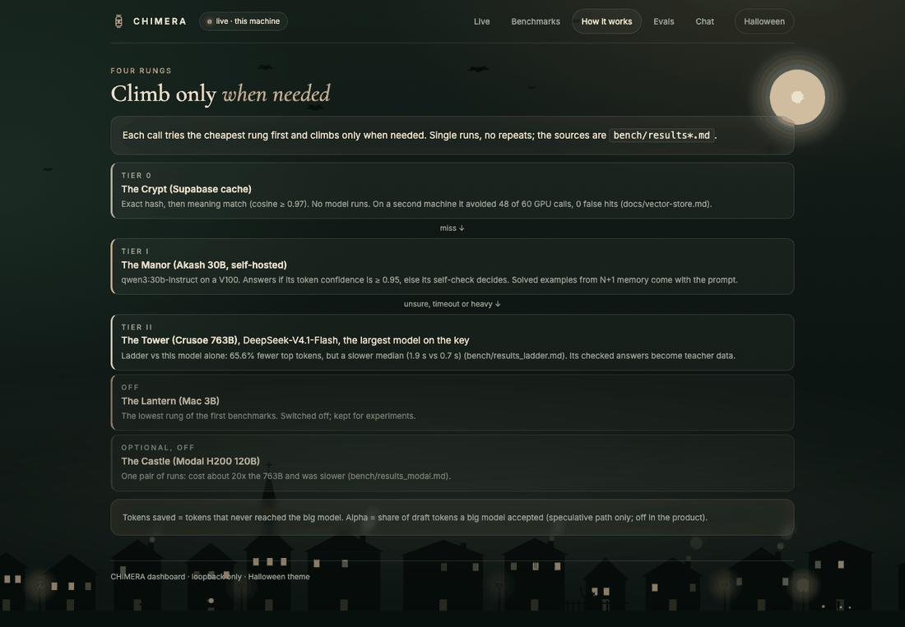
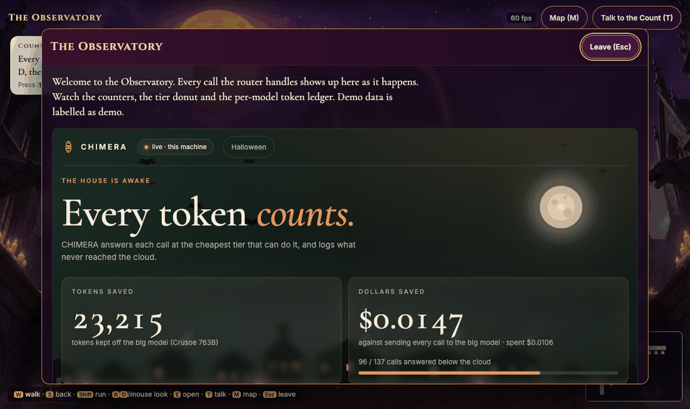

# Every panel on live data

Each panel reads the backend API from `docs/api.md`. No "pending API" chip is left:

```
$ grep -rn "pending API" site/index.html site/dashboard site/game site/world/chat.js | wc -l
0
```

Captured 2026-11-14 from http://127.0.0.1:8765 by `bench/.scratch/ui/live_shots.py`: headless Chromium, 1440x1000 for the dashboard, 1280x760 for the castle. The `/api/stats` payload read right after the screenshots is kept in `bench/.scratch/ui/stats_at_capture.json` (git-ignored). The screenshots took about a minute and one new chat call came in during them, so a few totals in the earlier shots are one call behind the payload.

## Payload at capture (`GET /api/stats`, `global` = every call on this machine)

| Field | Value |
|---|---|
| `global.calls` / `calls_today` | 137 / 44 |
| `global.tokens` / `tokens_today` | 15,324 / 15,324 |
| `global.tokens_kept_off_big` | 23,215 |
| `global.dollars_saved` / `dollars_spent` | $0.014738 / $0.010598 |
| `global.gpu_calls_avoided` | 13 |
| `global.hit_rate` | 0.1022 |
| `global.cache.all_time` | exact 14, cosine 0, false hits 0 |
| `global.cache.today` | exact 2, cosine 0 |
| `global.series.daily` | 1 day (2026-11-14): 44 calls, 6,418 tokens saved, $0.004149 saved, $0.005348 spent |
| `storage.supabase` | prompts 116 rows of ~221, 3.1 MB; cache_events 125 of ~4,148; teacher_pairs 0; total 4.1 MB |
| `storage.neo4j` | 28 nodes, 29 edges |
| `recent` | 20 calls, newest "Write a python function that reverses a string." (task `code`, `gpu-small`, qwen3:30b-instruct, 18→242 tokens, 57,615 ms) |

## Panels

| Panel | Number on screen | API field | Screenshot |
|---|---|---|---|
| Hero: tokens saved | 22,955 | `global.tokens_kept_off_big` |  |
| Hero: dollars saved, spent | $0.0144, spent $0.0106 | `global.dollars_saved`, `global.dollars_spent` | (same) |
| Hero: calls answered below the cloud | 95 / 136 | `global.calls` − `global.by_tier.top` over `global.calls` | (same) |
| Latest calls | one row per event | `GET /events` (telemetry stream) |  |
| Calls by tier (donut) | Supabase cache 14%, Akash 30B 50%, Crusoe 763B 21%, Mac 3B off 13% | `GET /events`, grouped by `tier_used` | (same) |
| Totals | 136 calls, 13 GPU calls avoided, 10% hit rate | `global.calls`, `global.gpu_calls_avoided`, `global.hit_rate` | (same) |
| Savings over time | 1 day, 6,158 tokens saved, $0.0039 saved, 43 calls; days and hours toggle | `global.series.daily`, `global.series.hourly` |  |
| Cache hits: exact vs cosine | all time 14 exact, 0 cosine, 0 false hits; today 2 exact | `global.cache.all_time`, `global.cache.today` | (same) |
| Database size | prompts 116 of ~221, 3.1 MB; cache events 124 of ~4,148, 760 KB; teacher_pairs 0, 120 KB; graph rows 0 / 0; total 4.1 MB; Neo4j 28 nodes, 29 edges | `storage.supabase.tables.*.tenant_rows`, `.rows_estimate`, `.bytes`, `storage.supabase.bytes_total`, `storage.neo4j.nodes`, `.edges` | (same) |
| How it answered | the last 10 calls, each with its steps, tier, model, cos, tokens, ms, $, task, time | `recent[]` (`prompt`, `steps`, `tier`, `model`, `score`, `tokens_in`, `tokens_out`, `ms`, `dollars`, `task`, `ts`) |  |
| Chat: cache hit rate | 10% of 137 calls (44 today) | `global.hit_rate`, `global.calls`, `global.calls_today` |  |
| Chat: tokens used today | 15,324 (15,324 all time) | `global.tokens_today`, `global.tokens` | (same) |
| Chat: tokens per task | other 134 calls / 15,028 tokens, code 1 / 260, chat 1 / 0, check 1 / 36 | `global.by_task.*.calls`, `.tokens`, `.cache_hits`, `.tokens_saved` | (same) |
| Chat: this conversation | 1 call, 260 tokens, 0 cache hits | `session.by_conversation[<this tab's id>]` | (same) |
| Chat: the answer's trace | cache miss, then gpu-small answers, 18 in / 242 out | `POST /api/chat` SSE steps | (same) |
| Evals leaderboard | one row per benchmark and mode; red = worse than its baseline | `GET /api/evals` `leaderboard[]` |  |
| How it works | today's ladder, numbers linked to `bench/*.md` | static text from the result files |  |
| Castle: the Observatory room | 23,215 tokens saved, $0.0147 saved, 96 / 137 calls below the cloud | the same dashboard inside the room (`/api/stats`) |  |

The cache numbers are true but small. All 14 cache hits so far are exact; no cosine hit has happened yet on this machine. The memory tables are still empty (`teacher_pairs`, `mem_nodes`, `mem_edges` at 0 rows) because no checked big-model answer has been stored yet.

## What changed

- `site/dashboard/halloween.html`: reads `storage`, `series`, `cache`, `recent`, `tokens_today`, `by_task` and `by_conversation` from `/api/stats`. It no longer uses this browser's local history or the telemetry stream for these panels.
- `site/world/chat.js`: every question is sent with `task` (`code`, `lookup` or `chat`, guessed from the text) and a `conversation_id` (one per browser tab), so `/api/stats` groups them.
- The walk-in castle's rooms show this same dashboard, so the Observatory, the Ledger and the Ladder are live too.

## Not checked

- Only Chromium, headless. The `hours` view of savings over time has one hour of data so far.
- `site/castle/` (the old 3D castle) still has its own panels with chips. It is off the main page and is not served from `/`.
