# Walk pacing and the new Great Hall

Measured 2026-11-15 on the one page, http://127.0.0.1:8765 (`make web`), in headless Chrome (DevTools) and in Playwright WebKit 27.2 (the Safari engine), both at 1280x720. The script is `scripts/ui_pace.py chrome|webkit walk|run`. It loads the page, holds W from the first frame and logs each moment. In `run` mode it also holds Shift. Each number below is a single run.

## Timings: from the first W

| Moment | Before, Chrome | Before, WebKit | After, Chrome | After, WebKit | After + Shift, Chrome | After + Shift, WebKit |
|---|---|---|---|---|---|---|
| Gates closed when the page loads | yes | yes | yes | yes | yes | yes |
| Great door closed when the page loads | yes | yes | yes | yes | yes | yes |
| Gates open (you reach them) | 7.85 s | 7.65 s | **1.65 s** | **1.53 s** | 0.90 s | 0.75 s |
| Great door opens (you reach it) | 20.39 s | 20.28 s | **3.15 s** | **3.06 s** | 1.68 s | 1.55 s |
| Inside the Great Hall | 28.49 s | 28.23 s | **3.67 s** | **3.53 s** | 1.93 s | 1.81 s |
| Hall doors ready to pick | 36.44 s | 36.18 s | 4.34 s | 4.26 s | 2.25 s | 2.13 s |
| E presses needed | 2 | 2 | 0 | 0 | 0 | 0 |
| S walks back out of the hall | yes | yes | yes | yes | yes | yes |
| Frames per second while walking (median / lowest) | 60 / 58 | 100 / 98 | 60 / 58 | 99 / 92 | 60 / 58 | 99 / 99 |

From the gates to the great door now takes 1.5 s, and the door is 0.5 s from the hall. WebKit headless is not held to a 60 Hz screen, so it shows about 100 fps.

How it works now (`site/game/walk.js`):
- Each stretch has its own walking time (`secs`): approach 1.5 s, gates 0.8 s, drive 0.75 s, door 0.5 s, hall 0.7 s. The walk's own clock sets the pace.
- A clip is sped up to fit its stretch through `playbackRate`. If the decoder falls behind, the video skips ahead. `win` picks the part of a clip to use: the first 2.4 s of `b-gates.mp4` is the gates swinging open.
- Shift doubles the speed. S walks the same clock backwards.
- A gate or door stays closed until you reach it, then opens by itself. E still opens it.

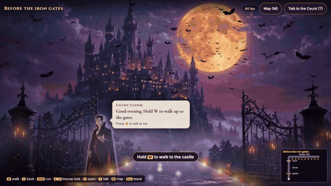

Full speed, 60 fps: [pacing_walkin.mp4](pacing_walkin.mp4). Recorded by `scripts/ui_record.py` with Chrome's screencast, keeping the real frame times. W is held from 0.8 s; the hall doors are ready 4.35 s later.

## The way in, after

| At the gates | The lantern drive | The great door, closed |
|---|---|---|
| 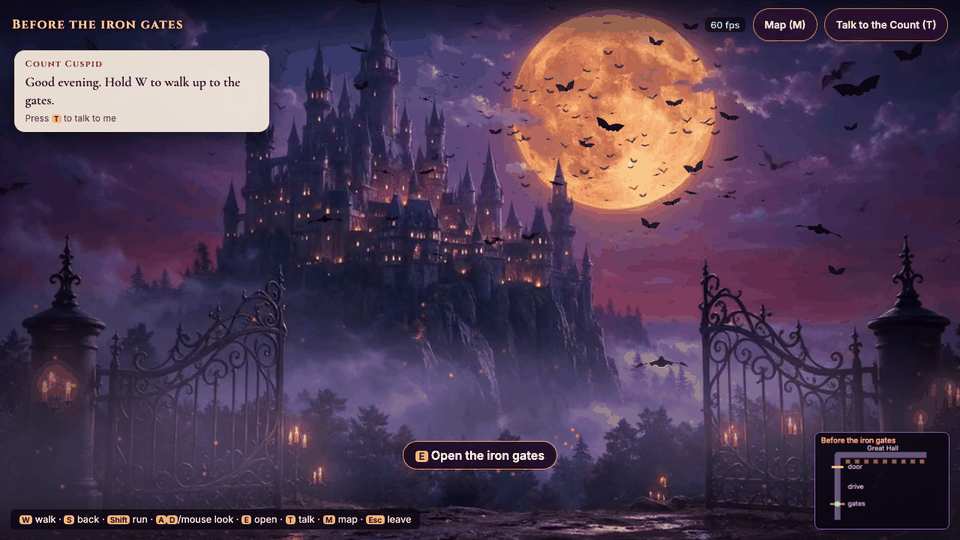 | 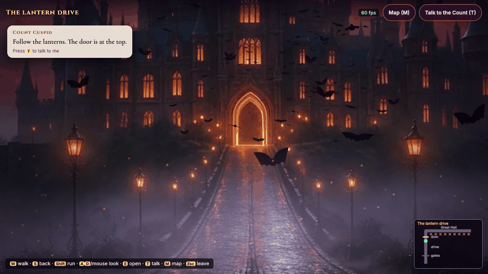 | 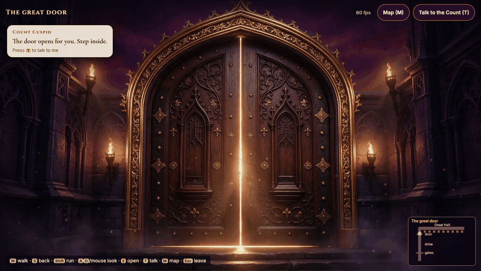 |
| **The door swings open** | **Walking through** | **Inside the hall** |
| 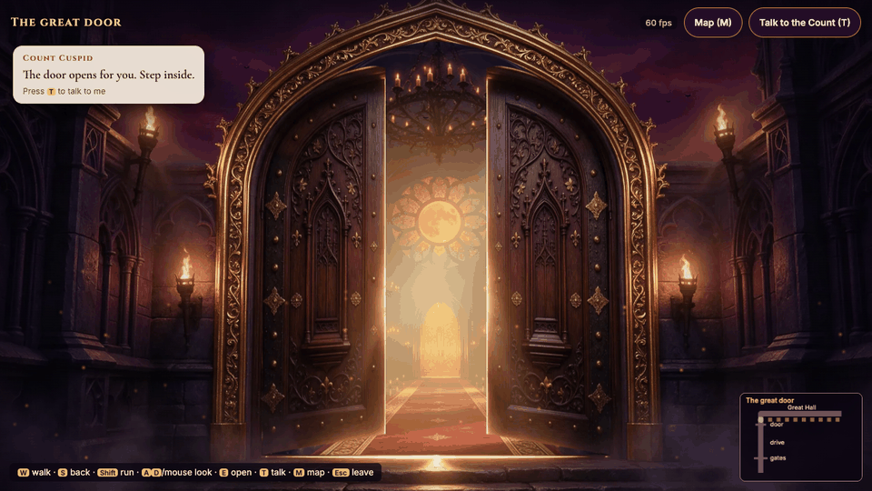 | 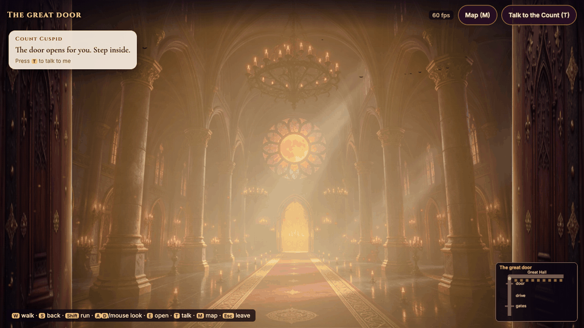 | 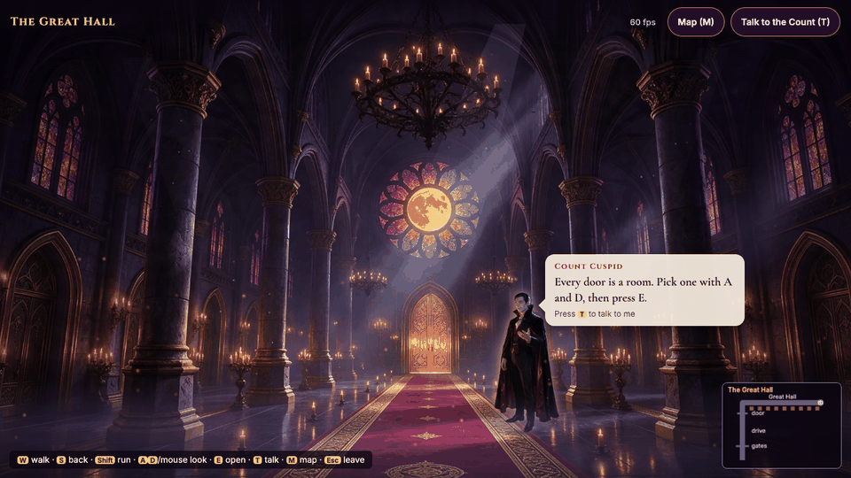 |

The great door is a new painting, `site/art/great-door.webp`. `scripts/cut_door.py` cuts it offline into a frame and two leaves (`site/game/layers/door-*.webp`), with a test in `tests/test_cut_door.py`. When you reach the door, the leaves swing inward in 3D and gold light pours out. You then walk through the doorway into the hall behind it (`site/game/scene.js`).

## The Great Hall: before and after

| Before | After |
|---|---|
| 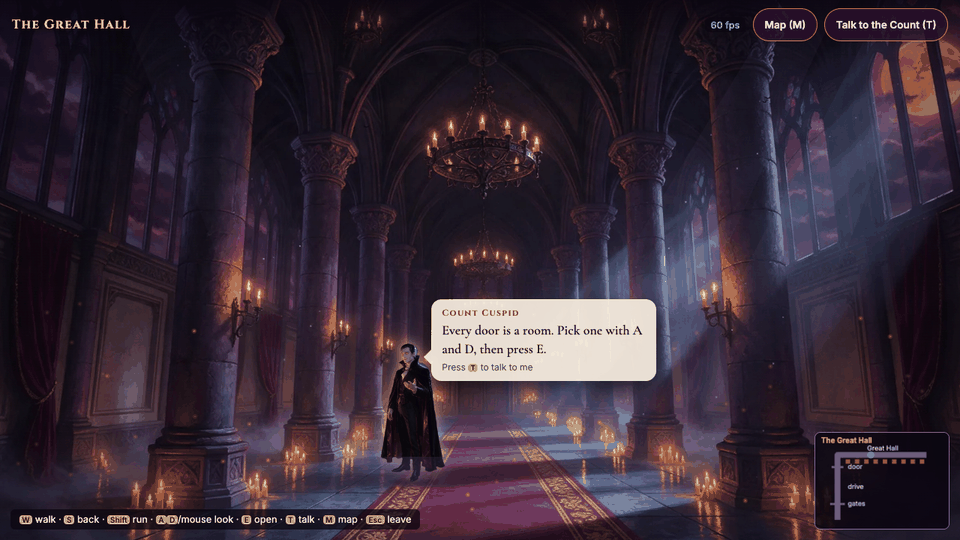 |  |
| 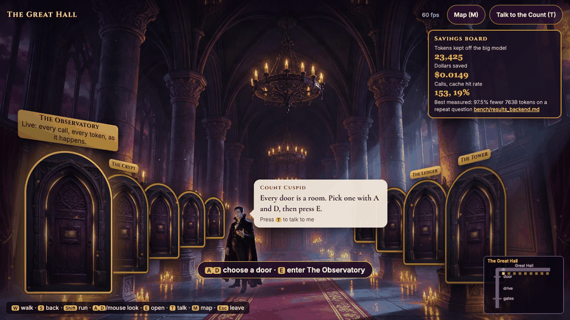 | 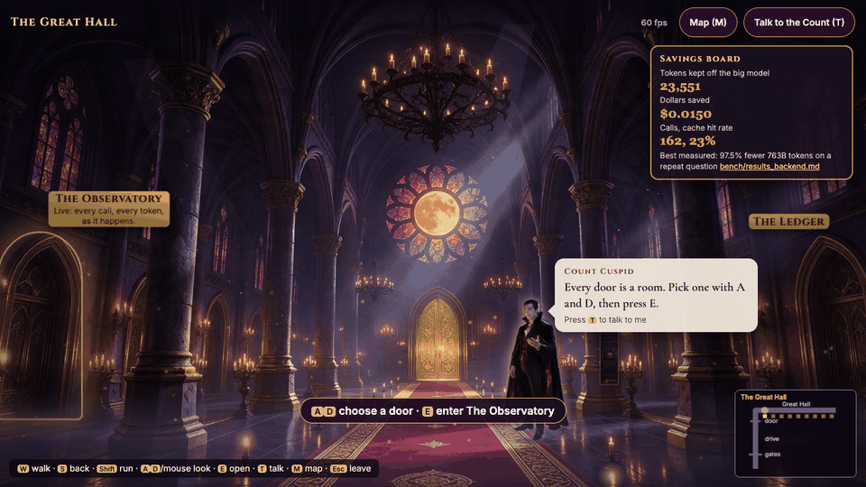 |
| | 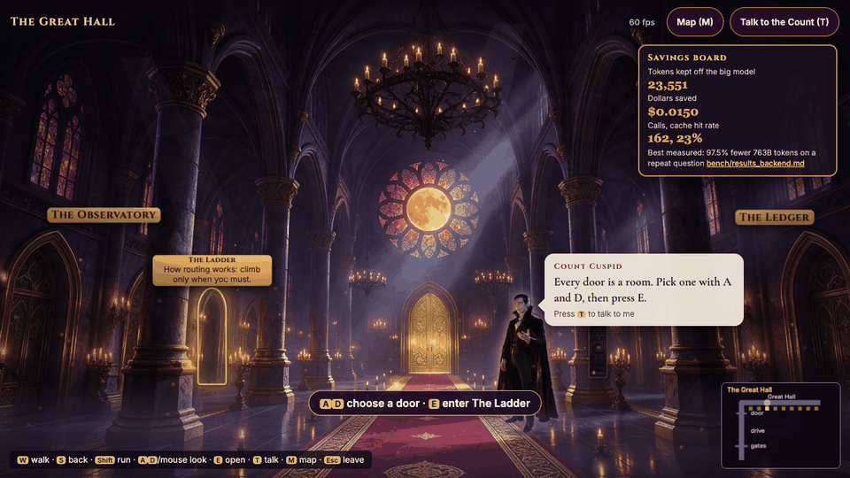 |

What changed:
- **A new painting**, `site/art/hall-grand-1.webp`. The prompt was written by MiniMax-M3 and the image was painted by Seedream 5.0 Pro on GMI (`scripts/gen_art.py --enrich hall-grand great-door`). It has soaring pointed arches, two rows of carved columns, iron chandeliers, hundreds of candles, a rose window with the orange moon, a red carpet, and gold doors along both walls. A second version, `hall-grand-2.webp`, is kept but not used.
- **The painting's own doors are the doors you pick.** Before, each door was a pasted-on door image. Now each room is tied to a painted gold door, placed by hand in `SLOTS` in `scene.js`. A/D sweeps down the left wall, across the far gold doors and back up the right wall. The chosen door lights up and shows its gold sign. Signs at the screen edge stay on screen. One spot on the right wall has no painted door, so a small gold door is drawn there.
- **Light:** every candle in the painting flickers. The page finds the bright warm spots in the image itself, about 110 of them. Shafts of moonlight follow the painted rays, with dust drifting in them, and low haze drifts along the floor. Past the great door, the whole painting is shown. The hall drifts slowly and never pauses.
- The Count waits on the carpet with his bubble. The savings board, the minimap, Count chat (T), the Evals (Ledger) and dashboard (Observatory) doors and their live data are unchanged.
- On a phone, the screen shows only the middle of the hall, so the doors stay a two-row arcade.

## Checks

| Check | Result |
|---|---|
| `scripts/ui_e2e.py webkit desktop` | 26 / 26 pass |
| `scripts/ui_e2e.py webkit iphone` | 24 / 24 pass |
| Chrome desktop, Chrome phone 390 px (`bench/.scratch/ui/e2e.py`) | 24 / 24, 22 / 22 pass |
| `scripts/ui_seams.py`: clip frames shown per second while W / S is held (Chrome, WebKit) | a-approach 61 / 61, 101 / 101; b-gates 62 / 63, 100 / 100; no gaps over 120 ms |
| Joint a-approach → b-gates (mean colour jump out of 255, the two clips crossfade over 0.25 s) | 14.9 |
| Joint b-gates → painted drive (crossfade) | 36 |
| `make test` | 231 passed, 4 xfail |
| `python3 site/build.py --check` | pass |

## Clips

- `a-approach.mp4` (8.0 s) plays in 1.5 s. The first 2.4 s of `b-gates.mp4` (5.1 s) plays in 0.8 s.
- `c-drive.mp4` landed during this work, but it is not used (`clip: false` in `SEGS`). For its whole 5 s the camera stays at the open gates and never walks up the drive to the door. The painted drive does that in 0.75 s.
- The planned `d-door` and `e-hall` clips (`site/game/clips.json`) end on the old `hall.webp`, not on the hall painted now, so they are set to `clip: false` too. To use a clip again, delete its `clip: false`.

## Not checked, and limits

- Only headless browsers were used, with no real Safari or real phone.
- The positions of the hall doors, the door leaves and the Count are placed by hand for these paintings. `shortcut: hand-placed; redo if hall-grand-1 or great-door is repainted.`
- New art cost 3 Seedream images and 2 MiniMax-M3 calls on GMI, logged in `site/art/README.md`. No GMI video was used.
