# UI polish: Safari, a walk that feels like the paintings, clean clip joints

Captured 2026-11-15 from http://127.0.0.1:8765 (the one page, `make web`, kept up by `make web-keep`).
Screens: headless Chrome over DevTools (`scripts/cdp.py`) at 1280x720, and Playwright WebKit 27.2 (the Safari engine) at 1280x760 and as an iPhone 13 (390x844, touch).

## 1. Safari / WebKit

Playwright WebKit was installed in the repo venv (`pip install playwright`, `playwright install webkit`, 82 MB in `~/Library/Caches/ms-playwright`). The check is `scripts/ui_e2e.py webkit desktop|iphone`.

**Found and fixed:** the server answered `HEAD` with 501 and sent no byte ranges. The walk asks for each clip with `HEAD`, so it never found `a-approach.mp4`, and every stretch played the still dolly in every browser. Safari also needs byte ranges to play a video at all. `apps/phantom-phone/hud-web/server.py` now serves `HEAD` and `Range: bytes=` (206, 416) for static files (`byte_range()`, test in `tests/test_hud.py`). Commit 8393db3.

| Check | WebKit desktop | WebKit iPhone 13 | Chrome desktop | Chrome phone 390 px |
|---|---|---|---|---|
| Page starts, no sideways scroll | pass | pass | pass | pass |
| Clip a-approach found and playing | pass | pass | pass | pass |
| W walks / S back / A-D look | 0 → 2.49 s, back to 1.48 s, yaw 0.44 | joystick: 0 → 2.45 s | pass | joystick pass |
| E opens gates and great door | pass | pass (E button) | pass | pass |
| Hall doors, savings board live | pass | pass | pass | pass |
| Ledger, Ladder, Observatory open with E; dashboard inside | pass (4,726 / 1,367 / 5,379 chars) | pass | pass | pass |
| Esc leaves, M map, minimap drawn | pass | pass | pass | pass |
| Count chat (T), one real question | "capital of Italy": answered, exact cache hit | same | "capital of France": Paris | pass |
| Frames per second (median, min) | 100, 93.6 | 100, 89.6 | 60, 57.8 | 60, 58.0 |
| Page errors | none | none | none | none |
| Checks passed | 26 / 26 | 24 / 24 | 24 / 24 | 22 / 22 |

WebKit headless runs unthrottled, so it shows 100 fps; Chrome is held to the 60 Hz frame clock.

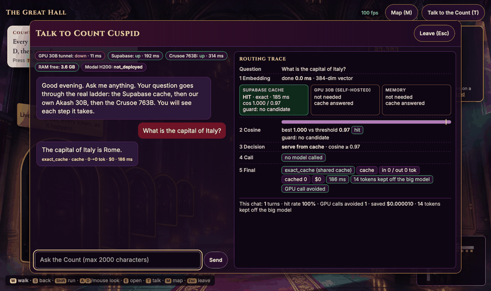
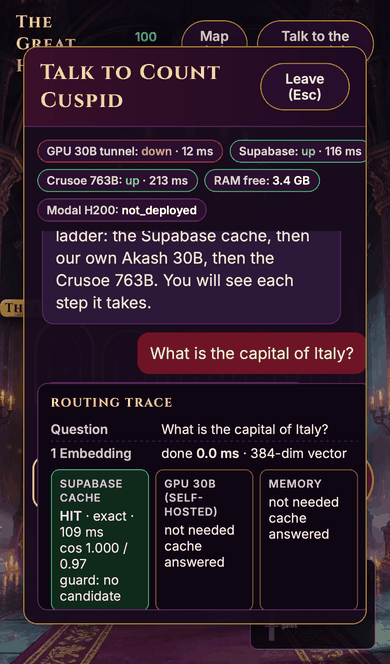 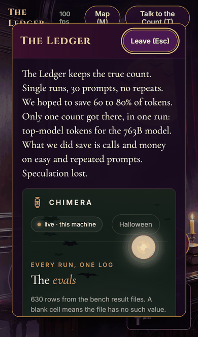

On the iPhone the Count's bubble used to show through an open panel. Now an open panel hides the bubble and the savings board.

## 2. The walk, before and after

| Stretch | Before | After |
|---|---|---|
| The landing | 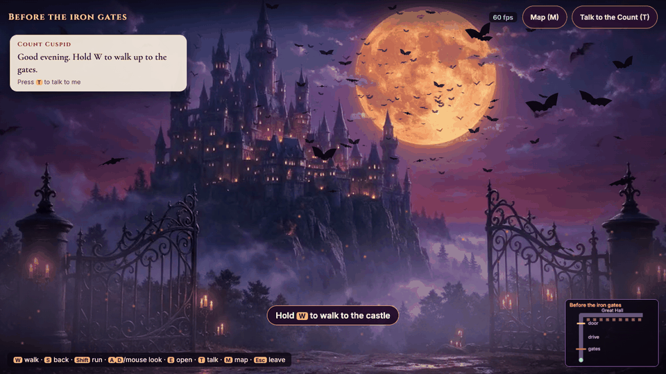 | 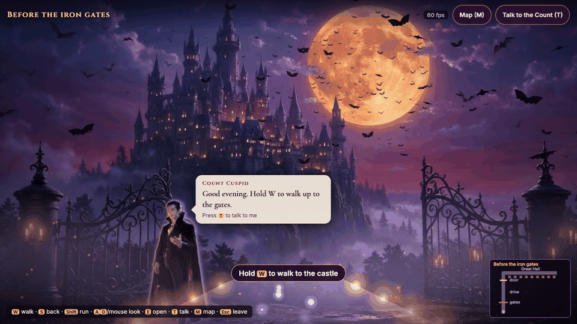 |
| At the gates | 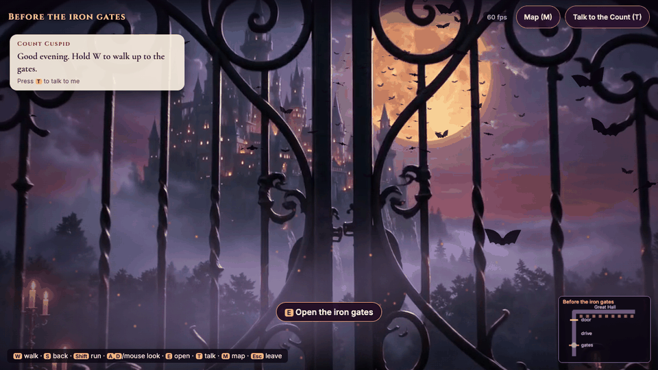 | 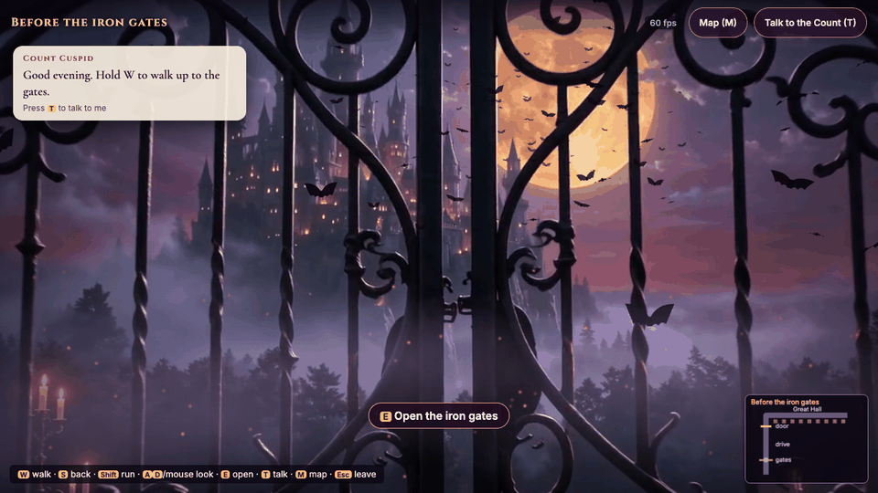 |
| The lantern drive | 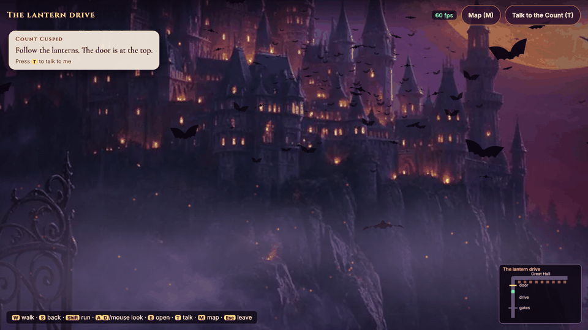 | 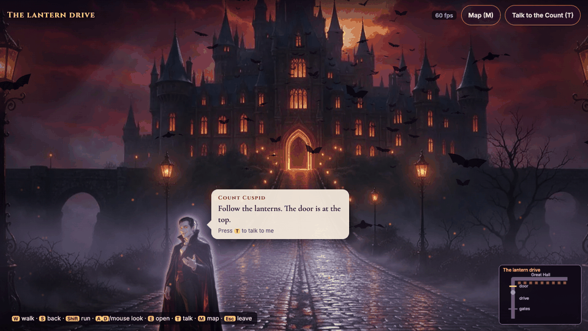 |
| The great door | 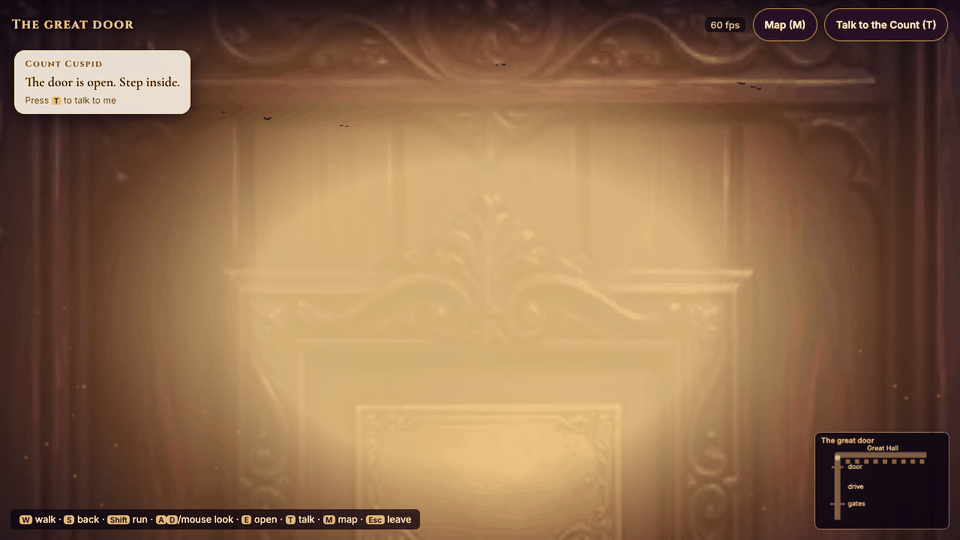 | 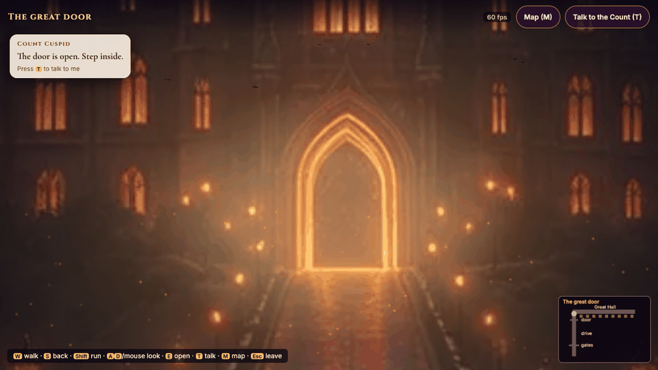 |
| Walking into the hall | 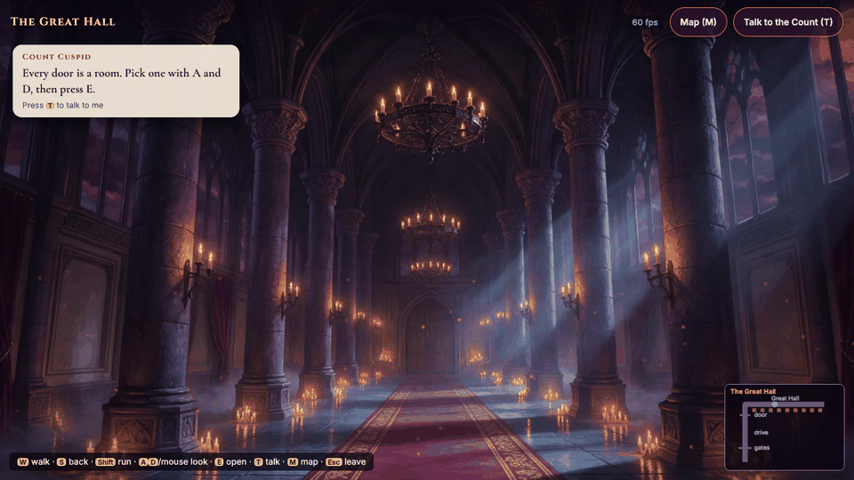 | 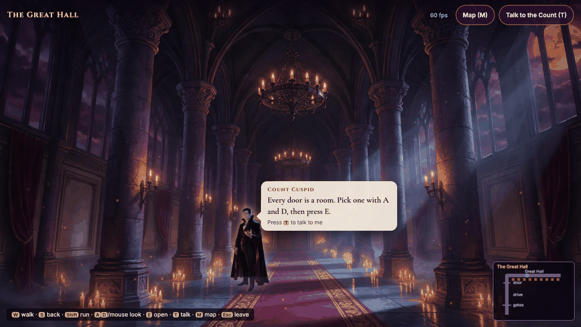 |
| The hall doors | 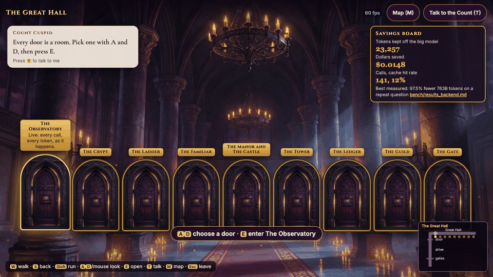 | 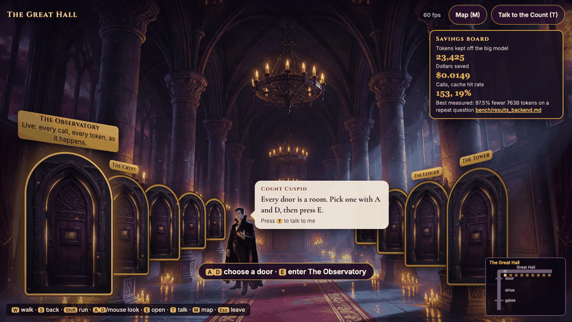 |
| iPhone: landing, hall | (no before shot) | 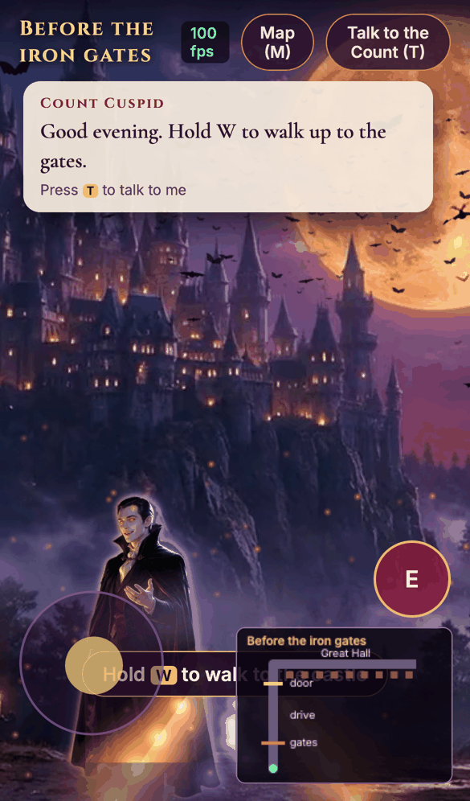 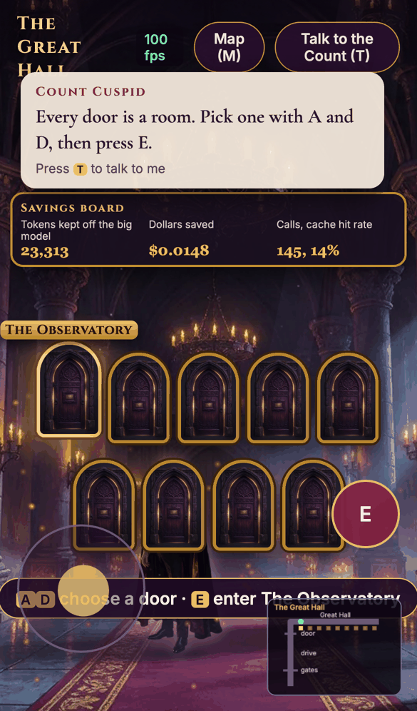 |

What changed (`site/game/scene.js`, new; small hooks in `site/game/walk.js` and `walk.css`):

- **The path to the gates is easy to see.** A moonlit band of ground runs from your feet to the gap between the gates. Lantern glows sit along both edges, and small wisps drift up it toward the gate. They follow the clip's forward zoom and fade as you reach the gates.
- **The lantern drive is a real drive.** Before, the drive was a zoom into the landing painting, with no path in it. It is now a new painting, `site/art/drive.webp`. A wet cobbled road leads between lamp posts and over a stone bridge to the castle's gold-rimmed door. The great-door stretch zooms into that same door, so the drive and the door join up.
- **The Count stands in the scene.** He was a parchment box in the corner. Now he is a full-length figure (`site/art/count-full.webp`, cut out offline by `scripts/cut_count.py` into `site/game/layers/count-full.webp`). He stands on the ground of each stretch and moves with the painting's own zoom. Candle light falls on one side of him and moonlight on the other. Fog covers his feet, and a soft shadow sits under him. His bubble hangs by his head, with a tail. You walk past him at the gates and on the drive, and he waits for you in the Great Hall. If the cut-out cannot load, the old half-length cut-out shows instead.
- **The Great Hall feels huge.** Slow shafts of moonlight come down from the tall windows, with dust drifting in them. The painting slowly drifts in, over 28 s, and never stops. The gold doors no longer sit in one flat row. On wide screens they stand along both walls in perspective and get smaller toward the far end of the hall. They are placed on the painting, so they move with it. The far doors show their sign when you choose them. On a phone the doors form a two-row arcade. The chosen door's sign is readable, and the savings board turns into one strip above the doors.
- Animation is always on. Nothing pauses, and the Halloween/Standard toggle and the minimap are unchanged.

New art: 3 Seedream 5.0 Pro images on GMI with 3 MiniMax-M3 prompt rewrites (`scripts/gen_art.py --enrich drive count-full`). The Count was painted twice, because the first one had a beard. The prompts are in `site/art/prompts.json`. The images are logged in `site/art/README.md`. No GMI video was used.

## 3. The clips: W, S and the joints

Only one clip exists so far: `site/game/clips/a-approach.mp4` (8.04 s, 24 fps, H.264, a keyframe every 6 frames). The video chat has not landed b-gates through e-hall or the room clips yet. The check is `scripts/ui_seams.py webkit|chrome`. It reads every clip in `site/game/clips/`, so rerun it when a clip lands.

| | Chrome | WebKit |
|---|---|---|
| W held 2.5 s: clip clock moved every screen frame, gaps over 120 ms | 0 | 0 |
| S held 1.5 s: positions shown per second, gaps over 120 ms | 31, 0 | 42, 0 |
| Joint a-approach → b-gates, screen jump (mean abs. difference of 255), before fix | 25.0 to 28.3 | 24.0 to 29.2 |
| The same joint after the fix, by map jump and by walking to the gate + E | 0.0 / 0.0 | 0.0 / 0.0 |

**Seam found and fixed** (commit 63b1d2e): b-gates has no clip yet, so it played a still of a-approach's last frame (`a-approach-last.jpg`). The browser decodes that JPEG with other colours than the video frame, which gave a visible jump (mean RGB 63/54/69 against 58/48/63). Now, when a still stretch's keyframe is the last frame of the clip before it, the walk keeps that clip's own video, paused on its last frame, and moves the dolly on it. The jump is now 0. A second fix: a map jump that came in while the video was seeking did not land. Jumps now always land.

When b-gates lands, a-approach → b-gates becomes video to video, and this hold is no longer used.

## Not checked, and known limits

- Real Safari on a real iPhone was not used. Only the Playwright WebKit engine was tested, with iPhone emulation.
- Joints between clips (video to video) are untested, because there is only one clip so far.
- The Count's place in each stretch is set by hand in `SPOT` in `scene.js`. The landing's zoom follows `a-approach.mp4` (`CLIP_ZOOM`), so a remade clip with a different camera path needs that number retuned. `shortcut: hand-placed, retune when a clip is remade.`
- On the phone the hint bar and the joystick still overlap a little at the bottom.
- `make test`: 220 passed (4 xfail). `python3 site/build.py --check` passes.
