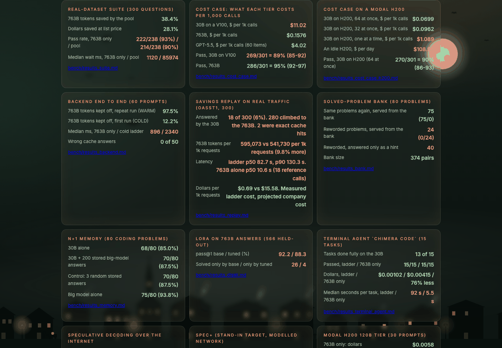
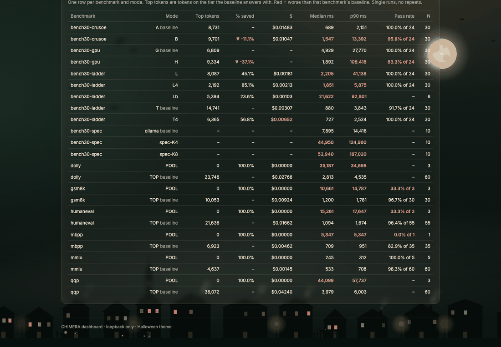
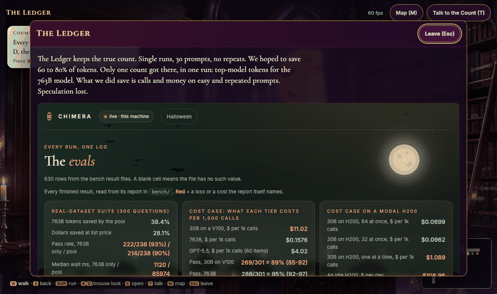
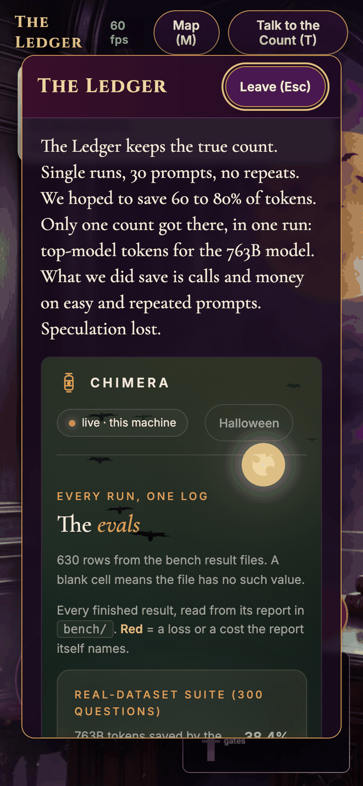
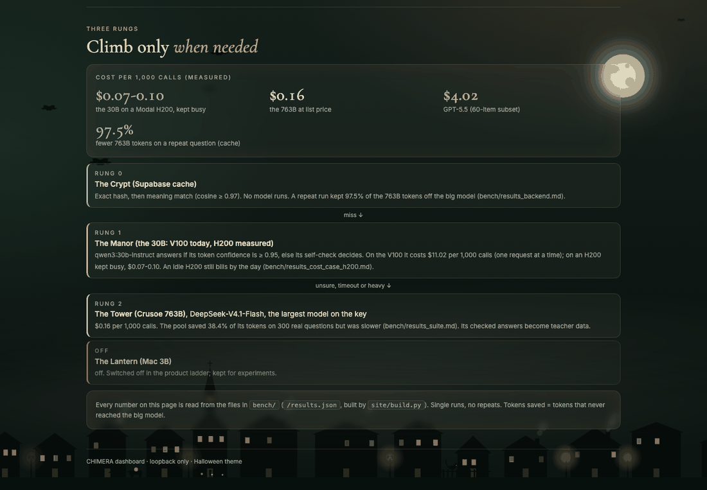
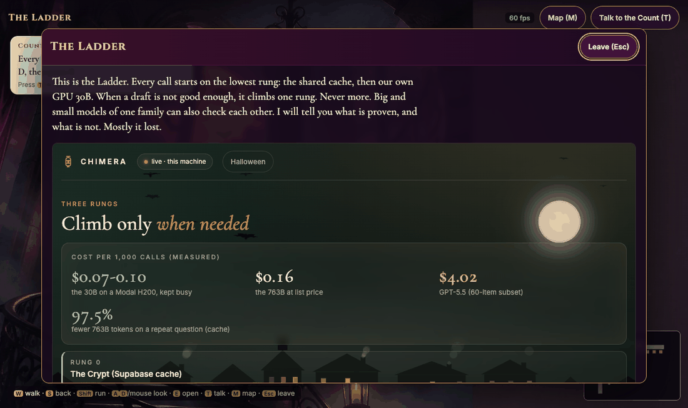
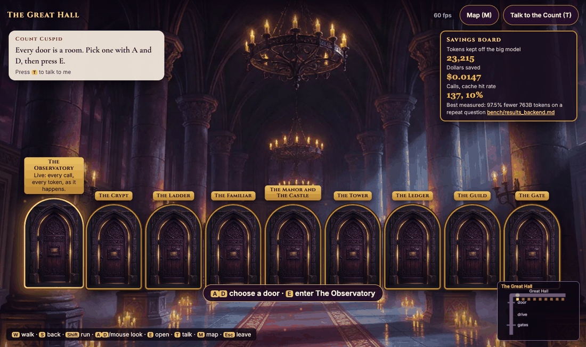
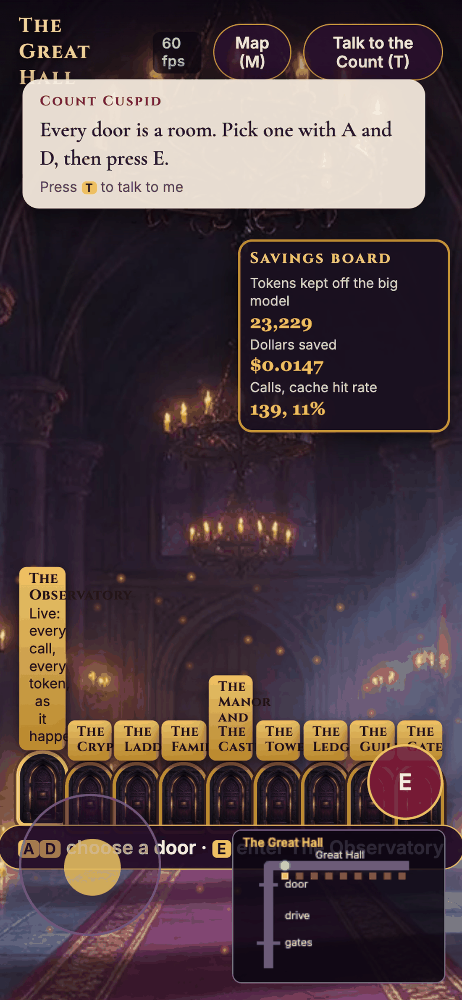
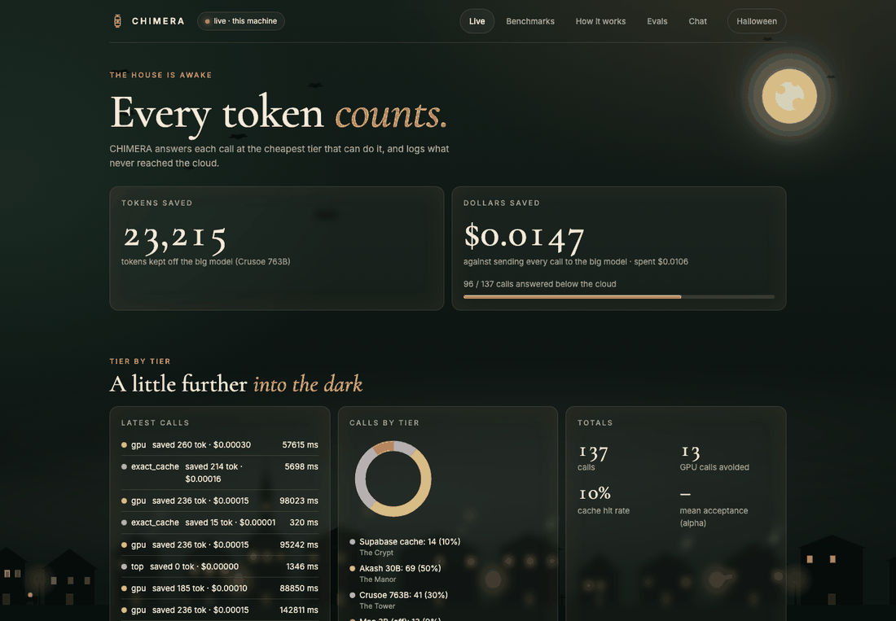

# Results in the castle rooms

Every result report is now on the Evals tab (the Ledger door) as a card. Each number is read from its `bench/*.md` file by `site/results.py` into `site/results.json` (`python3 site/build.py` writes it, `--check` fails if it drifted; `tests/test_site_results.py` checks it). A row that moves in a report makes the build fail instead of showing an old number. Red = the report itself calls it a loss or a cost. Captured 2026-11-15 from http://127.0.0.1:8765 with headless Chromium (`bench/.scratch/ui/rooms_shots.py`, `e2e.py`).

## Evals door and Ledger room

Both show the same dashboard Evals tab. Report cards first, then the `/api/evals` leaderboard.

| Card | Numbers on screen | Source file |
|---|---|---|
| Real-dataset suite | tokens saved 38.4%, dollars saved 28.1%, pass 93% vs 90% (red), median wait 1120 vs 85974 ms (red) | `bench/results_suite.md` |
| Cost case | 30B on V100 $11.02 per 1k calls (red), 763B $0.1576, GPT-5.5 $4.02, pass 89% vs 95% | `bench/results_cost_case.md` |
| Cost case on H200 | $0.0699 and $0.0962 per 1k calls busy, $1.089 one at a time (red), idle H200 $108.96 a day (red) | `bench/results_cost_case_h200.md` |
| Backend end to end | repeat run 97.5% of 763B tokens kept off, first run 12.2%, median 896 vs 2340 ms (red), wrong cache answers 0 of 50 | `bench/results_backend.md` |
| Savings replay | 30B answered 18 of 300 (red), 763B tokens 9.8% more (red), ladder p50 82.7 s (red), $0.69 vs $15.58 per 1k | `bench/results_replay.md` |
| Solved-problem bank | same problems 75 served, reworded 24 served (red), 40 hint only (red), 374 pairs | `bench/results_bank.md` |
| N+1 memory | 68/80 alone, 70/80 with 200 stored, 70/80 with random control, 75/80 big model | `bench/results_memory.md` |
| LoRA on 763B answers | pass@1 92.2 to 88.3 (red), 26 solved only by base, 4 only by tuned (red) | `bench/results_distill.md` |
| Terminal agent | 13 of 15 done on the 30B, 15/15 both, $0.00102 vs $0.00415, 92 s vs 5.5 s per task (red) | `bench/results_terminal_agent.md` |
| Speculative decoding | 0.15x and 0.22x of plain Ollama (red), alpha 0.68, round trip 599 ms (red) | `bench/spec_results.md` |
| Spec+ | 1.14x to 1.22x over plain spec, 13.36 tok/s vs 19.27 for the big model alone (red) | `bench/results_specplus.md` |
| Modal H200 120B | 763B only $0.0058, 728 ms; H200 then 763B about $0.11, 1,352 ms (red) | `bench/results_modal.md` |

## Ladder room

Headline cards: the 30B on an H200 $0.07-0.10 per 1,000 calls (`results_cost_case_h200.md`, 64 and 32 at once), the 763B $0.16 and GPT-5.5 $4.02 (`results_cost_case.md`), 97.5% fewer 763B tokens on a repeat question (`results_backend.md`). The Mac 3B shows "off". The rung texts also use `/results.json`.

## Savings board in the Great Hall

| On the board | Value at capture | Source |
|---|---|---|
| Tokens kept off the big model | 23,229 | `/api/stats` `global.tokens_kept_off_big` |
| Dollars saved | $0.0147 | `global.dollars_saved` (0.014749) |
| Calls, cache hit rate | 139, 11% | `global.calls`, `global.hit_rate` (0.1079) |
| Best measured | 97.5% fewer 763B tokens on a repeat question | `results.json` `headlines.repeat_tokens_off` from `bench/results_backend.md` |

The board refreshes every 5 s while you are in the hall.

## Observatory (Halloween dashboard) and the other doors

Unchanged and live. One screenshot per door, each a real room opened with E:
[Observatory](rooms_door_observatory.png), [Crypt](rooms_door_crypt.png), [Ladder](rooms_door_ladder.png), [Familiar](rooms_door_familiar.png), [Manor and Castle](rooms_door_gpus.png), [Tower](rooms_door_tower.png), [Ledger](rooms_door_ledger.png), [Guild](rooms_door_guild.png), [Gate](rooms_door_gate.png).

## Browser checks

Run by `bench/.scratch/ui/e2e.py` over the DevTools protocol against the live server. All passed.

| Check | Desktop Chrome 1280x760 | Phone 390x844 (touch) |
|---|---|---|
| Walk | W moved the clock 0 to 2.5 s, S moved it back, A/D turned the view | touch joystick pushed up walked 0 to 2.57 s |
| E opens gates, great door, rooms | pass (Ledger, Ladder, Observatory, each iframe had content) | pass |
| Esc leaves a room, M map open and close | pass | pass |
| Minimap drawn | pass | pass |
| Count chat (T), one real question "What is the capital of France?" | answered Paris | answered (exact cache hit, 101 ms) |
| Frame rate (median of 1 s samples) | 60 fps, min 58 | 60 fps, min 58 |
| No sideways scroll | pass | pass |

## Not checked, and known faults

- **WebKit/Safari: not run.** Only Chromium is installed (no Playwright browsers for WebKit on this Mac).
- On a 390 px phone the hall's door plaques are cut off and the hint bar, minimap and E button overlap. This is the existing hall layout in `site/game/walk.css`; I only moved the savings board clear of the Count's bubble. It works but looks cramped.
- `python3 site/build.py --check` and the full test suite pass (218 tests).
- "GPU 30B tunnel: down" appeared in the chat's health strip during the run. That is the live state, not a fault of the page.
