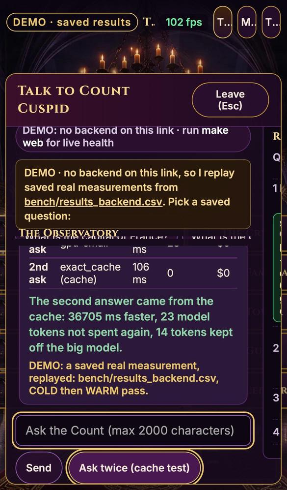
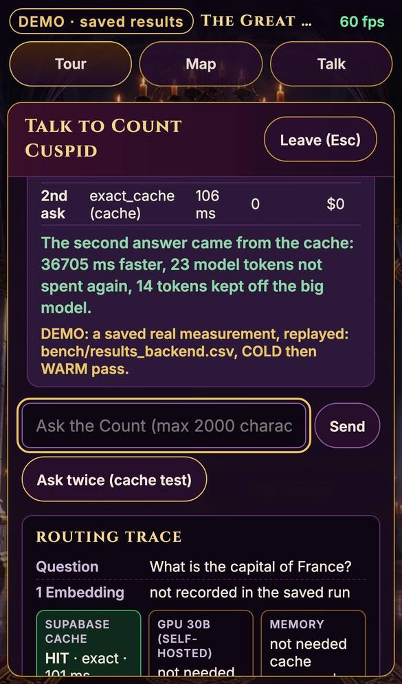
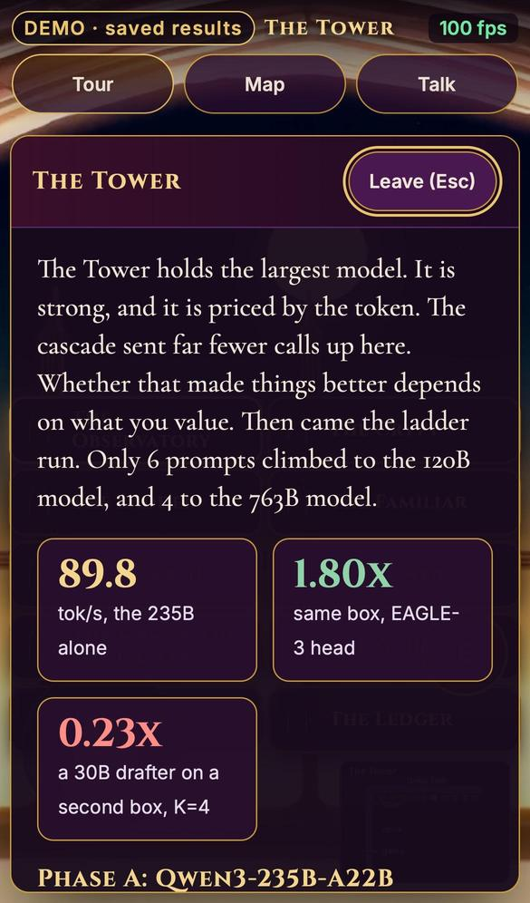

# UI polish rounds

Each round walks the whole castle with `scripts/ui_rounds.py` (Playwright): load, hold W (or the joystick) into the Great Hall with a window resize mid-walk, open every door, the map, the chat cache test (Ask twice), the first stops of the tour, fps on the landing and in the hall. In `live` mode it also cuts `/api/stats` mid-session and checks that the page falls to DEMO. In `demo` mode every `/api/*` and `/events` request fails, as on the public link. Then I judge every screenshot by eye, as a Kiroween judge would, and fix the worst defects.

```
.venv/bin/python scripts/ui_rounds.py <round> chromium|webkit desktop|phone demo|live [--url https://manvendersingh21.github.io/tremor-core/] [--full-tour] [--video]
.venv/bin/python scripts/ui_round_shots.py <round> <config> <shot> ...   # copies chosen shots into site/docs/rounds/
```

Raw results (every screenshot, `result.json` per run): `bench/.scratch/ui/rounds/<round>/<browser>_<view>_<mode>/` (git-ignored). Phone = Playwright's iPhone 13 (390 x 664, touch). WebKit headless does not sync to a display, so it reports about 100 fps.

## Defects per round

| Round | Where it ran | Defects found | Fixed in |
|---|---|---|---|
| 1 | local, all 4 browser/view pairs + live | 12 | e46c884 |
| 2 | Pages (e46c884), all 4 pairs | 11 | round 2 commit |

## Timings

| Round | Browser | View | Mode | Served from | First paint ms | W held to Great Hall s | fps (median) | Automatic defects |
|---|---|---|---|---|---|---|---|---|
| r1 | chromium | desktop | demo | local | not read (script bug, fixed) | 4.35 | 60 | 2 |
| r1 | chromium | desktop | live | local | 228 | 4.35 | 60 | 1 |
| r1 | chromium | phone | demo | local | 212 | 4.5 | 60 | 13 |
| r1 | webkit | desktop | demo | local | 259 | 4.29 | 100 | 1 |
| r1 | webkit | phone | demo | local | 239 | 4.52 | 100 | 14 |
| r2 | chromium | desktop | demo | Pages | 488 | 4.03 | 60 | 0 |
| r2 | chromium | phone | demo | Pages | 408 | 4.11 | 60 | 10 |
| r2 | webkit | desktop | demo | Pages | 278 | 4.02 | 100 | 0 |
| r2 | webkit | phone | demo | Pages | 465 | 4.12 | 100 | 13 |
| r2 fixes | chromium | desktop | demo | local | 280 | 3.88 | 60 | 0 |
| r2 fixes | chromium | phone | demo | local | 240 | 3.96 | 60 | 0 |
| r2 fixes | webkit | phone | demo | local | 243 | 4.04 | 100 | 0 |

"W held" is measured from key-down to the hall flag with a 50 ms poll, so it reads up to 0.05 s long.

## Round 1 (local, before the first push)

The live run passed its own checks: the LIVE badge, live board numbers (172 calls), the cache test against the real backend, and the fall to DEMO when `/api/stats` returned 503 (board kept the saved numbers).

| # | Defect | Fix |
|---|---|---|
| 1 | W held to the hall took 4.35 s (Chrome), 4.5 s (phone): over the 4 s target | drive 0.75 -> 0.7 s, hall dolly 0.7 -> 0.4 s |
| 2 | The Count's bubble said "Press T to talk to me", but T now starts the tour | "Press C to talk to me · T for a tour" |
| 3 | Every Workshop visit asked for `room-workshop.mp4` and got a 404 (a console error on the public link) | rooms.js `clip: false`, no request |
| 4 | Chat, demo: the cache-test card was squeezed ("36811 ms" over two lines); the demo note and saved questions pushed the input down | note and questions above the log in one row, card full width |
| 5 | Ledger: a loss read "$2,889 (-611%) more" | "$2,889 a month more (+611%)", in red |
| 6 | Phone: the top bar ran off the screen (Map and Talk unreachable); the place name wrapped to 4 lines | two-row bar, short labels |
| 7 | Phone: the bubble covered the place name | bubble moved under the bar |
| 8 | Phone: 10 identical doors in the hall, only the chosen one named | named gold door tiles in two columns |
| 9 | Phone: "Hold W" prompt under the joystick and the minimap, and W on a touch screen | prompt above the stick: "Push the stick up to walk" |
| 10 | Phone: text under 14 px (badge 12.5, buttons 13.6, keys 12.8, door names 8.8, board labels) | 14 px floor on phone |
| 11 | Phone: room panels covered the top bar | panel starts under the bar |
| 12 | Phone: the E button and the joystick sat over the door list | hidden in the hall (doors are tapped) |

| Before (round 1) | |
|---|---|
|  |  |
|  |  |

## Round 2 (the Pages build of e46c884)

| # | Defect | Fix |
|---|---|---|
| 1 | W held to the hall: 4.02 to 4.12 s, still a hair over 4 s | approach 1.5 -> 1.35 s (now 3.88 to 4.04 s, poll included) |
| 2 | Tour: the Count's words showed twice (bubble and tour bar) | bubble hidden while touring |
| 3 | Tour: the hall prompt "A D choose a door" showed through the tour bar | prompt and key help hidden while touring |
| 4 | Tower: a 14-row table and no focal number | three key cards first: 89.8 tok/s, 1.80x (green), 0.23x (red) |
| 5 | Chat, demo: two DEMO notices (monitor strip and note) | the monitor strip hides in DEMO |
| 6 | Phone: bar buttons squeezed to "T...", "M..", "T..." | short labels Tour / Map / Talk on a second row |
| 7 | Phone: the right column of door tiles ran off the screen | columns `minmax(0, 1fr)`, names wrap |
| 8 | Phone: chat column wider than the panel; the trace overlapped the cache card | one column that scrolls |
| 9 | Phone: the chosen door's name showed through the chat panel | panels and the map sit above the hall doors |
| 10 | Phone: "Leave (Esc)" at 13.6 px | 14 px |
| 11 | Phone: the bubble said "Hold W" and listed keys | "Push the stick up", no key list on touch |

| Before (round 2, Pages) | After (round 2 fixes, local) |
|---|---|
|  |  |
|  |  |
|  |  |
|  |  |
