# UI polish rounds

Each round walks the whole castle with `scripts/ui_rounds.py` (Playwright): load, hold W (or the joystick) into the Great Hall with a window resize mid-walk, open every door, the map, the chat cache test (Ask twice), the first stops of the tour, fps on the landing and in the hall. In `live` mode it also cuts `/api/stats` mid-session and checks that the page falls to DEMO. In `demo` mode every `/api/*` and `/events` request fails, as on the public link. Then I judge every screenshot by eye, as a Kiroween judge would, and fix the worst defects.

```
.venv/bin/python scripts/ui_rounds.py <round> chromium|webkit desktop|phone demo|live [--url https://manvendersingh21.github.io/tremor-core/] [--full-tour] [--video]
.venv/bin/python scripts/ui_round_shots.py <round> <config> <shot> ...   # copies chosen shots into site/docs/rounds/
```

Raw results (every screenshot, `result.json` per run): `bench/.scratch/ui/rounds/<round>/<browser>_<view>_<mode>/` (git-ignored). Phone = Playwright's iPhone 13 (390 x 664, touch). WebKit headless does not sync to a display, so it reports about 100 fps.

## Defects per round

| Round | Where it ran | Defects found | Fixed in |
|---|---|---|---|
| 1 | local, all 4 browser/view pairs + live | 12 | e46c884 |
| 2 | Pages (e46c884), all 4 pairs | 11 | af4f106 |
| 3 | Pages (af4f106): full tour with video, WebKit phone, a slow line (4 Mbit/s, 150 ms, cache off) | 7 (6 fixed, 1 is clip art) | 75d8dff |
| 4 | Pages (75d8dff): Chromium phone, WebKit desktop and phone; live backend locally | 6 (4 fixed, 1 handled, 1 found by the recheck and fixed) | round 4 commit |

## Timings

| Round | Browser | View | Mode | Served from | First paint ms | W held to Great Hall s | fps (median) | Automatic defects |
|---|---|---|---|---|---|---|---|---|
| r1 | chromium | desktop | demo | local | not read (script bug, fixed) | 4.35 | 60 | 2 |
| r1 | chromium | desktop | live | local | 228 | 4.35 | 60 | 1 |
| r1 | chromium | phone | demo | local | 212 | 4.5 | 60 | 13 |
| r1 | webkit | desktop | demo | local | 259 | 4.29 | 100 | 1 |
| r1 | webkit | phone | demo | local | 239 | 4.52 | 100 | 14 |
| r2 | chromium | desktop | demo | Pages | 488 | 4.03 | 60 | 0 |
| r2 | chromium | phone | demo | Pages | 408 | 4.11 | 60 | 10 |
| r2 | webkit | desktop | demo | Pages | 278 | 4.02 | 100 | 0 |
| r2 | webkit | phone | demo | Pages | 465 | 4.12 | 100 | 13 |
| r2 fixes | chromium | desktop | demo | local | 280 | 3.88 | 60 | 0 |
| r2 fixes | chromium | phone | demo | local | 240 | 3.96 | 60 | 0 |
| r2 fixes | webkit | phone | demo | local | 243 | 4.04 | 100 | 0 |
| r3 | chromium | desktop | demo, full tour | Pages | 432 | 3.88 | 60 | 0 (tour 199 s) |
| r3 | webkit | phone | demo | Pages | 408 | 4.09 | 100 | 0 |
| r3 | chromium | desktop | demo, slow line | Pages | 696 | 3.89 | 60 | 0 |
| r3 fixes | webkit | phone | demo | local | 252 | 3.97 | 100 | 0 |
| r3 fixes | chromium | desktop | demo, full tour | local | 272 | 3.80 | 60 | 0 (tour 179 s) |
| r4 | chromium | desktop | live | local | 268 | 3.76 | 60 | 0 |
| r4 | chromium | phone | demo | Pages | 480 | 3.93 | 60 | 1 (a 503 from Pages) |
| r4 | webkit | desktop | demo | Pages | 369 | 3.72 | 101 | 0 |
| r4 | webkit | phone | demo | Pages | 397 | 3.89 | 100 | 0 |
| r4 fixes | chromium | phone | demo | local | 232 | 3.98 | 60 | 0 |
| r4 fixes | webkit | desktop | demo | local | 236 | 3.77 | 100 | 0 |

"W held" is measured from key-down to the hall flag with a 50 ms poll, so it reads up to 0.05 s long.

## Round 1 (local, before the first push)

The live run passed its own checks: the LIVE badge, live board numbers (172 calls), the cache test against the real backend, and the fall to DEMO when `/api/stats` returned 503 (board kept the saved numbers).

| # | Defect | Fix |
|---|---|---|
| 1 | W held to the hall took 4.35 s (Chrome), 4.5 s (phone): over the 4 s target | drive 0.75 -> 0.7 s, hall dolly 0.7 -> 0.4 s |
| 2 | The Count's bubble said "Press T to talk to me", but T now starts the tour | "Press C to talk to me · T for a tour" |
| 3 | Every Workshop visit asked for `room-workshop.mp4` and got a 404 (a console error on the public link) | rooms.js `clip: false`, no request |
| 4 | Chat, demo: the cache-test card was squeezed ("36811 ms" over two lines); the demo note and saved questions pushed the input down | note and questions above the log in one row, card full width |
| 5 | Ledger: a loss read "$2,889 (-611%) more" | "$2,889 a month more (+611%)", in red |
| 6 | Phone: the top bar ran off the screen (Map and Talk unreachable); the place name wrapped to 4 lines | two-row bar, short labels |
| 7 | Phone: the bubble covered the place name | bubble moved under the bar |
| 8 | Phone: 10 identical doors in the hall, only the chosen one named | named gold door tiles in two columns |
| 9 | Phone: "Hold W" prompt under the joystick and the minimap, and W on a touch screen | prompt above the stick: "Push the stick up to walk" |
| 10 | Phone: text under 14 px (badge 12.5, buttons 13.6, keys 12.8, door names 8.8, board labels) | 14 px floor on phone |
| 11 | Phone: room panels covered the top bar | panel starts under the bar |
| 12 | Phone: the E button and the joystick sat over the door list | hidden in the hall (doors are tapped) |

| Before (round 1) | |
|---|---|
| 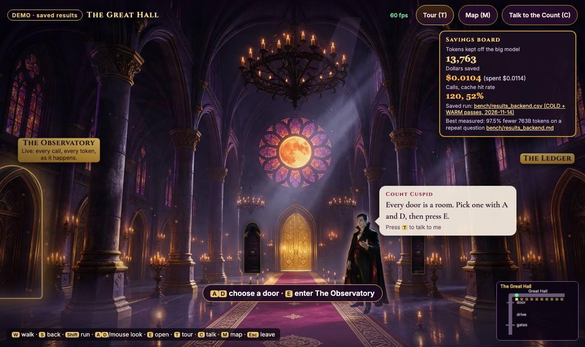 | 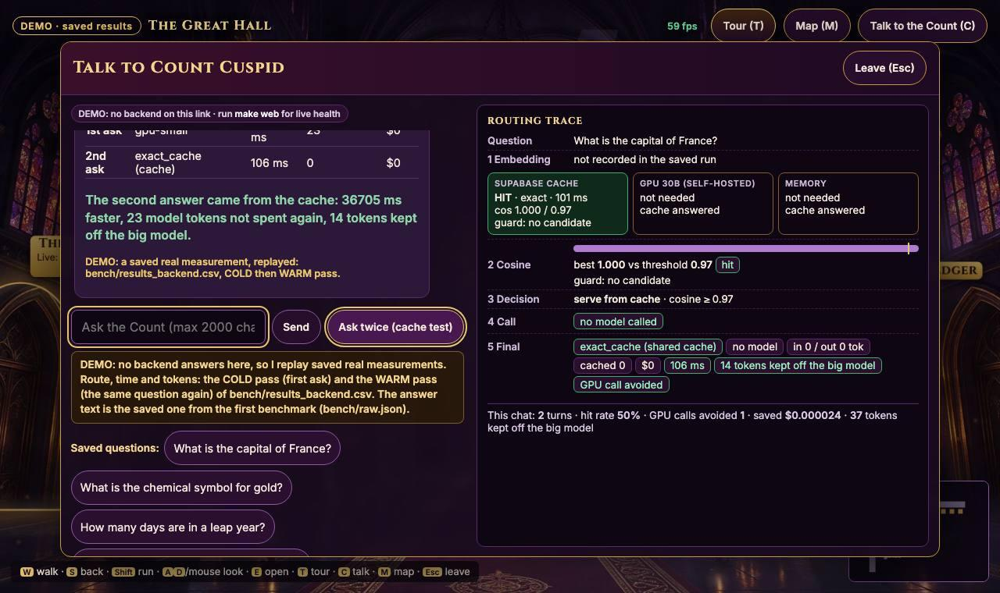 |
| 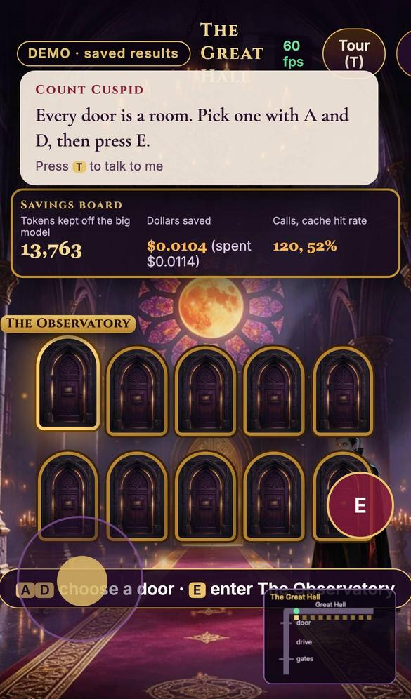 | 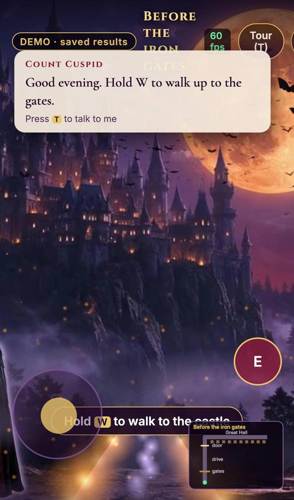 |

## Round 2 (the Pages build of e46c884)

| # | Defect | Fix |
|---|---|---|
| 1 | W held to the hall: 4.02 to 4.12 s, still a hair over 4 s | approach 1.5 -> 1.35 s (now 3.88 to 4.04 s, poll included) |
| 2 | Tour: the Count's words showed twice (bubble and tour bar) | bubble hidden while touring |
| 3 | Tour: the hall prompt "A D choose a door" showed through the tour bar | prompt and key help hidden while touring |
| 4 | Tower: a 14-row table and no focal number | three key cards first: 89.8 tok/s, 1.80x (green), 0.23x (red) |
| 5 | Chat, demo: two DEMO notices (monitor strip and note) | the monitor strip hides in DEMO |
| 6 | Phone: bar buttons squeezed to "T...", "M..", "T..." | short labels Tour / Map / Talk on a second row |
| 7 | Phone: the right column of door tiles ran off the screen | columns `minmax(0, 1fr)`, names wrap |
| 8 | Phone: chat column wider than the panel; the trace overlapped the cache card | one column that scrolls |
| 9 | Phone: the chosen door's name showed through the chat panel | panels and the map sit above the hall doors |
| 10 | Phone: "Leave (Esc)" at 13.6 px | 14 px |
| 11 | Phone: the bubble said "Hold W" and listed keys | "Push the stick up", no key list on touch |

| Before (round 2, Pages) | After (round 2 fixes, local) |
|---|---|
| 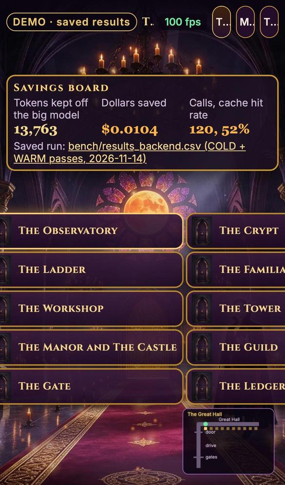 | 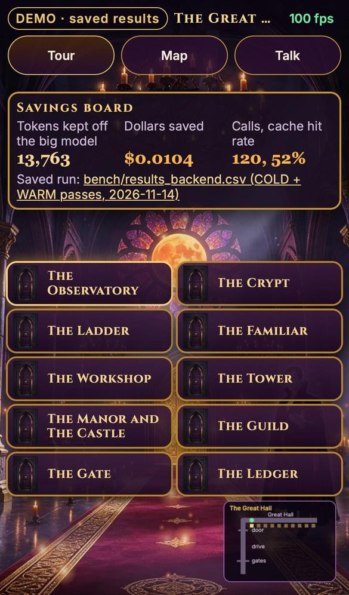 |
|  |  |
| 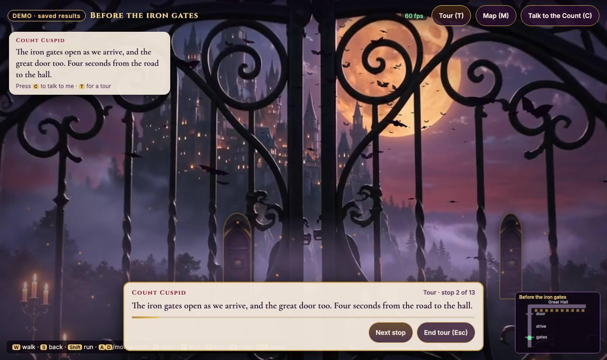 | 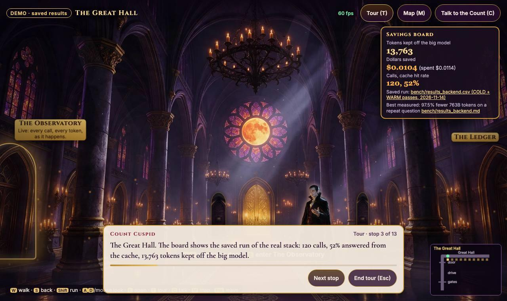 |
| 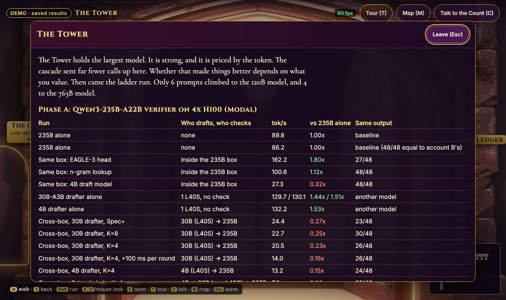 |  |

## Round 3 (the Pages build of af4f106)

The automatic checks passed on all three runs. Every defect below came from reading the screenshots and the recorded tour.

| # | Defect | Fix |
|---|---|---|
| 1 | After using the chat, every room lost its layout: the chat's `m-chat` class stayed on the panel body, so the Workshop text sat in a narrow column and the Ledger split into four columns (seen in the tour video, which opens rooms after the chat) | `openPanel` resets the panel body class |
| 2 | Tour: the tour bar covered the bottom third of every room panel | during the tour the panel ends above the bar |
| 3 | Tour: 199 s, over "about 3 minutes" | narration trimmed to 152 s; the whole tour with door clips is now 179 s |
| 4 | Phone: the tour bar covered half the screen and the door list | a compact bar; the door list hides while the tour picks doors |
| 5 | Desktop: the hall door labels stayed on screen during door clips (`.m-doors.m-spots` beat `[hidden]`) | `[hidden]` wins |
| 6 | Phone: the stick walk-in took 4.09 s | gates stretch 0.8 -> 0.7 s (3.97 s, poll included) |
| 7 | Slow line: mid-walk through the gates, the gate clip shows its own cross-fade ghost of the bars | not fixed: it is in the clip (`site/game/clips/b-gates.mp4`, owned by the video chat); the same frame shows at full speed |

Also fixed: the place name now changes to the room as its door clip starts (it said "The Great Hall" during the Ledger clip).

| Before (round 3, Pages) | After (round 3 fixes, local) |
|---|---|
| 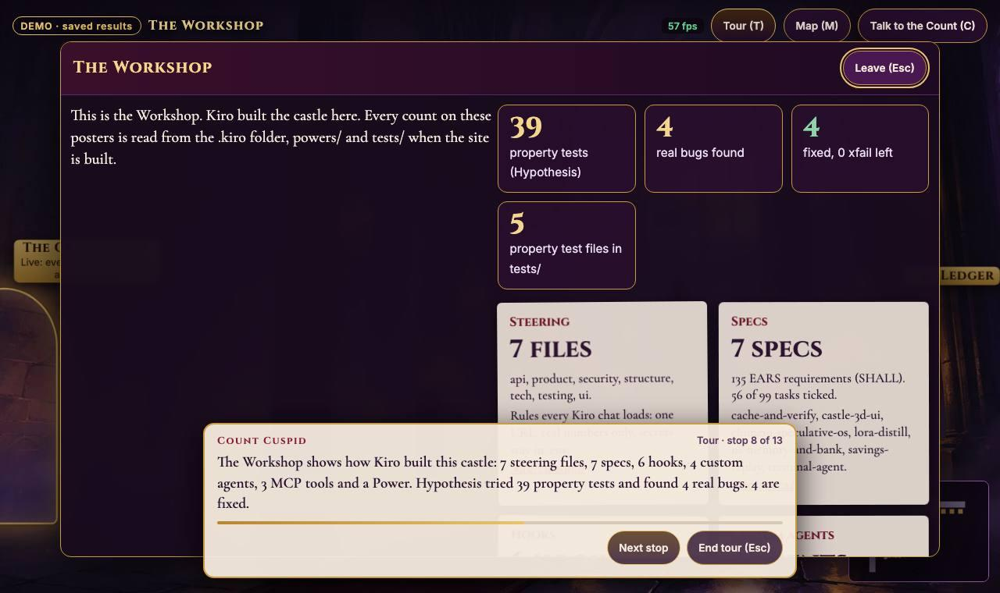 | 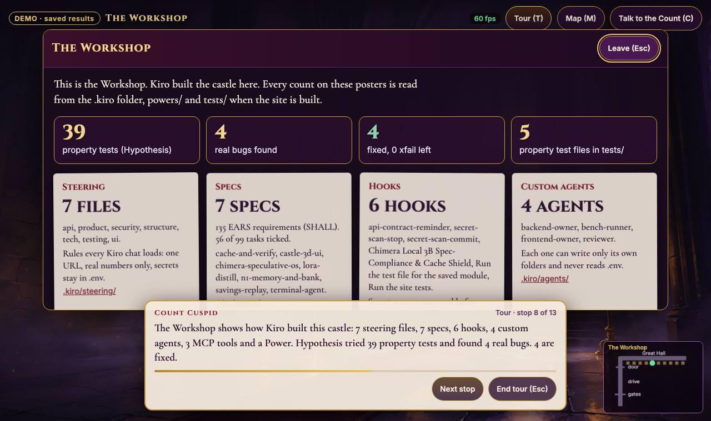 |
| 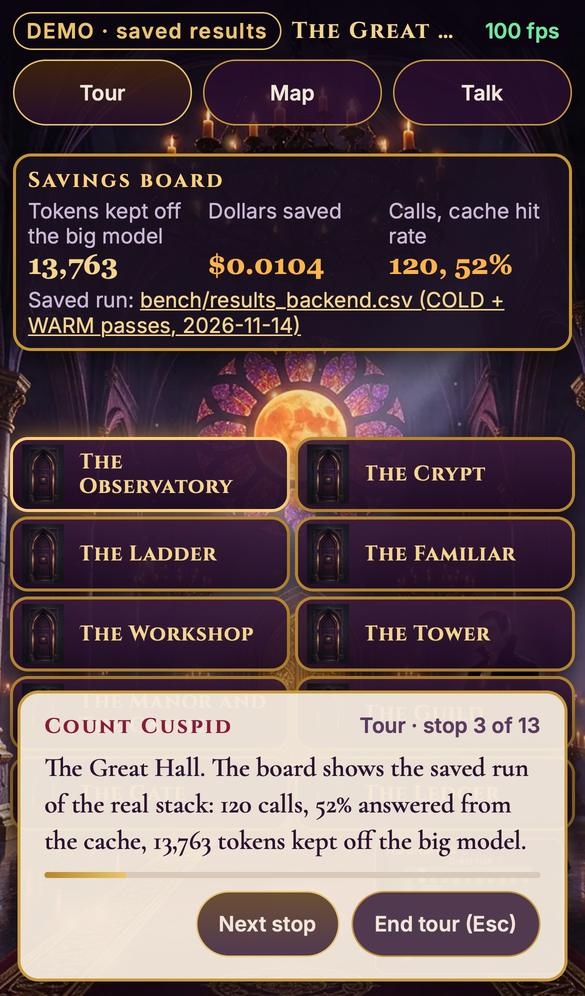 | 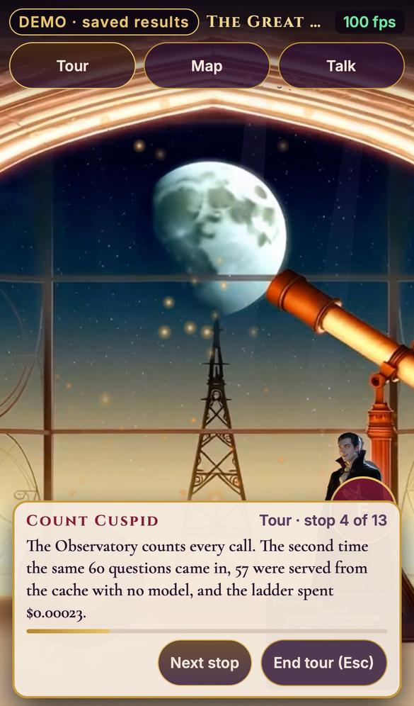 |
| 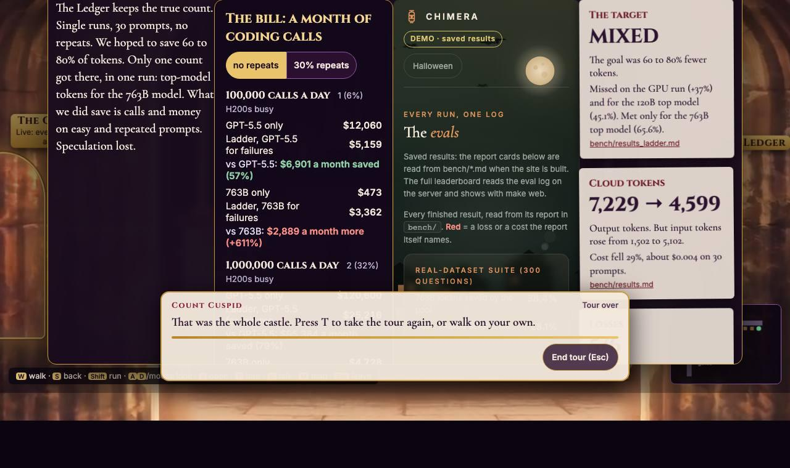 | 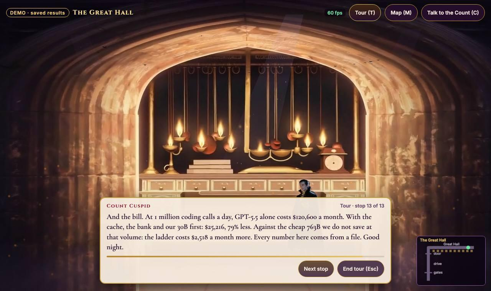 |

Slow line (4 Mbit/s, 150 ms, cache off): first paint 696 ms, W held to the hall 3.89 s, no blank frame.

| Mid-walk on the slow line | The hall on the slow line |
|---|---|
| 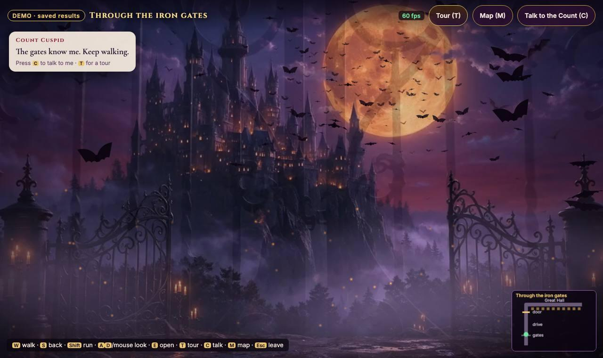 |  |

Videos from the Pages build of af4f106 (before the round 3 fixes): [the 4 s walk-in](ui_walk_in.mp4), [the whole tour](ui_tour.mp4). The final tour video is re-recorded in round 4.

## Round 4 (the Pages build of 75d8dff, plus the live backend)

Live, against the real backend on 127.0.0.1:8765: Ask twice with a new question went to the GPU 30B (17,220 ms, 45 model tokens), then came back from the Supabase cache in 217 ms with 0 tokens. With `/api/stats` cut to 503 mid-session, the badge fell to "DEMO · saved results" within 7 s and the board switched to the saved run. Nothing broke.

| # | Defect | Fix |
|---|---|---|
| 1 | The Observatory, Ladder and Ledger dashboards showed a second CHIMERA brand and a second DEMO badge inside the room (a page inside a page) | embedded, the dashboard shows only its Halloween/Standard switch |
| 2 | The Manor's lead said "The Castle's H200 never answered" while its own poster says the H200 took all 25 calls off the 763B | "answered every call it was given, but it cost far more than the 763B" |
| 3 | The tour quotes the 30B's cost per 1,000 calls in the Manor, but the room did not show that number | five cost cards from `bench/results_company_cost.md`: H200 busy $0.070 (green), H200 10% busy $0.700, tuned V100 $0.178 (green), H200 one at a time $1.089 (red), V100 before tuning $11.02 (red) |
| 4 | Phone, Ledger: the cost chart, the room's focal point, started below the fold under a long lead | lead at 16 px on phones |
| 5 | Ledger chart: "1 (6%) H200s busy" | "1 H200, 6% busy" |
| 6 | Pages answered one door clip with 503 once (`room-observatory.mp4`) | handled already: the room opened on its painted still. Not a UI fix |

While fixing 3, the cost report changed under me (another chat renamed "the shared V100" to "the Akash V100 before tuning" and added tuned V100 rows). The room now matches the new rows by name; the build would have failed loudly if a row were gone.

| Before (round 4, Pages) | After (round 4 fixes, local) |
|---|---|
| 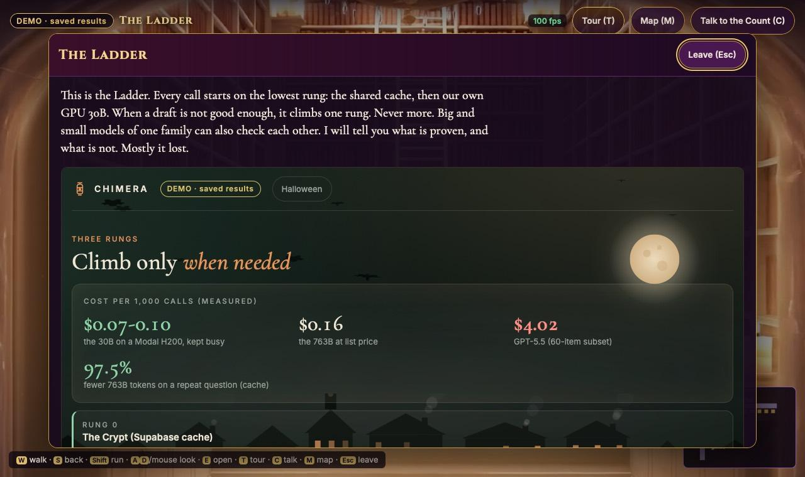 | 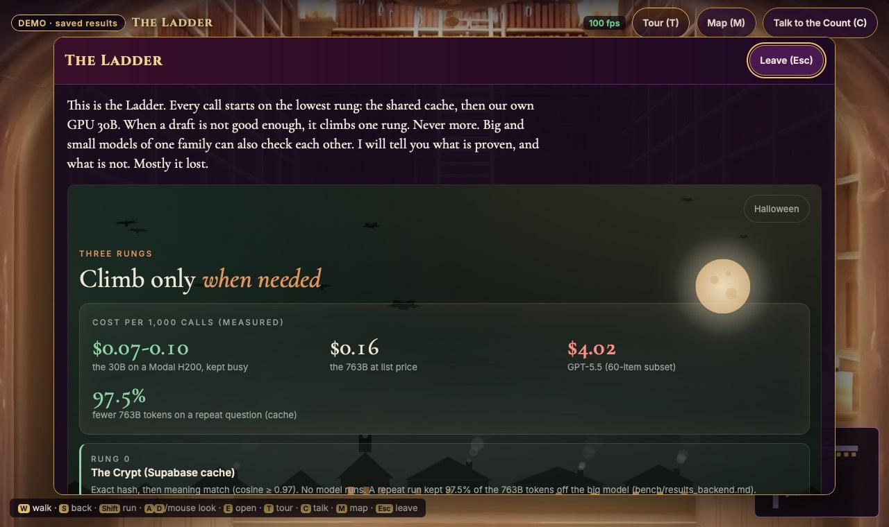 |
| 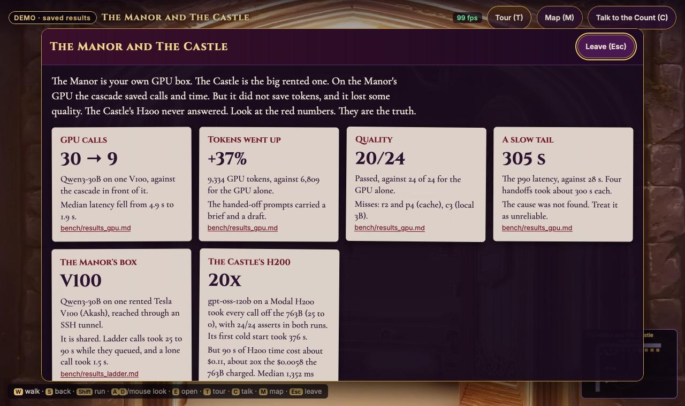 | 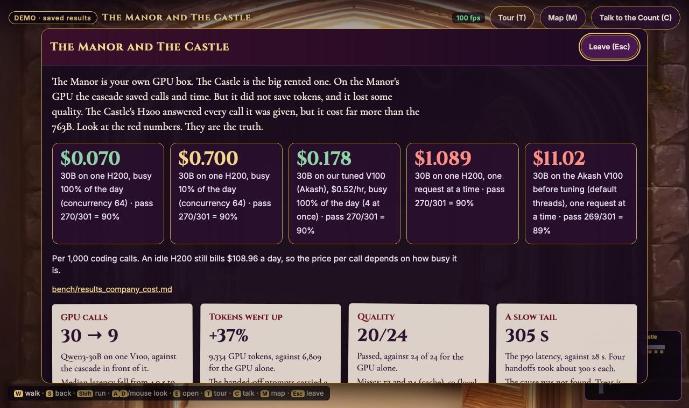 |
| 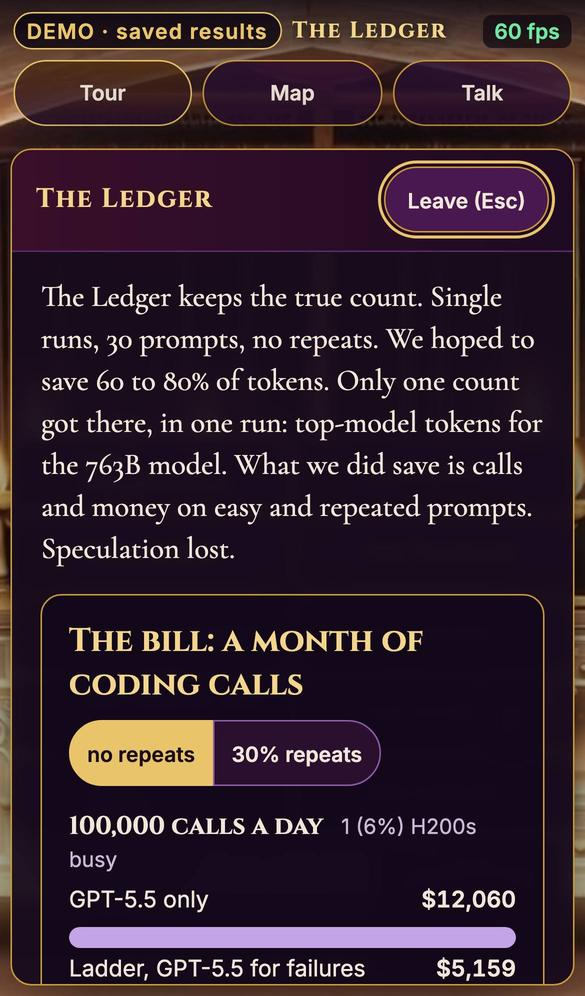 | 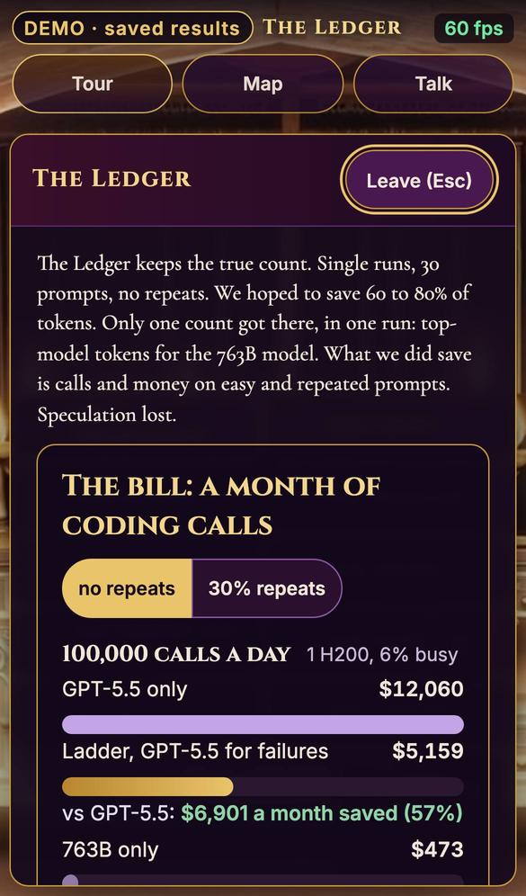 |

| Live: Ask twice (real backend) | Live: backend cut mid-session, page falls to DEMO |
|---|---|
|  | 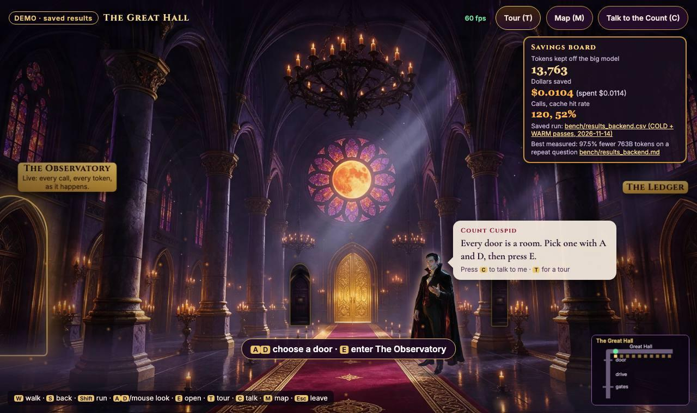 |
