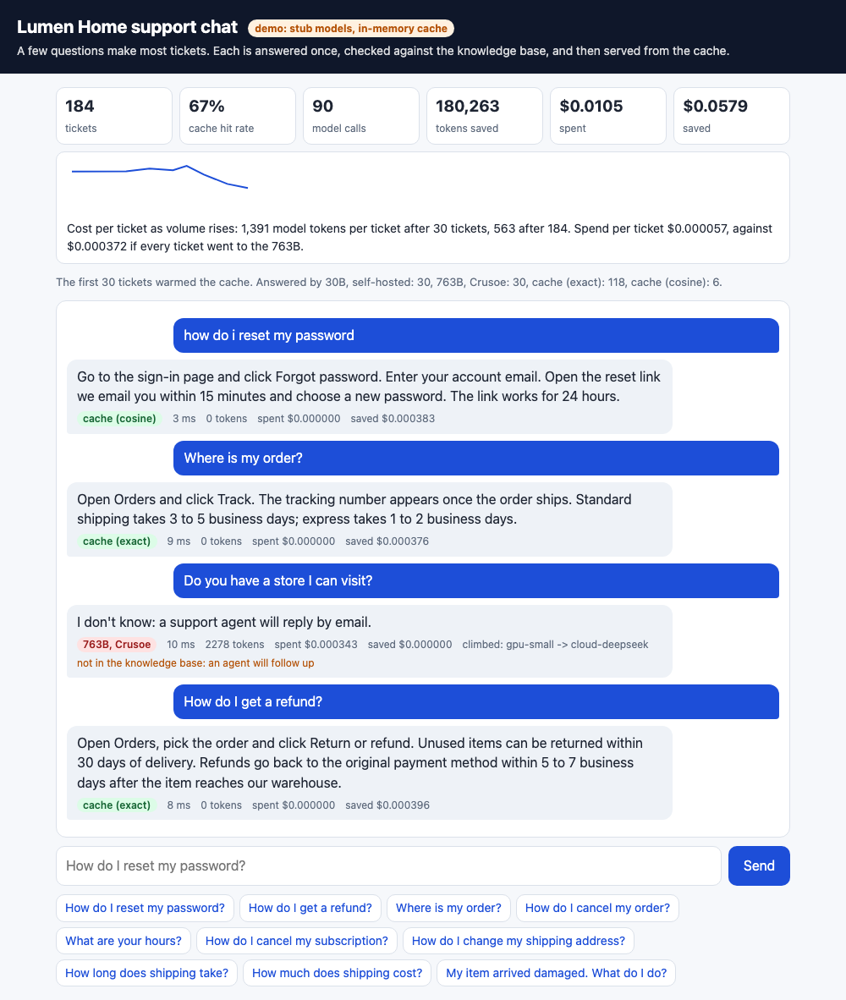

# Help desk: a support chat on the skeleton

Many customers, the same few questions: how do I reset my password, how do I get a refund, where is my order, how do I cancel, what are your hours. The help desk answers each once and then reuses the answer. The cache answers repeats with no model call. New tickets go to the self-hosted 30B, and only what the 30B cannot resolve climbs to the 763B.



## Run

```bash
.venv/bin/python -m skeleton.apps.helpdesk           # demo: stub models, in-memory cache, no keys
.venv/bin/python -m skeleton.apps.helpdesk --live    # 30B (CHIMERA_GPU_URL), 763B (CRUSOE_API_KEY), Supabase (CHIMERA_DB_URL)
# open http://127.0.0.1:8766
```

Live, on the A6000 30B with the 763B and Supabase, 86.0% of 200 tickets came from the cache in 113 ms (median), with 0 wrong cache answers. Model tokens per ticket fell from 1,208 at 30 tickets to 373 at 200 (`skeleton/RESULTS.md`). Answers that quote the support phone number are not cached, because the core's privacy scrub treats the number as personal data.

At start it asks the 30 common questions in `questions.json` once, so the cache is warm. Those 30 count as the first tickets in the stats. In live mode Supabase keeps the answers, so the next start costs no model calls.

The stats strip shows tickets, the cache hit rate, model calls, tokens saved, $ spent and $ saved, and which tier answered. A cost-per-ticket line shows model tokens and $ per ticket as the ticket count grows.

## Files

| File | Job |
|---|---|
| `kb.json` | demo knowledge base: FAQ entries with steps, policies, hours, contact (all invented) |
| `helpdesk.toml` | the app config: mode, ladder, the instructions for the models |
| `helpdesk.py` | `KnowledgeBase` (the knowledge hook) and `KnowledgeBase.grounded` (the verify hook) |
| `server.py` | one page and `/api/ask`, `/api/stats`, `/api/info` (standard library) |
| `index.html` | the chat page, sample questions, the stats strip, the cost-per-ticket line |

The verify hook rejects an answer that quotes a number the knowledge base does not have (days, prices, a phone number, hours), or says "I don't know". Such an answer is never cached. The ticket climbs to the 763B, and if the 763B cannot answer either, the page says an agent will follow up. The cache key is the question; each version of `kb.json` gets its own cache section, so an edited policy never meets an old answer.

Limit: the whole knowledge base goes in each model prompt (about 1,100 tokens). Past about 100 entries, retrieve only the matching ones.
