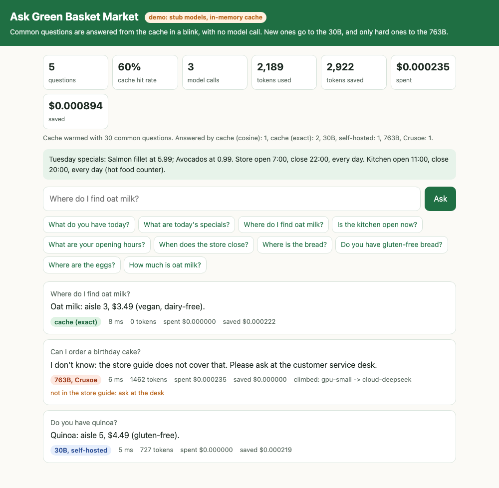

# Store: a food-store helper on the skeleton

Shoppers ask the same things all day: what is on special, where is the oat milk, is the kitchen open. The cache answers those with no model call. Only new questions reach the self-hosted 30B, and only what the 30B cannot answer climbs to the 763B.



## Run

```bash
.venv/bin/python -m skeleton.apps.store            # demo: stub models, in-memory cache, no keys
.venv/bin/python -m skeleton.apps.store --live     # 30B (CHIMERA_GPU_URL), 763B (CRUSOE_API_KEY), Supabase (CHIMERA_DB_URL)
# open http://127.0.0.1:8766
```

At start it asks the 30 common questions in `questions.json` once, so the cache is warm. In live mode the Supabase cache keeps them, so the next start costs no model calls.

## Files

| File | Job |
|---|---|
| `foods.json` | demo catalog: items, aisles, prices, hours, specials per weekday, services |
| `store.toml` | the app config: mode, ladder, the instructions for the models |
| `store.py` | `Catalog` (the knowledge hook) and `Catalog.grounded` (the verify hook) |
| `server.py` | one page and `/api/ask`, `/api/stats`, `/api/guide` (standard library) |
| `index.html` | the page: ask box, sample questions, the stats strip |

The verify hook rejects an answer that quotes a price or aisle the catalog does not have, or says "I don't know". Such an answer is never cached and the question climbs. The cache key is the question, kept apart per catalog version and day, so new prices or specials never get old answers.

Limit: the whole guide goes in each model prompt (about 700 tokens). Past about 200 items, retrieve only the matching lines.
