# Vice City look for the Skeleton Crew apps

White page, hot pink and electric blue, an 80s sunset stripe, palm silhouettes, a neon-style italic heading with a pink-to-blue chrome fill and glow. No game logos or assets. Heading font is a system stack (Avenir Next Condensed, Futura, Century Gothic, Trebuchet), so nothing is downloaded.

## What changed

| File | Change |
|---|---|
| `skeleton/web/vicecity.css` | New. One shared stylesheet for both pages. |
| `skeleton/apps/helpdesk/index.html`, `skeleton/apps/store/index.html` | Inline `<style>` removed; they link `/vicecity.css`. Page scripts, ids and every stat panel are unchanged. The help-desk cost curve is hot pink. |
| `skeleton/apps/helpdesk/server.py`, `skeleton/apps/store/server.py` | New route `GET /vicecity.css`. |
| `skeleton/apps/coder/vice.py` | New. ANSI 24-bit hot pink (255,45,149) and electric blue (0,194,255), plus a small banner. |
| `skeleton/apps/coder/coder.py`, `demo.py` | `ask` and `demo` print through the colouriser. `report()` text is unchanged. |
| `site/index.html`, `site/dashboard.js`, `site/dashboard.css` | One extra "Vice City" button in the existing theme toggle. Default stays Gothic/Halloween. 3D world and animation untouched. |
| `tests/test_skeleton_vice.py` | New. NO_COLOR, text kept when painted, banner aligned, CSS served. |
| `skeleton/docs/shoot.py` | Makes the screenshots below. |

## Colour off

`NO_COLOR=1 python -m skeleton.apps.coder ask ...` prints plain text. Colour is also off when output is piped. `FORCE_COLOR=1` turns it on for a pipe.

## Contrast (WCAG 2.x, on white unless noted)

| Use | Colours | Ratio | AA |
|---|---|---|---|
| Body text | `#1a1030` on `#fff` | 18.09 | pass |
| Muted text | `#56497a` on `#fff` / `#fff7fb` | 7.99 / 7.59 | pass |
| Pink numbers and links | `#b0005f` on `#fff` | 6.97 | pass |
| Blue numbers and chips | `#00608a` on `#fff` / `#e6f8ff` | 6.91 / 6.33 | pass |
| Pink tier tag | `#b0005f` on `#ffeaf5` | 6.09 | pass |
| Violet tier tag | `#54259a` on `#f3ecff` | 8.66 | pass |
| Button and your chat bubble | white on `#c4006b` / `#7a2cc4` | 5.90 / 7.04 | pass |
| Warning text | `#8a4b00` on `#fff` | 6.80 | pass |
| Input placeholder | `#6b5f8c` on `#fff` | 5.77 | pass |
| Neon pink `#ff2d95` (big heading, borders, glow) | on `#fff` | 3.46 | large text only (3:1) |
| Neon blue `#00c2ff` (borders, glow, stripe) | on `#fff` | 2.07 | never used for text |

The coder colours are for a dark terminal. The neon pink and blue read well there, and the screenshots below are a white render of the same output, which is the weakest case. Use `NO_COLOR` on a light terminal.

## Screenshots

Demo mode (stub models), one question asked on each page. Before is the old look.

| | Before | After |
|---|---|---|
| Help desk, desktop | 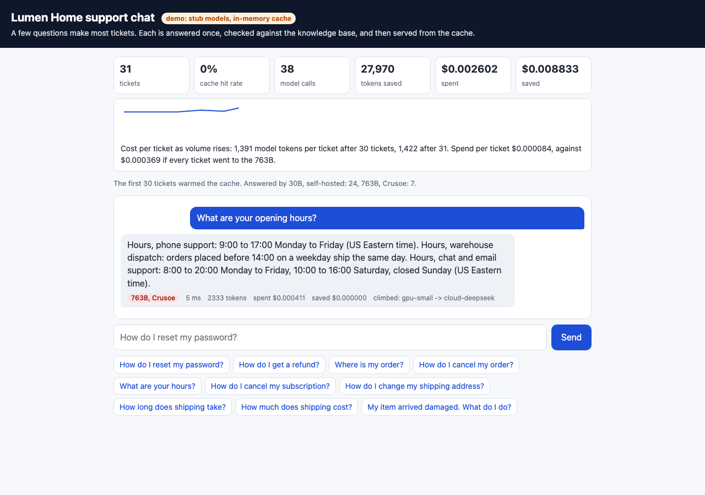 | 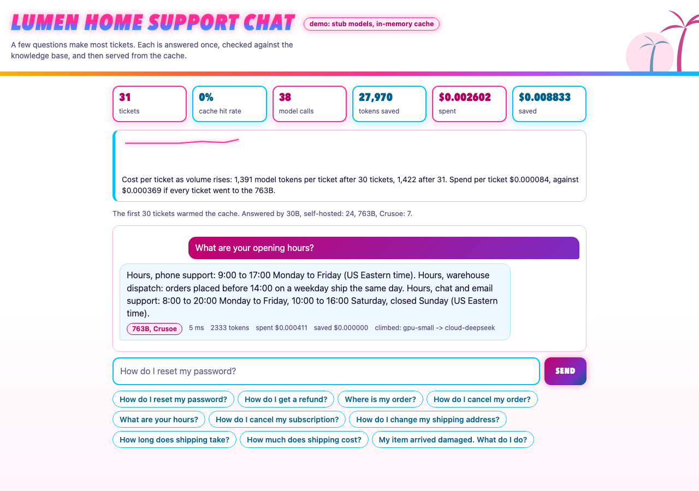 |
| Help desk, phone | 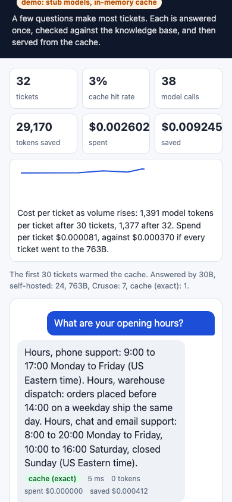 | 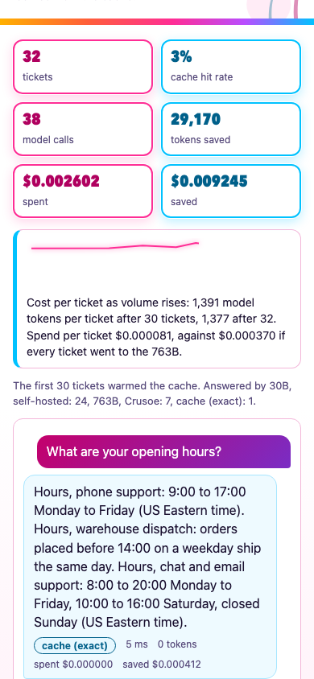 |
| Store, desktop | 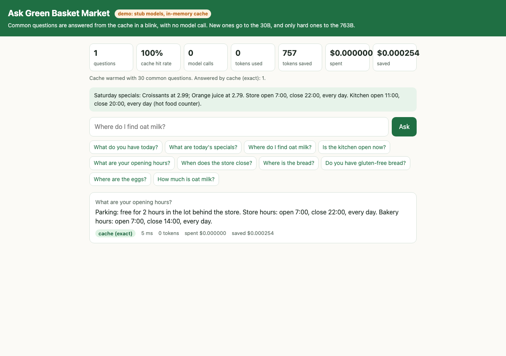 | 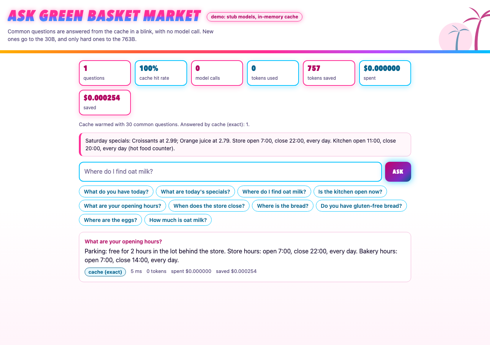 |
| Store, phone | 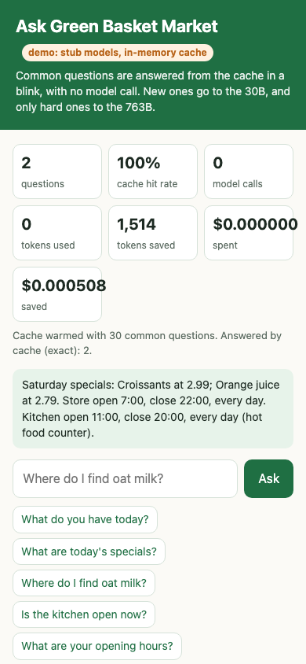 | 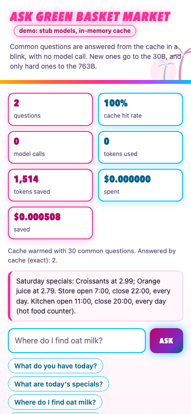 |
| Coder demo, desktop | 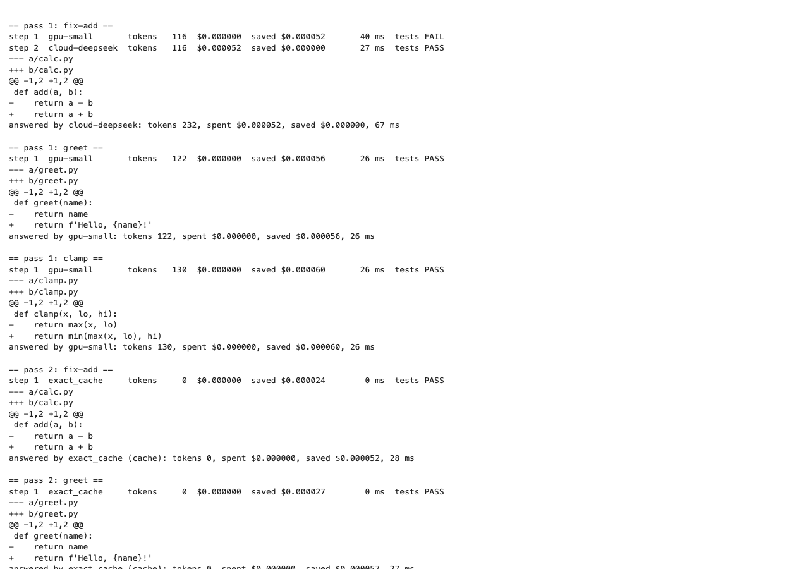 | 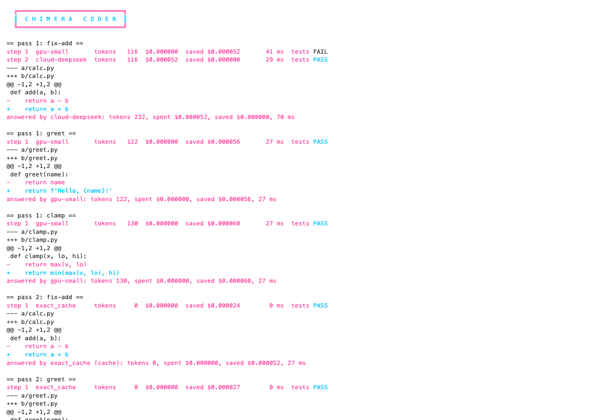 |
| Coder demo, phone | 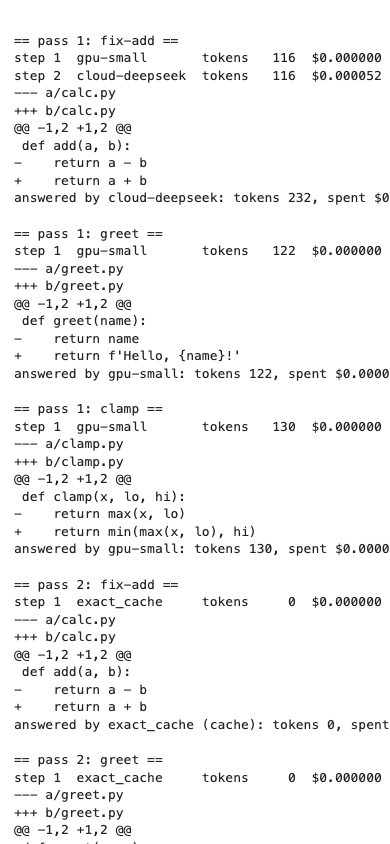 | 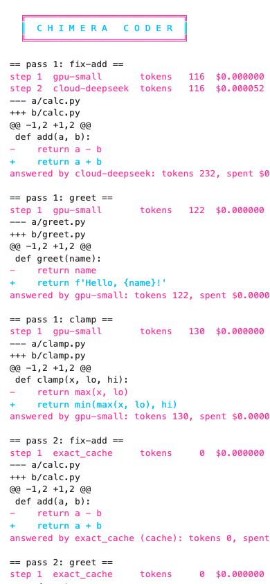 |

## Not checked

- The Vice City theme on the castle site (`site/`) was not looked at in a browser. It only sets variables for the existing dashboard theme system.
- WebKit and real phones were not run. Chromium headless shell at 390 px only.
- Live mode (Crusoe) was not run. The change touches only CSS, one route and print calls.
